# How Does EVA MARSWALK Work?
*A Complete Step-by-Step User Guide*

> [!IMPORTANT]
> **Simulation & Research Disclaimer:** **EVA MARSWALK** (`EVA MARS EXPLORER`) is a research, educational, and mission-planning simulation tool. It is **not** a NASA flight-certified operational navigation system and must **not** be used for real astronaut life-support decisions or unverified field traversal.

---

## Table of Contents

- [1. Introduction](#1-introduction)
- [2. Getting Started](#2-getting-started)
- [3. Exploring Mars with the 2D Explorer](#3-exploring-mars-with-the-2d-explorer)
- [4. Using Scientific Data Layers and Interpreting Colors](#4-using-scientific-data-layers-and-interpreting-colors)
- [5. Exploring Mars with the 3D Globe Explorer](#5-exploring-mars-with-the-3d-globe-explorer)
- [6. Searching Locations, Landmarks, and Coordinates](#6-searching-locations-landmarks-and-coordinates)
- [7. Monitoring Astronaut Safety and Environmental Conditions](#7-monitoring-astronaut-safety-and-environmental-conditions)
- [8. Planning a Marswalk Mission](#8-planning-a-marswalk-mission)
- [9. Selecting and Comparing Pathfinding Algorithms](#9-selecting-and-comparing-pathfinding-algorithms)
- [10. Running the Simulated Astronaut Walk](#10-running-the-simulated-astronaut-walk)
- [11. Simulating and Responding to Dust Storms](#11-simulating-and-responding-to-dust-storms)
- [12. Inspecting the Telemetry & Biophysical Analytics Dashboard](#12-inspecting-the-telemetry--biophysical-analytics-dashboard)
- [13. Inspecting Local 3D Terrain Around a Point](#13-inspecting-local-3d-terrain-around-a-point)
- [14. Customizing Themes, Constraints, and System Settings](#14-customizing-themes-constraints-and-system-settings)
- [15. Understanding Route Statuses, Safety Colors, and Warnings](#15-understanding-route-statuses-safety-colors-and-warnings)
- [16. Troubleshooting Common Issues](#16-troubleshooting-common-issues)
- [17. Important Limitations](#17-important-limitations)

---

## 1. Introduction

**EVA MARSWALK** is an interactive Martian planetary explorer and simulated surface mission planner that runs locally in your web browser. It brings together planetary orbital imagery, topography, gravity fields, and atmospheric data alongside terrain-aware pathfinding algorithms and a simulated NASA xEMU astronaut suit model.

### What You Can Do

With EVA MARSWALK, you can perform two distinct types of work:

1. **Planetary Exploration (2D Explorer & 3D Globe):**
   Browse global Martian surface imagery and scientific data layers, fly to famous volcanoes, canyons, and NASA rover landing sites, inspect local elevation and gravity values at any coordinate, and view local 3D relief patches.
2. **Simulated Astronaut Mission Planning (Marswalk Planner & Dust Storm Engine):**
   Choose a starting point and destination on Mars, adjust astronaut mobility and life-support parameters (speed, suit/equipment mass, oxygen capacity, slope limits), compare four pathfinding solvers (`Field D*`, `D* Lite`, `Fast Marching (FMM)`, and `Baseline A*`), test dynamic dust storms, run an accelerated walk simulation, and inspect coupled biophysical analytics.

### Understanding Data Provenance Inside the App

Throughout EVA MARSWALK, values fall into four distinct categories:

| Category | Examples in the Application | How to Interpret It |
|---|---|---|
| **Measured Orbital Datasets** | **Viking MDIM 2.1 Color** mosaic, **MGS MOLA (`GTM090AA`)** elevation tiles, **MRO (`MRO120G` / `120F`)** gravity anomaly grid, **MRO MCS (`2025073120_DDR`)** sounding tracks | Scientifically archived planetary observations stored locally inside the project. |
| **Derived Physical Values** | Terrain slope ($\theta$), surface gravitational acceleration ($g$), geoid/areoid undulation ($N$), differential gravity ($\Delta g$), cumulative ascent/descent | Computed mathematically from the loaded orbital grids. |
| **Modeled Estimates** | `Atmospheric Pressure (Modeled)` via Barometric Model $P(h)$ outside direct MCS tracks, `MODEL-BASED SAFETY INDEX`, Minetti-Mars metabolic energy and $O_2$ consumption, **Dust Storm Engine** (`MODELED`) | Simulation estimates built for mission modeling—useful for scenario comparison, not direct orbital telemetry. |
| **Visual Representations** | 3D terrain vertical exaggeration (`1x–10x` on the 3D Globe; `Exag: 5x` in Local 3D Terrain View), scientific layer color ramps | Visual aids that amplify subtle planetary relief or map numeric values to colors. |

---

## 2. Getting Started

### Launching the Application

**Purpose:** Start the local Python HTTP server so all offline 72-tile map pyramids, elevation rasters, and scientific manifests load cleanly in your browser.

**How to use it:**
1. Open the project folder (`nasa_mars_explorer`) on Windows.
2. Double-click **`desktop/launch_desktop.bat`** (opens the **Mission Portal** `index.html`) or **`launch_2d_map.bat`** (opens directly into `mars_2d_map.html`), or run one of these commands from the project root terminal:
   ```bash
   python desktop/server.py index.html
   ```
   (Omit `index.html` to launch `mars_2d_map.html` directly.)
3. The server binds to `http://localhost:8080` (automatically incrementing to `8081–8089` if `8080` is busy) and opens your default web browser.

**Expected result:** The **EVA MARS EXPLORER — MISSION CONTROL** portal appears with two navigation cards: **2D Mars Map** and **3D Globe Explorer**.

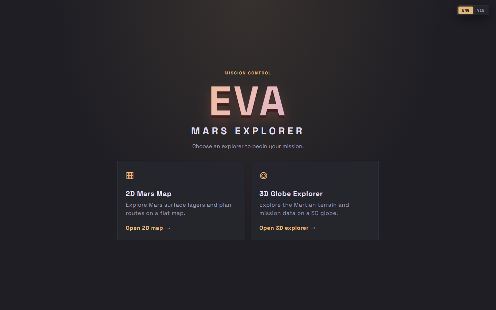
*Figure 1: The EVA MARSWALK Mission Portal (`index.html`) showing the **ENG | VIE** language toggle (top-right) and launch cards for the 2D Mars Map and 3D Globe Explorer.*

### Switching Modes and Languages

- **2D Map vs. 3D Globe Explorer:**
  - From the portal (`index.html`), click **Open 2D map →** (`mars_2d_map.html`) or **Open 3D explorer →** (`mars_3d_map.html`).
  - Inside **2D Mars Explorer**, switch pages at any time from the top navigation bar using **2D Map (Active)** / **3D Globe Explorer**.
  - Inside **3D Globe Explorer**, return to the flat map using **2D Map (72 Tiles LOD)** in the top bar.
- **Language Switching (`ENG | VIE`):**
  Click **`ENG`** or **`VIE`** in the top-right corner of the Mission Portal, 2D Explorer, or 3D Globe to toggle interface labels, modals, and alerts between **English** and **Vietnamese**. Your language preference is saved in `localStorage`.
- **Opening System Settings:**
  In **2D Mars Explorer**, click **`Settings`** in the bottom-left footer bar to customize themes, mobility profiles, slope limits, performance mode, and safety view options. *(Note: the Settings modal is available on the 2D Explorer page; visual theme changes chosen there persist across all pages via `localStorage`.)*

**Tips and warnings:** Always launch via `desktop/server.py` (or the `.bat` launchers) rather than opening `.html` files with `file://`. Opening HTML files directly without a local web server prevents browsers from loading manifest JSON and tile datasets.

---

## 3. Exploring Mars with the 2D Explorer

The **2D Explorer** (`mars_2d_map.html`) is the primary workspace for both planetary inspection and mission planning.

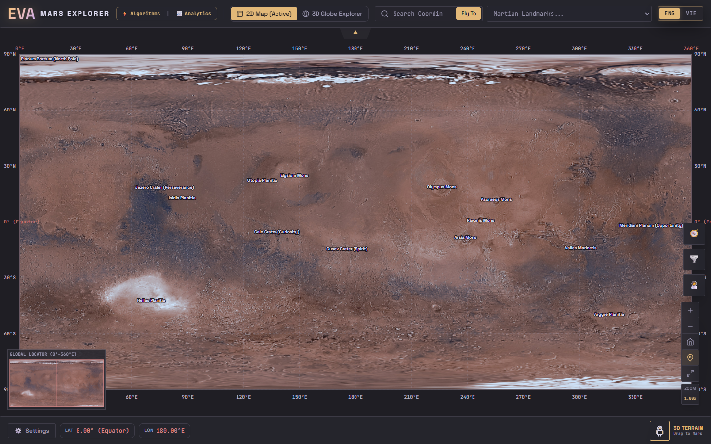
*Figure 2: The 2D Explorer initial screen showing the top command bar, collapsed Layer Ribbon tab (`▲`), global equirectangular canvas, right-edge tool launchers, docked `GLOBAL LOCATOR`, bottom `Settings` and `LAT / LON` readout, and the `3D TERRAIN` Pegman control.*

### Main Interface Controls at a Glance

- **Top Bar:** `EVA MARS EXPLORER` wordmark | **`Algorithms`** & **`Analytics`** buttons | **`2D Map (Active)` / `3D Globe Explorer`** switcher | **`Search Coordinates or Landmark` + `Fly To`** | **`Martian Landmarks...`** dropdown (18 presets) | **`ENG | VIE`** toggle.
- **Top Center Arrow (`▲` / `▼`):** Collapses or expands the horizontal **Scientific Data Layer Ribbon**.
- **Right Edge Tool Rail:** Three launcher buttons stacked vertically—**`Marswalk Planner`**, **`Dust Storm`**, and **`Astronaut Monitoring`**—above the bottom-right zoom stack (**`+`**, **`-`**, **Reset View (Home)**, **Toggle Place Names**, **Fullscreen**, and live **ZOOM** badge).
- **Bottom-Left Dock:** **`GLOBAL LOCATOR (0°–360°E)`** minimap preview, **`Settings`** button, and live cursor/target **`LAT` / `LON`** readout.
- **Bottom-Right Dock:** **`3D TERRAIN Drag to Mars`** draggable astronaut Pegman icon.

---

### Step-by-Step 2D Navigation Walkthrough

#### 1. Panning Around the Martian Surface
- **What it does:** Shifts the visible equirectangular map horizontally (`0°E–360°E`) and vertically (`90°S–90°N`).
- **How to use it:** Click and drag anywhere on the main Martian canvas, or click a destination inside the **`GLOBAL LOCATOR (0°–360°E)`** box in the bottom-left corner.
- **What you should see:** The map tiles follow your cursor smoothly, the highlighted viewport rectangle in the **`GLOBAL LOCATOR`** tracks your position, and the bottom-left **`LAT`** / **`LON`** coordinates update continuously.
- **Practical tip:** When panning across the `0°E / 360°E` prime meridian edge, use the **`GLOBAL LOCATOR`** or **`Fly To`** if you want to re-center on Syrtis Major / Arabia Terra immediately.

#### 2. Zooming In and Out
- **What it does:** Magnifies surface craters, canyons, and volcano rims while automatically loading sharper multi-tier tile levels of detail (LOD).
- **How to use it:** Scroll your mouse wheel over the map, or click the **`+`** and **`-`** buttons above the **`ZOOM`** indicator on the bottom-right stack. Click the **Home icon** button (**Reset View (`0`)**) to return to the global `1.00x` full-planet view, or click the **Fullscreen** arrows button to expand the workspace.
- **What you should see:** The **`ZOOM`** readout changes from `1.00x` upward (for example `4.00x` or `16.00x`) and tile resolution sharpens after a brief fetch.
- **Practical tip:** For route planning between local sites around a crater, zoom in between `5x` and `16x` so waypoint markers and terrain slopes are easy to read.

#### 3. Using the Coordinate Grid and Identifying Locations
- **What it does:** Displays latitude (`90°N` down to `90°S`), equator line (`0° (Equator)`), and east longitude (`0°E` to `360°E`) gridlines, alongside labeled surface features (`Olympus Mons`, `Jezero Crater (Perseverance)`, `Valles Marineris`, `Hellas Planitia`, etc.).
- **How to use it:**
  - Click anywhere on the map to place the red target crosshair and inspect that exact coordinate.
  - Toggle feature labels on or off with the **Map Pin (`Hide place names`)** icon button in the bottom-right control stack.
- **What you should see:** Clicking on the surface updates the bottom-left **`LAT`** / **`LON`** badges and displays an on-map callout pill near the crosshair (for example, `Jezero Crater (Perseverance) • Viking MDIM 2.1 Color`).
- **Practical tip:** Look at the callout pill or open **Astronaut Monitoring** (right rail) to verify whether your selected point landed on a crater floor, canyon rim, or smooth plain before making it a mission waypoint.

#### 4. Navigating with the Global Locator and Fly To
- **What it does:** Jumps straight to any latitude/longitude or named feature without manual panning.
- **How to use it:** Type a coordinate pair such as `18.38, 77.58` or a feature name such as `Jezero Crater` into **`Search Coordinates or Landmark`**, press **`Enter`** or click **`Fly To`**, or pick one of the presets in **`Martian Landmarks...`**.
- **What you should see:** The canvas centers smoothly on your target (zooming to `4.00x–6.50x`), places the target crosshair on the site, and moves the viewport rectangle inside **`GLOBAL LOCATOR (0°–360°E)`**.
- **Practical tip:** Remember that EVA MARSWALK uses **Planetocentric East Longitude (`0°–360°E`)**, so `18.38, 77.58` means `18.38°N, 77.58°E`.

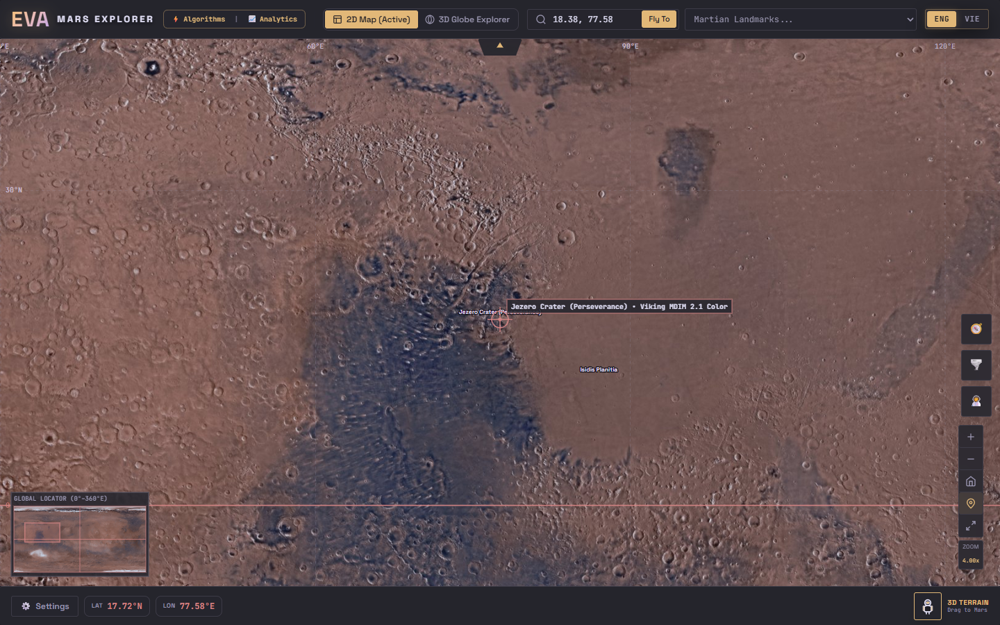
*Figure 3: Zooming into Jezero Crater (`18.38, 77.58`) via **Fly To**—showing the zoomed `4.00x` surface mosaic, target crosshair callout, updated **`GLOBAL LOCATOR`** box, and bottom-left coordinate badges.*

#### 5. Interpreting Terrain and Launching Local 3D Inspection
- **What it does:** Lets you inspect regional craters and scarps in true 3D perspective without leaving the 2D Explorer.
- **How to use it:** Click and drag the **`3D TERRAIN`** astronaut icon (bottom-right) onto any spot on the 2D map canvas and release it. (See [Section 13](#13-inspecting-local-3d-terrain-around-a-point) for full details.)
- **What you should see:** A **`MARS TERRAIN VIEW`** modal opens with a rotatable `40° × 40°` (~`2,366 km`) WebGL relief block centered on the drop location.
- **Practical tip:** Visual brightness in **`Main RGB`** represents albedo (dark basaltic sand vs. bright dust), **not** height—always switch to the **`MOLA Elevation`** or **`Terrain Slope`** layer to judge actual steepness and altitude.

---

## 4. Using Scientific Data Layers and Interpreting Colors

**Purpose:** Switch between Mars visual imagery and 7 scientific datasets to understand elevation, terrain steepness, gravity variations, and modeled atmospheric pressure across Mars.

**How to use it:**
1. Click the small upward arrow tab (**`▲`**) centered just below the top navigation bar to open the **Scientific Data Layer Ribbon**.
2. Click any of the 8 layer cards (scroll left/right with **`◀`** / **`▶`** if your window is narrow).
3. Inspect the floating **`Scale:`** bar that appears at the bottom center whenever a numeric scientific layer is active. Move your pointer or click on the map to read the live **`Selected:`** marker along the color ramp.

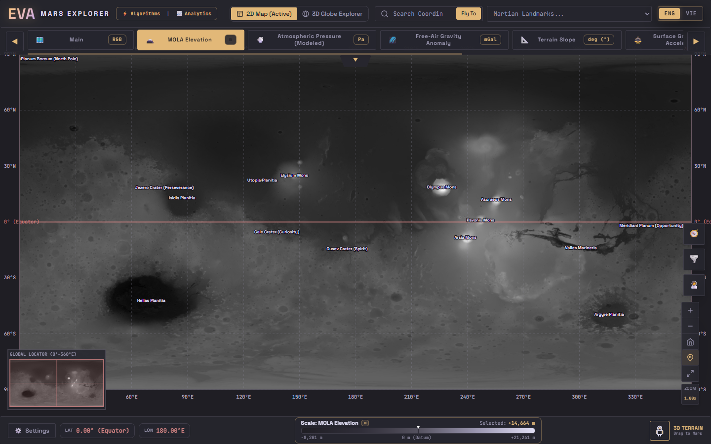
*Figure 4: The expanded top layer ribbon with **MOLA Elevation** selected, grayscale topographic relief (bright highs at Olympus Mons/Tharsis, dark lows in Hellas Planitia), and the bottom **`Scale: MOLA Elevation`** bar (`-8,201 m` to `+21,241 m`).*

### Available 2D Layers

| Layer Button | Unit | Type | Color & Physical Interpretation |
|---|---|---|---|
| **Main** (`RGB`) | Visual | Measured Mosaic (Viking MDIM 2.1) | Natural-color albedo imagery; dark regions like Syrtis Major are basaltic rock/sand, bright regions are dust-covered plains or polar ice. |
| **MOLA Elevation** | `m` | Measured Topography (MGS MOLA `GTM090AA`) | Grayscale elevation relative to the Martian datum (`-8,201 m` to `+21,241 m`): darker = deep basins (Hellas Planitia, Valles Marineris floor); bright white = high volcanic shields (Olympus Mons, Tharsis Montes). |
| **Atmospheric Pressure (Modeled)** | `Pa` | Modeled Estimate (`Barometric Model P(h)`) | Altitude-driven surface pressure estimate calibrated against Mars conditions; low basins hold denser air (~770+ Pa at Jezero), while summit volcanoes drop into near-vacuum (~99 Pa at Olympus Mons). |
| **Free-Air Gravity Anomaly** | `mGal` | Measured Gravity (MRO `JGMRO_120g`) | Subsurface mass anomalies on a `720×360` grid; positive values mark massive volcanic constructs or dense mascons, negative values mark uncompensated basins. |
| **Terrain Slope** | `deg (°)` | Derived Value | Local steepness computed from elevation gradients; highlights crater rims, chasma walls, and escarpments that threaten rover or astronaut traversal. |
| **Surface Gravitational Acceleration** | `m/s²` | Derived Value | Total local gravity combining mass distribution and planetary flattening/rotation (~`3.71 m/s²` mean, varying locally with relief and gravity anomaly). |
| **Geoid / Areoid Undulation** | `m` | Derived Value | Equipotential reference surface height difference relative to the Martian ellipsoid (`+2,695 m` near Jezero Crater). |
| **Differential Gravity (120G - 120F)** | `mGal` | Derived Comparison | Difference between gravity models `MRO120G` and `MRO120F`, useful for comparing crustal refinement across regions. |

**Expected result:** The map canvas updates immediately to your chosen layer and displays its calibrated scale bar (`Min`, `Mid`, `Max`, plus `Selected:` marker). Click **`▼`** at the top center to collapse the ribbon again for a cleaner view.

**Tips and warnings:** Switching visual layers changes what is drawn on screen—and **`MOLA Elevation`**, **`Terrain Slope`**, and **`Atmospheric Pressure`** reflect the exact terrain data consulted by the pathfinder—but switching layers does **not** alter already plotted route lines until you click **`Calculate Route`**.

---

## 5. Exploring Mars with the 3D Globe Explorer

**Purpose:** Visualize Mars as a true 3D rotating sphere with radial terrain displacement, orbital atmospheric sounding tracks, and an always-open **Astronaut Survival Monitor**.

**How to use it:**
1. Open **3D Globe Explorer** from the Mission Portal (`index.html`), or click **`3D Globe Explorer`** in the top bar of the 2D Explorer.
2. Rotate Mars by dragging on the globe, zoom in/out with your scroll wheel, or click **`Reset`** in the top-right bar to restore the default view. Click **`Full`** for fullscreen mode.
3. Click anywhere on the 3D globe surface to drop the location pin and inspect telemetry on the right panel.

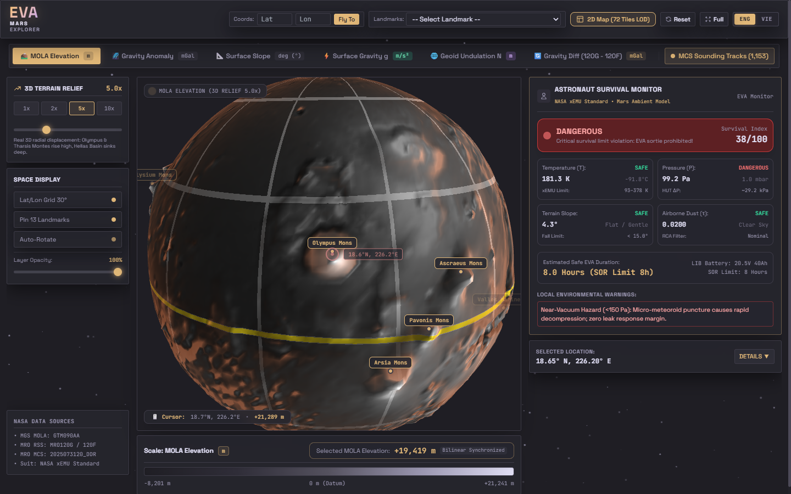
*Figure 5: The **3D Globe Explorer** (`mars_3d_map.html`) focused on **Olympus Mons** (`18.6°N, 226.2°E`) with `5.0x` **3D TERRAIN RELIEF**, the **SPACE DISPLAY** toggles on the left, and the **ASTRONAUT SURVIVAL MONITOR** warning (`DANGEROUS 38/100`) on the right.*

### Controls Unique to the 3D Globe Explorer

- **Top Layer Tabs (6 Layers + Sounding Overlay):**
  Switch among **`MOLA Elevation` (`m`)**, **`Gravity Anomaly` (`mGal`)**, **`Surface Slope` (`deg (°)`)**, **`Surface Gravity g` (`m/s²`)**, **`Geoid Undulation N` (`m`)**, and **`Gravity Diff (120G - 120F)` (`mGal`)**, or toggle **`MCS Sounding Tracks (1,153)`** to display orbital Mars Climate Sounder strips over the globe.
- **Left Panel — `3D TERRAIN RELIEF`:**
  Pick **`1x`**, **`2x`**, **`5x`** (default), or **`10x`**, or drag the slider to amplify radial height displacement so volcanoes rise visibly and basins like Hellas sink inward.
- **Left Panel — `SPACE DISPLAY`:**
  Toggle **`Lat/Lon Grid 30°`**, **`Pin 13 Landmarks`**, and **`Auto-Rotate`**, or adjust **`Layer Opacity`** (`0–100%`).
- **Right Panel — `ASTRONAUT SURVIVAL MONITOR` & `SELECTED LOCATION`:**
  Shows live safety status (`SAFE`, `CAUTION`, or `DANGEROUS`), `Survival Index` (`/100`), `Temperature (T)`, `Pressure (P)`, `Terrain Slope`, `Airborne Dust (τ)`, `Estimated Safe EVA Duration`, and `LOCAL ENVIRONMENTAL WARNINGS`. Click **`DETAILS ▼`** on the `SELECTED LOCATION` card to expand the full geophysical dossier (`Planetographic Lat`, `West Longitude`, `3D Coordinates (X, Y, Z)`, `MOLA Elevation (h)`, `Planetary Radius (R)`, `Terrain Slope (θ)`, `Gravity Anomaly`, and vertical MCS sounding chart when a sounding track covers that spot).

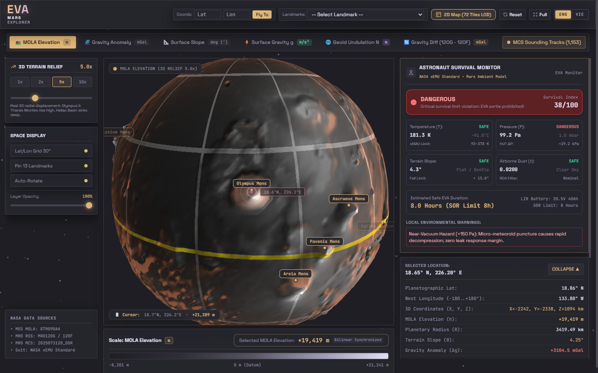
*Figure 6: Expanding **`DETAILS ▼`** (`COLLAPSE ▲`) on **3D Globe Explorer** reveals full Cartesian `(X, Y, Z)` coordinates, planetary radius, MOLA height (`+19,419 m`), and gravity anomaly (`+3104.5 mGal`) at Olympus Mons.*

**Tips and warnings:**
- Notice the **Data Provenance** panel in the bottom-left (`NASA DATA SOURCES`): `MGS MOLA: GTM090AA`, `MRO RSS: MR0120G / 120F`, `MRO MCS: 2025073120_DDR`, `Suit: NASA xEMU Standard`.
- The **3D Globe Explorer** is built for global visualization and location inspection; mission route planning (`Marswalk Planner`), algorithm benchmarking, and system **`Settings`** live in the **2D Explorer** (`2D Map (72 Tiles LOD)`).

---

## 6. Searching Locations, Landmarks, and Coordinates

EVA MARSWALK provides three ways to jump to locations depending on what you are doing:

| Search Tool | Where It Lives | Accepted Input | Behavior |
|---|---|---|---|
| **Global Search Bar + `Fly To`** | 2D Explorer top bar | Landmark name (`Olympus Mons`, `Jezero`, etc.), IAU/USGS gazetteer name, tile filename, or `lat, lon` (`18.38, 77.58`) | Flies the 2D camera smoothly (`4.00x–6.50x`), places the target crosshair, and updates **`GLOBAL LOCATOR`**. |
| **`Martian Landmarks...` / `Landmarks`** Dropdown | Top bar (2D has 18 presets; 3D has `-- Select Landmark --`) | Preset selection from dropdown | Instantly centers the map or rotates the 3D globe onto major volcanoes, basins, canyons, poles, and NASA landing sites. |
| **IAU/USGS Gazetteer Search** (`routeStartSearch` / `routeDestSearch`) | Inside **Marswalk Planner** drawer (`Starting Point` and `Destination` boxes) | Feature name (e.g., `Jezero Crater`, `Gale Crater`) | Filters a searchable dropdown list with coordinates, feature type, and source (`IAU / USGS` or `NASA JPL`); clicking a result fills the `Latitude` and `Longitude` boxes for routing. |

### Coordinate System & Error Behavior

- **Coordinate Convention:** EVA MARSWALK uses **Latitude (`-90°` to `+90°`)** and **Planetocentric East Longitude (`0°` to `360°E`)**. Enter latitude **first**, longitude **second** (for example: `18.65, 226.2` for Olympus Mons or `-5.37, 137.81` for Gale Crater).
- **Invalid Search Input Behavior:**
  - In **2D Explorer**, if you enter unparseable text (or miss a valid pair) and click **`Fly To`**, the app triggers a browser alert: *"Could not parse location. Please enter coordinates like: '18.65, 226.2' or landmark name like 'Olympus Mons'"*.
  - In **3D Globe Explorer**, the `Coords: Lat / Lon / Fly To` bar validates numeric bounds explicitly: entering non-numeric or incomplete coordinates triggers the alert *"Please enter valid latitude (-90 to +90) and longitude (0 to 360)."*, and values outside range are clamped/wrapped (`[-90, 90]` lat, `[0, 360)` lon).

---

## 7. Monitoring Astronaut Safety and Environmental Conditions

**Purpose:** Evaluate whether a chosen site on Mars is livable for a simulated **NASA xEMU** spacesuit before committing to a route.

**How to use it:**
1. In **2D Explorer**, click any spot on the map (or fly to a landmark like **Jezero Crater**).
2. Click the **Astronaut Monitoring** icon button (bottom of the three-button rail on the right edge, just above `+` / `-`).
3. Click **`Mission Details ▲ / ▼`** inside the drawer to expand or collapse the **CRITERIA SAFETY BREAKDOWN** and **PLANETARY SCIENCE PARAMETERS (6 LAYERS)**.
*(On **3D Globe Explorer**, the **ASTRONAUT SURVIVAL MONITOR** is visible continuously on the right side of the screen.)*

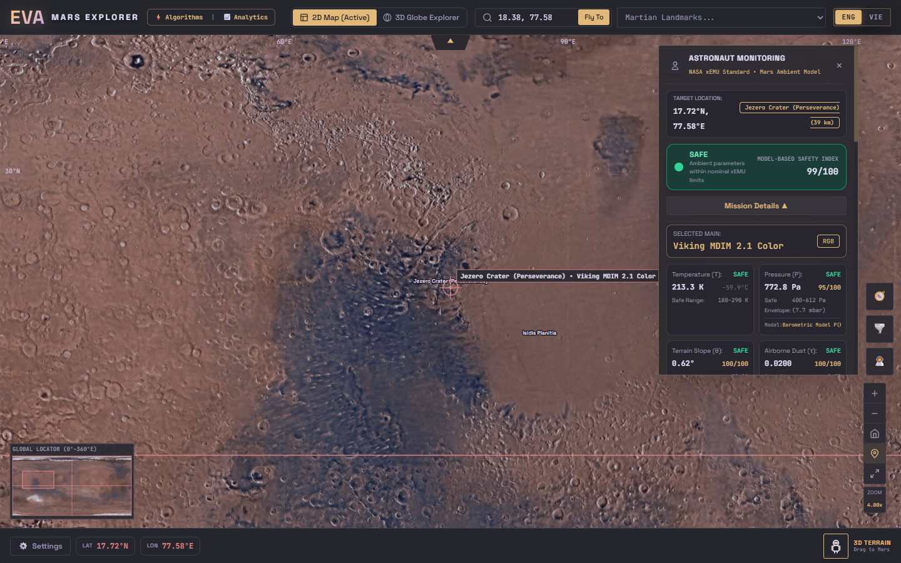
*Figure 7: The **ASTRONAUT MONITORING** slide-out panel at **Jezero Crater (Perseverance)** displaying `SAFE` (`99/100`), individual metric ratings, and the expanded **Mission Details** breakdown.*

### How to Read the Safety Metrics

The **MODEL-BASED SAFETY INDEX (`/100`)** uses a strict bottleneck evaluation across five environmental parameters:

- **Temperature (`T`):** Ambient surface temperature estimate (safe nominal envelope shown in detail cards, e.g., `213.3 K / -59.9°C` at Jezero Crater = `SAFE 100/100`).
- **Atmospheric Pressure (`P`):** Modeled via `Barometric Model P(h)` (or MRO MCS where sounding tracks overlap). High altitudes suffer severe low-pressure decompression risk (`Olympus Mons` = `99.2 Pa`, `DANGEROUS`, driving Survival Index down to `38/100` in Figure 5), whereas deep basins like **Jezero Crater** reach `772.8 Pa` (`95/100 SAFE`).
- **Terrain Slope (`θ`):** Local terrain gradient derived from MOLA elevation (`0.62°` flat at Jezero Crater = `100/100 SAFE`).
- **Airborne Dust (`τ`):** Atmospheric optical depth (`0.0200` clear-sky baseline = `100/100 SAFE` unless a dust storm is active).
- **Radiation (`R`, 2D panel):** Ambient Solar & GCR dose estimate (`0.645 mSv/d` vs ALARA `≤ 0.72 mSv/day` = `100/100 SAFE`).

**Expected result:** A green **`SAFE`** badge (such as `99/100` at Jezero Crater), yellow **`CAUTION`** badge, or red **`DANGEROUS`** banner (`38/100` at Olympus Mons summit), together with an **`Estimated Safe EVA Window`** (`8.0 Hours (Nominal 8h SOR)`) and **`LOCAL ENVIRONMENTAL ADVISORIES`**.

**Tips and warnings:** Because **EVA MARSWALK** applies a **Strict Severity Bottleneck**, a single critical failure (such as near-vacuum pressure `<150 Pa` on Olympus Mons) marks the location **`DANGEROUS`** even when temperature and slope look benign.

---

## 8. Planning a Marswalk Mission

**Purpose:** Configure endpoints, astronaut suit load, and safety preferences to compute a terrain-verified route on the 2D Mars surface.

**How to use it:**
1. Click the top button on the right-edge tool rail (**Marswalk Planner** compass icon) to slide open the planner drawer.
2. **Set `Starting Point` (`S`) and `Destination` (`D`):** Use any of three methods:
   - **Gazetteer Search:** Type a Martian landmark name in `Named Martian Location (IAU/USGS Gazetteer)` and click a match from the dropdown.
   - **Direct Coordinates:** Type decimal `Latitude (°)` and `Longitude (°E)` values directly.
   - **Map Picking:** Click **`Select Start on Map`** (green) or **`Select Destination on Map`** (red), then click directly on the Martian surface.
   *(Tip: Click **`⇅ Swap Start / Destination`** if you want to reverse endpoints to check the uphill vs. downhill return leg manually!)*

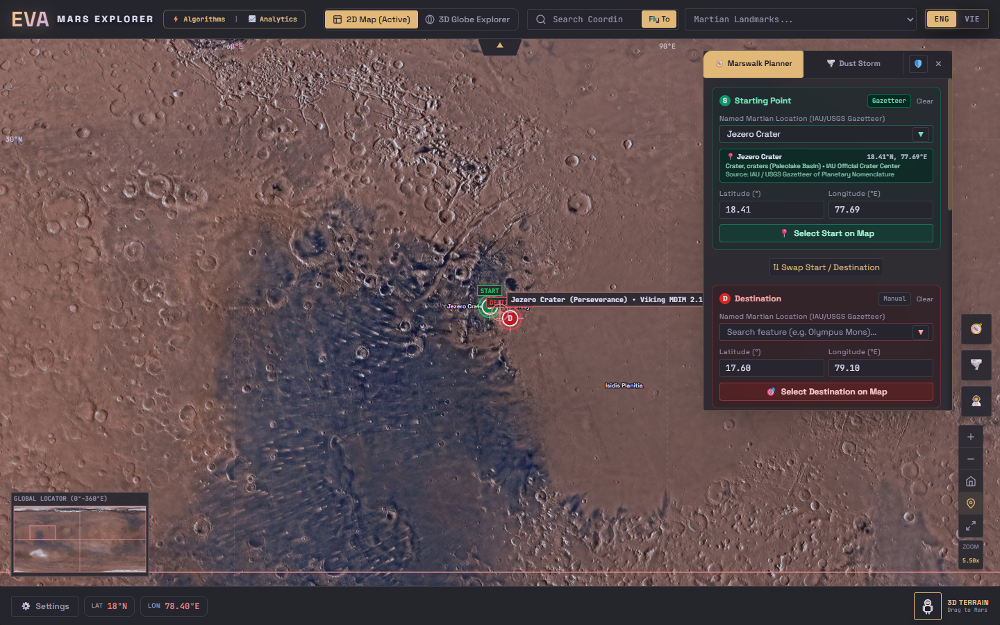
*Figure 8: Setting **`Starting Point`** to **Jezero Crater** (`18.41°N, 77.69°E`) via the IAU/USGS Gazetteer and **`Destination`** (`17.60°N, 79.10°E`), with green **`START (S)`** and red **`D`** markers placed on the map.*

3. **Review `ASTRONAUT PARAMETERS` (`SHARED`):**
   - **Active Algorithm:** Displays the active solver (default **`Field D*`**). Click **`Configure ⚡`** to switch algorithms or benchmark them.
   - **`Walking Speed` (`m/s`):** Default `1.2 m/s` (range `0.1–15.0 m/s`).
   - **`Body Mass` (`kg`):** Default `80.0 kg` (range `30–250 kg`).
   - **`Equipment Mass` (`kg`):** Default `15.0 kg` (range `0–100 kg`).
   - **Auto Suit Load:** `+50.0 kg NASA xEMU` is added automatically (default **`Total: 145.0 kg`**).
   - **`O₂ Capacity` (`L`):** Default `480.0 L` (range `50–2000 L`, with `20%` return reserve = `96 L`).
   - **`Slope Limit` & `Corridor`:** Shows active directional thresholds (`Slope: +22.0° / -16.5° • Corridor: 30 km`). Click **`Slope ⚙️`** to jump straight into **Settings → Profile & Constraints**.
4. **Choose `Optimization Objective` and Safety Options:**
   - **`Minimum Risk (Default Safety Priority)`** (`min_risk`)
   - **`Minimum Energy Consumption`** (`min_energy`)
   - **`Minimum Elevation Variation`** (`min_elevation`)
   - **`Balanced Optimization`** (`balanced`)
   - Optionally check **`Allow CAUTION Segments (Relaxed Risk)`** if strict SAFE-only corridors cannot reach your destination, or expand **`⚙️ Weight & Safety Tuning ▼`** to adjust the 6 weighting sliders (`Risk: 35`, `Elevation: 25`, `Slope: 20`, `Roughness: 10`, `Distance: 5`, `Energy: 5`, plus **`Reset to Recommended Weights`**).
5. Click **`🚀 Calculate Route`**. (During long searches, click **`Cancel`** if needed; **`Clear`** resets endpoints.)

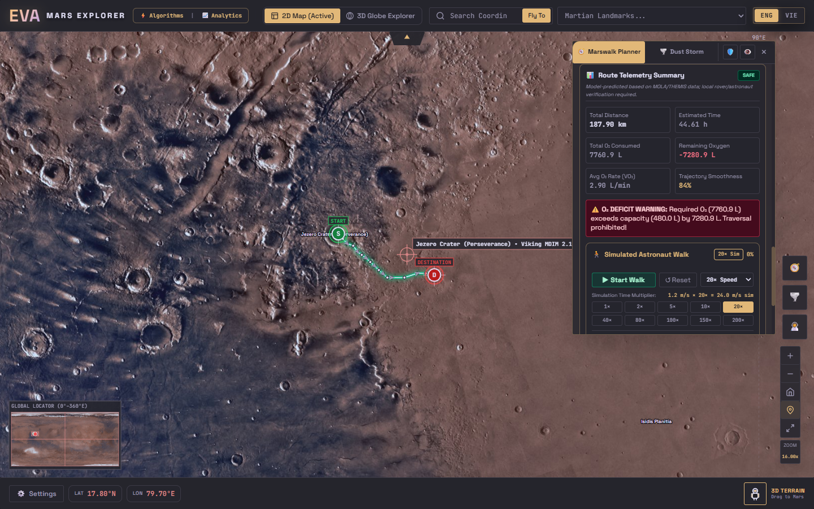
*Figure 9: After clicking **`Calculate Route`** (`18.41°N, 77.69°E` to `17.20°N, 80.50°E`), the canvas displays the continuous `Field D*` trajectory and **`Route Telemetry Summary`** (`187.90 km`, `44.61 h`, `7760.9 L` O₂ required, triggering **`O₂ DEFICIT WARNING`** against the 480 L single-EVA tank).*

**Expected result:** Once computation finishes, the planner shows:
1. A colored trajectory drawn between **`START (S)`** and **`DESTINATION (D)`** on the map (and a top banner message such as `✓ CONTINUOUS ANY-ANGLE TRAJECTORY verified: SAFE`).
2. **`Route Validation Report`** (with a **`Corridor Map`** eye/shield toggle in the drawer header, raw/final waypoints, direct vs. corridor status, minimum distance to unsafe slopes, max directional uphill/downhill slope, and `Path-to-Straight-Line Ratio`).
3. **`Route Telemetry Summary`** (Total Distance, Estimated Time, Total O₂ Consumed, Remaining Oxygen, Avg O₂ Rate (VO₂), Trajectory Smoothness, plus **`O₂ DEFICIT WARNING`** if O₂ consumption exceeds your configured tank).
4. Collapsible **`Detailed Topographic & Life Support Parameters`** (cumulative ascent/descent, min safety score, missing data coverage, `Electrical Equivalent Wh`) and **`Algorithm Diagnostics & Search State`** (grid snapping, search stage reached, nodes expanded, CPU time, PDS pressure check).

**Tips and warnings:** Long regional traverses across tens or hundreds of kilometers intentionally trigger **`O₂ DEFICIT WARNING`** under standard single-EVA `480 L` xEMU capacity. Either plan shorter `≤ 10–15 km` sorties for single-suit EVAs, or treat longer traverses as unpressurized/resupplied rover-range engineering studies by raising `O₂ Capacity` or selecting the **`Robotic Rover`** profile.

---

## 9. Selecting and Comparing Pathfinding Algorithms

**Purpose:** Understand how different pathfinding engines solve the same Martian terrain problem, and pick the best solver for your mission.

**How to use it:**
1. Click **`Algorithms`** in the top header bar (or click **`Configure ⚡`** inside the Marswalk Planner).
2. In **SECTION A: ACTIVE ALGORITHM SELECTION**, click any of the four solver cards to set it as active:
   - **`Field D*` (`RECOMMENDED`):** Continuous any-angle linear interpolation (`Ferguson & Stentz, NASA JPL`) — produces smooth diagonal paths without `45°/90°` grid zigzags.
   - **`D* Lite` (`DYNAMIC REPLAN`):** Discrete 8-connected dynamic replanning (`Koenig & Likhachev`).
   - **`Fast Marching (FMM)` (`WAVEFRONT PDE`):** Continuous Eikonal wavefront PDE gradient descent.
   - **`Baseline A*` (`OPTIMAL BASELINE`):** Standard discrete 8-connected graph search.
3. Click **`🔄 Re-Run Benchmark on Current Map`** in **SECTION B: FOUR-ALGORITHM BENCHMARK COMPARISON** (ensure a Start and Destination are selected first).

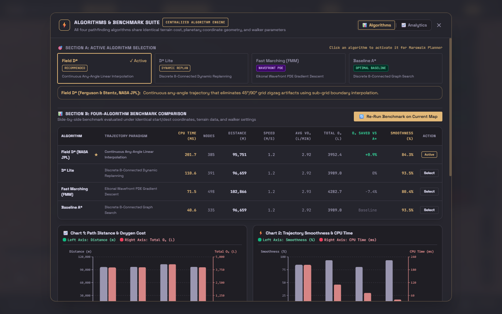
*Figure 10: **Algorithms & Benchmark Suite** comparing `Field D*`, `D* Lite`, `Fast Marching (FMM)`, and `Baseline A*` on identical Jezero Crater terrain, showing CPU time, expanded nodes, distance, O₂ consumption, O₂ saved vs. A\*, smoothness, and comparison bar charts.*

**Expected result:** All four algorithms run sequentially using identical elevation/slope grids and astronaut parameters, populating the side-by-side table and **Chart 1 (`Distance (m)` & `Total O₂ (L)`)** + **Chart 2 (`Smoothness (%)` & `CPU Time (ms)`)**. You can click **`Select`** directly inside any table row to activate that solver.

**Tips and warnings:** Switching algorithms here updates **`Marswalk Planner`** immediately, so your next **`Calculate Route`** click uses the newly selected engine. Scroll down inside the modal to read **Section C: Algorithm Core Principles & Search Strategies** if you want a quick refresher on how each solver works.

---

## 10. Running the Simulated Astronaut Walk

**Purpose:** Watch the simulated astronaut traverse your calculated route step-by-step and observe how local terrain slope and atmospheric dust affect speed and telemetry in real time.

**How to use it:**
1. Calculate a valid route in **Marswalk Planner** first.
2. Scroll down inside the planner drawer to **`Simulated Astronaut Walk`**.
3. Choose a **Simulation Time Multiplier** using the dropdown or pill buttons (`1×`, `2×`, `5×`, `10×`, `20×` default, `40×`, `80×`, `100×`, `150×`, or `200×`).
4. Click **`▶ Start Walk`** to begin (the button turns into **`Pause`** while running and **`▶ Resume Walk`** when paused). Click **`↺ Reset`** to move the astronaut back to `0%` at Start.

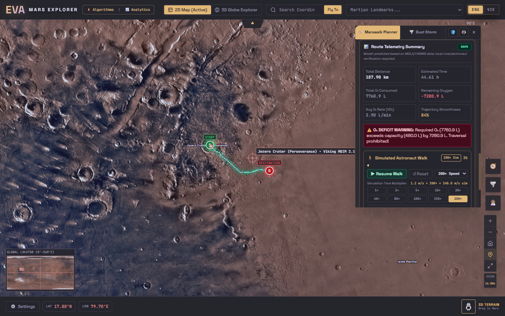
*Figure 11: Mid-traversal capture at `200× Sim` (`1.2 m/s × 200× = 240.0 m/s sim`): the astronaut marker advances along the computed path while live telemetry updates position (`18.34°N, 77.75°E`), `Sim Time`, `Sim Dist`, `Seg Slope (θ)`, and `Local Tau / Wind`.*

**Expected result:** A miniature astronaut marker glides along the calculated polyline on the 2D canvas, progress advances (`0%` to `100%`), and six live telemetry readouts update continuously:
- `Position` (`lat°, lon°`)
- `Sim Time` (`T+...h`)
- `Walk Speed` (`m/s` and `km/h`)
- `Sim Dist` (`traversed / total km`)
- `Seg Slope (θ)` (for example `+0.21° (FLAT)`)
- `Local Tau / Wind` (`0.35 / 10 km/h` baseline clear conditions)

**Tips and warnings:** A `200×` multiplier (`240 m/s`) lets you preview a `10 km` EVA in ~42 real seconds, whereas multi-hundred-kilometer routes take proportionally longer. Always check the four-color leg legend (**`SAFE`**, **`CAUTION`**, **`UNSAFE`**, **`UNKNOWN`**) directly beneath the telemetry card.

---

## 11. Simulating and Responding to Dust Storms

**Purpose:** Model localized Martian dust storms with customizable size, intensity, and movement vectors, and observe how pathfinding detours around or rejects blocked corridors.

**How to use it:**
1. Open the **`🌪️ Dust Storm`** tab inside the right-hand drawer (or click the middle tornado icon on the right tool rail).
2. **Create and Place a Storm:**
   - Either click **`+ Add Storm`** under **`Active Storms`** (or **`📍 Place Storm on Mars Map`** and click a point on the 2D canvas), or type **`Latitude (°)`** and **`Longitude (°E)`** manually.
3. **Configure Physical & Atmospheric Parameters:**
   - **`2. Propagation Vector`:** Pick one of 8 compass headings (**`N (0°)`** to **`NW (315°)`**) or drag the `0°–359°` angle slider.
   - **`3. Storm Size (Physical Mars Scale)`:** Drag **`Radius (R)`** (`20–600 km`); the panel automatically reports **`Diameter (2R)`** and **`Affected Area (km²)`**.
   - **`4. Intensity & Atmospheric Impact`:** Click **`Weak`**, **`Moderate`**, **`Strong`**, or **`Severe`** to inspect `Modeled Peak Δτ` and `Modeled Peak Wind (km/h)`.
   - **`5. Movement Simulation & Clock`:** Click **`▶ Simulate Storm Movement`** (or step **`+1h`** / **`+6h`** at `1x`, `10x`, or `100x` speed, with **`Physical Storm Velocity`** from `0–100 km/h`).
4. Switch back to **`Marswalk Planner`** and click **`🚀 Calculate Route`** to recompute your trajectory with the active storm hazard field enabled. Click **`Clear All`** when finished to remove all storms.

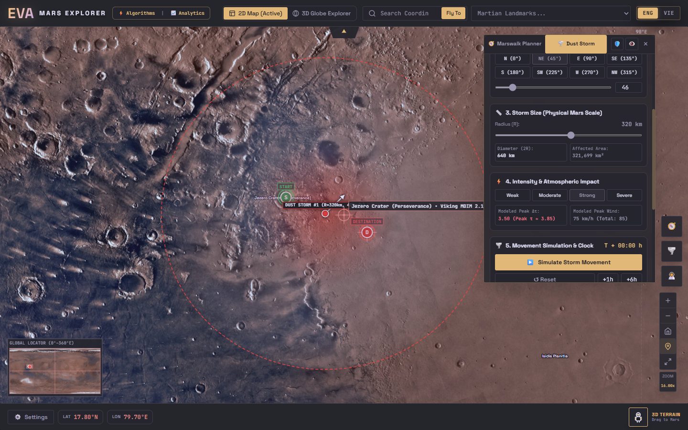
*Figure 12: Active **`DUST STORM #1`** (`R=320 km`, `Strong`, `Modeled Peak Δτ: 3.50`, `Peak τ = 3.85`, `Peak Wind: 75 km/h`) centered near `17.85°N, 79.05°E`, displaying its dashed hazard radius, wind vector arrow, and atmospheric controls.*

**Expected result:**
- The 2D map renders a semi-transparent storm circle with a dashed red boundary and white wind-direction arrow.
- During live testing between Jezero Crater (`18.41°N, 77.69°E`) and Isidis Planitia (`17.20°N, 80.50°E`):
  - Placing a smaller **32 km** storm offset across the mid-corridor forced **`Field D*`** to compute a **`193.53 km` detour** (`23` waypoints, vs. `187.90 km` clear-sky) cleanly bypassing the storm perimeter.
  - Placing an overlapping **320 km** `Strong` storm (`Peak τ = 3.85`, exceeding the `τ ≥ 2.0` **UNSAFE** threshold and `48h Buffer`) blocked both Start and Destination and rightly aborted with **`❌ STORM_EXCLUSION`**.

**Tips and warnings:** Pay attention to the **`Mission Hazard Thresholds`** legend at the bottom of the Dust Storm tab:
- **`SAFE`:** $\tau < 1.5$ and wind $\le 40\text{ km/h}$
- **`CAUTION`:** $1.5 \le \tau < 2.0$ or $40 < \text{wind} \le 100\text{ km/h}$
- **`UNSAFE`:** $\tau \ge 2.0$ or wind $> 100\text{ km/h}$ or within the **48h Buffer**

---

## 12. Inspecting the Telemetry & Biophysical Analytics Dashboard

**Purpose:** Review detailed oxygen consumption curves, walking speed fluctuations, elevation profiles, and the exact biophysical equations driving your current route.

**How to use it:**
1. Calculate an active route in **Marswalk Planner** first.
2. Click **`Analytics`** in the top header bar (or toggle from **`Algorithms`** → **`Analytics`** inside the shared dashboard modal).
3. Click **`🔄 Sync Telemetry`** at the top-right of the dashboard if you modified astronaut suit mass, speed, or O₂ capacity after opening the modal.

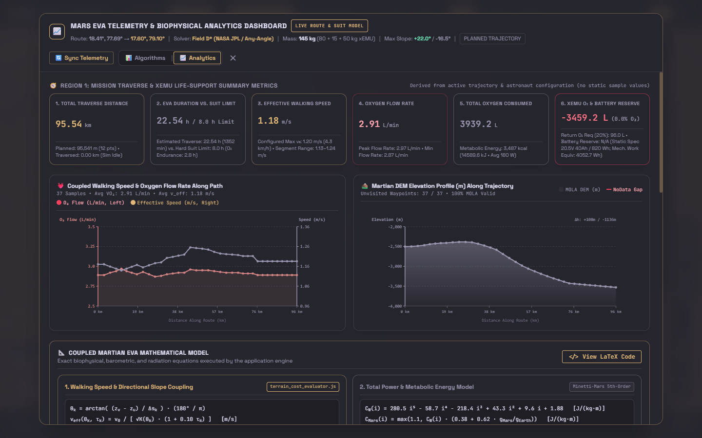
*Figure 13: The **Analytics Dashboard** synchronized to an active `95.54 km` Jezero Crater route—displaying 6 summary cards, the dual-axis **Coupled Walking Speed & Oxygen Flow Rate** SVG plot, the **Martian DEM Elevation Profile**, and the **Coupled Martian EVA Mathematical Model**.*

### What Each Region Shows

- **Region 1 (6 Summary Cards):**
  1. `Total Traverse Distance` (km, waypoints, simulated km traversed)
  2. `EVA Duration vs. Suit Limit` (compares estimated walk hours against the `8.0 h` hard xEMU SOR limit and O₂ endurance)
  3. `Effective Walking Speed` (mean terrain-coupled $v_{\text{eff}}$ vs configured $v_0$)
  4. `Oxygen Flow Rate` (average, peak, and minimum $VO_2$ in `L/min`)
  5. `Total Oxygen Consumed` (`L` plus Minetti-Mars metabolic energy in `kcal` / `kJ` and average metabolic power `W`)
  6. `xEMU O₂ & Battery Reserve` (remaining O₂ including `20%` return reserve; explicitly notes `Battery Reserve: N/A — Static Spec 20.5V 40Ah / 820 Wh`, meaning battery discharge is **not dynamically modeled**)
- **Region 2 (Two Synchronized SVG Charts):**
  - Left: **Coupled Walking Speed & Oxygen Flow Rate Along Path** (`O₂ Flow L/min` on left axis, `Effective Speed m/s` on right axis).
  - Right: **Martian DEM Elevation Profile (m) Along Trajectory** (elevation curve, `Δh` ascent/descent summary, and red markers if any `NoData Gap` occurs).
- **Region 3 (`Coupled Martian EVA Mathematical Model`):**
  Shows the live formulas parameterized with your active speed, suit mass, and directional slope limits, plus a **`</> View LaTeX Code`** button so you can inspect or copy the raw LaTeX equations.

**Tips and warnings:** If no route has been calculated yet, Analytics clearly displays `No Active Route Selected` and `N/A` placeholders rather than inventing sample numbers.

---

## 13. Inspecting Local 3D Terrain Around a Point

**Purpose:** Inspect craters, ridges, and steep escarpments around any single site on a local `40° × 40°` (~`2,366 km`) WebGL 3D relief patch without leaving the 2D Explorer.

**How to use it:**
1. Locate the **`3D TERRAIN`** (`Drag to Mars`) button with the white astronaut icon in the bottom-right corner of the 2D Explorer.
2. Click and drag the astronaut icon over your target area on the 2D canvas—a prompt banner says *"Release astronaut to open Interactive 3D Terrain View at this location"*—and release the mouse button.
3. Inside the **`MARS TERRAIN VIEW`** modal:
   - **Left-drag** to orbit around the dropped astronaut marker.
   - **Right-drag** to pan.
   - **Scroll** to zoom in/out.
   - Adjust vertical relief exaggeration with **`Exag: - 5x +`**.
   - Switch surface shading modes between **`Visual`** (Viking MDIM 2.1 mosaic), **`MOLA`** (elevation colormap), and **`Slope`** (astronaut walking mobility hazard shading).
   - Use top-right icons to **Reset Camera (`↺`)**, **Expand (`⛶`)**, or **Close (`✕`)**.

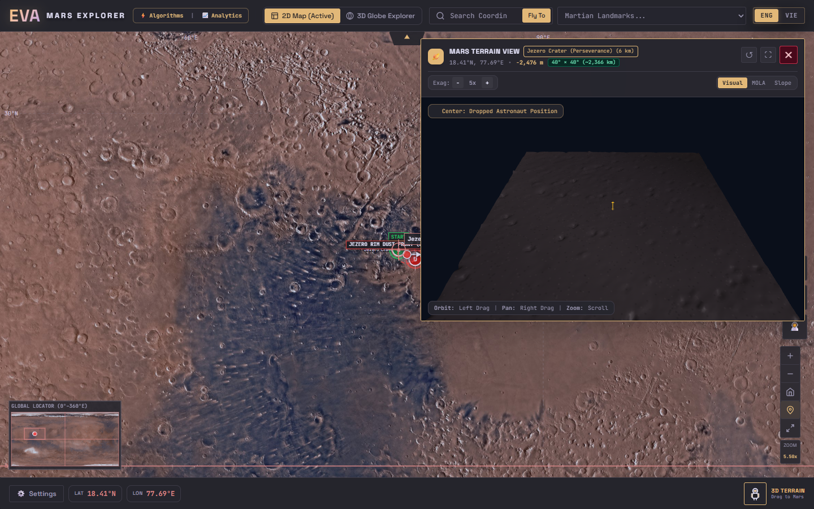
*Figure 14: The **`MARS TERRAIN VIEW`** modal opened at **Jezero Crater** (`18.41°N, 77.69°E`, `-2,476 m`), showing the `40° × 40° (~2,366 km)` WebGL block with `5x` vertical exaggeration and `Visual / MOLA / Slope` shading switches.*

**Expected result:** A smooth WebGL terrain block centered on your dropped astronaut pin, highlighting rim slopes and crater floor depth in perspective.

**Tips and warnings:** Local `MARS TERRAIN VIEW` relies on hardware/browser **WebGL** acceleration; **`Exag: 5x`** intentionally stretches vertical height by 5× so Martian relief is easy to read, so do not judge visual steepness without checking **`Slope`** mode or numeric degrees.

---

## 14. Customizing Themes, Constraints, and System Settings

**Purpose:** Personalize the interface palette, switch between Astronaut/Rover/Scout slope limits and safety corridor widths, adjust rendering framerate, and review roadmap capabilities.

**How to use it:**
Click **`Settings`** in the bottom-left footer of the **2D Explorer** (or click **`Slope ⚙️`** inside Marswalk Planner to jump straight to Profile & Constraints). All changes take effect immediately and persist across reloads in `localStorage`.

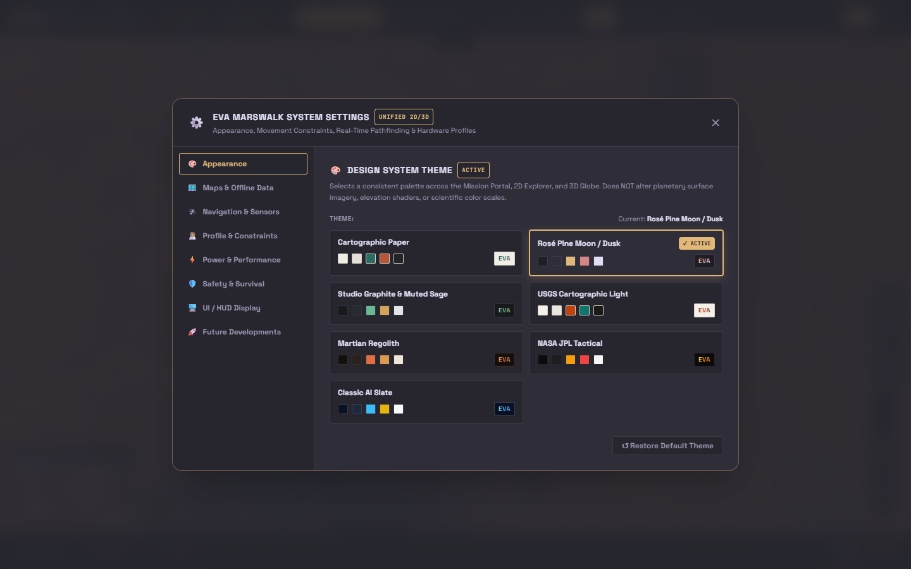
*Figure 15: **Settings → Appearance** showing the 7 visual themes (default **`Rosé Pine Moon / Dusk ✓ ACTIVE`**) and **`Restore Default Theme`**. Changing themes restyles panels and controls cleanly without altering scientific colormaps.*

### All 8 Settings Tabs Explained

| Tab | What You Can Configure / Inspect |
|---|---|
| **`🎨 Appearance`** | Select one of 7 visual themes in exact order: `Cartographic Paper`, **`Rosé Pine Moon / Dusk`** (default), `Studio Graphite & Muted Sage`, `USGS Cartographic Light`, `Martian Regolith`, `NASA JPL Tactical`, and `Classic AI Slate`, or click **`Restore Default Theme`**. Themes never distort planetary surface imagery or scientific legends. |
| **`🗺️ Maps & Offline Data`** | Summarizes the loaded standalone datasets (**MOLA Elevation: 72 Tiles**, **Viking MDIM 2.1: 72 Tiles 4-Tier LOD**, **Gravity Anomaly `JGMRO_120g`: 720×360**, **Terrain Slope Derived: 720×360**) and notes future HiRISE orbital sync. |
| **`🛰️ Navigation & Sensors`** | Documents the active geodetic reference frame (**IAU 2015 Mars Equirectangular**, $R = 3{,}396{,}190.0\text{ m}$, $g = 3.721\text{ m/s}^2$, `0°–360°E` / `-90°S–+90°N`) and planned IMU / Visual Odometry hardware integration. |
| **`👨‍🚀 Profile & Constraints`** | Choose a mobility profile (**`Astronaut EVA` `22.0°`**, **`Robotic Rover` `15.0°`**, or **`Agile Scout` `28.0°`**), customize **`Maximum Slope (θ_max)`** (`5°–35°`, step `0.5°`), and tune **`Route Safety Clearance (C)`** (`0–120,000 m`, default `30,000 m`, scanning three concentric buffers at `0.40·C`, `0.75·C`, `1.00·C`), **`Max CAUTION Density (%)`** (`5–90%`, default `35%`), and **`Max UNKNOWN Coverage (%)`** (`1–50%`, default `15%`). |
| **`⚡ Power & Performance`** | Switch **`Rendering Performance Mode`** between **`High Performance (Target 60 FPS)`** and **`Eco-Nav Mode (Target 30 FPS Power Save)`**, or click **`Purge Local Bitmap Cache`** to free GPU/browser tile memory. |
| **`🛡️ Safety & Survival`** | Displays fixed life-support alert references: **`Dust Storm Optical Depth (τ) Alert`** (`2.2`, read-only) and **`Oxygen Safety Return Reserve (%)`** (`20%` NASA contingency margin, read-only). |
| **`🖥️ UI / HUD Display`** | Shows the active synchronized telemetry overlay theme name. |
| **`🚀 Future Developments`** | Read-only **`ROADMAP`** listing 5 capabilities **not yet implemented**: (1) Regional Offline Map Package Download (`Planned`), (2) Live MRO Orbital Weather & Dust Telemetry (`Planned`), (3) Visual Odometry Landmark Tracking (`Hardware Dependent`), (4) 6-DOF IMU Inertial Navigation (`Hardware Dependent`), and (5) Phobos & Deimos Celestial Navigation (`Hardware Dependent`). |

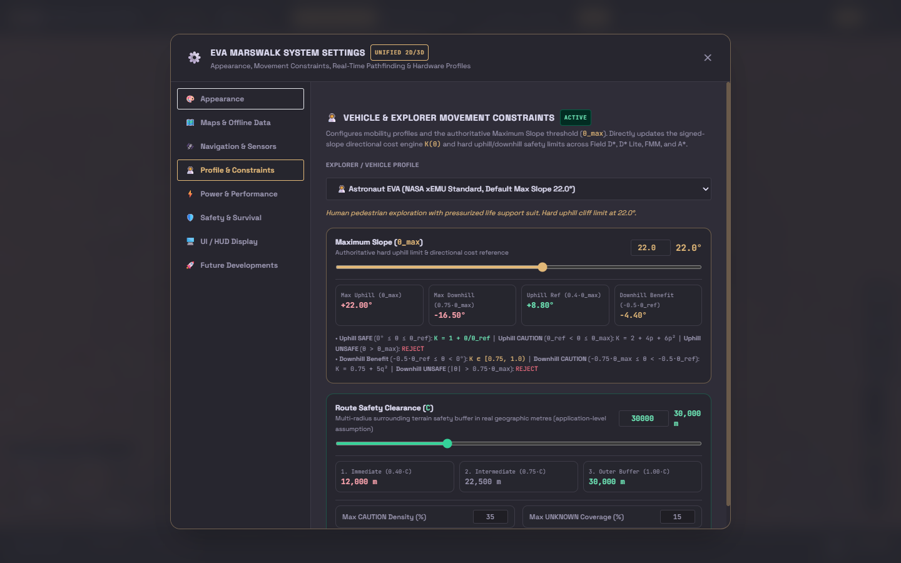
*Figure 16: **Settings → Profile & Constraints** displaying the active `Astronaut EVA` profile, `Maximum Slope (θ_max) = 22.0°` (`+22.00°` uphill / `-16.50°` downhill / `+8.80°` ref), and the 3-ring `Route Safety Clearance (C = 30,000 m)` corridor thresholds.*

**Tips and warnings:** Lowering `Maximum Slope (θ_max)` (for example switching to **`Robotic Rover 15.0°`**) or increasing `Route Safety Clearance (C)` makes routes much safer around steep crater walls—but can cause previously valid paths to fail with `NO_SAFE_CORRIDOR_FOUND` in rugged highlands.

---

## 15. Understanding Route Statuses, Safety Colors, and Warnings

Use this quick reference table whenever a route finishes (or fails) to understand what happened:

| Status / Badge | Color / Meaning | What It Means & Recommended Action |
|---|---|---|
| **`SAFE`** / **`SAFE_ROUTE_FOUND`** | Green | All segments meet slope, corridor clearance, dust, and available MCS pressure checks. Ready to simulate in **Simulated Astronaut Walk**. |
| **`CAUTION`** / **`CAUTION_ROUTE_FOUND`** | Muted amber/secondary | Route is passable only by crossing moderate slopes ($\theta_{\text{ref}} < \theta \le \theta_{\max}$) or moderate dust (`1.5 ≤ τ < 2.0`). Inspect `Max Directional Slope` and segment colors carefully. |
| **`UNKNOWN`** / **`UNKNOWN_DATA_UNAVAILABLE`** | Accent highlight | Slope is physically traversable, **but** the corridor crosses coordinates without orbital MRO MCS pressure sounding coverage (or exceeds `Max UNKNOWN Coverage`). |
| **`UNSAFE`** | Red | Route or inspected site violates hard uphill/downhill slope ($\theta > \theta_{\max}$ or $|\theta| > 0.75\,\theta_{\max}$), extreme dust ($\tau \ge 2.0$), or near-vacuum decompression (`< 150 Pa`). |
| **`STORM_EXCLUSION`** | Red error banner | Active dust storm(s) violate optical depth ($\tau \ge 2.0$), wind ($> 100\text{ km/h}$), or the 48-hour temporal exclusion buffer over your endpoints or all detour corridors. Move/resize/clear the storm or delay mission start. |
| **`NO_SAFE_CORRIDOR_FOUND`** / **`NO_FEASIBLE_ROUTE`** | Red error banner | No continuous path satisfies both local slope and `Route Safety Clearance (C)` tolerances. Check **`Allow CAUTION Segments (Relaxed Risk)`**, pick closer/flatter endpoints, or reduce Clearance `C` in **Settings → Profile & Constraints**. |
| **`SEARCH_LIMIT_REACHED`** | Red error banner | Grid search expanded the maximum node budget before linking distant points. Pick closer waypoints or use **`Field D*`** / reduce clearance strictness. |
| **`CANCELLED`** | Neutral notice | You clicked **`Cancel`** while pathfinding was running. |
| **`⚠️ O₂ DEFICIT WARNING`** | Red warning box in Summary | The path is geometrically safe, **but** `Total O₂ Consumed` exceeds your configured `O₂ Capacity` (`480 L` default). Shorten the traverse distance, raise `O₂ Capacity`, or evaluate as a rover profile. |

---

## 16. Troubleshooting Common Issues

- **`Calculate Route` button is grayed out / disabled:**
  Make sure **both** `Starting Point` (`Latitude` and `Longitude`) and `Destination` (`Latitude` and `Longitude`) contain valid numbers (`-90 ≤ lat ≤ 90`, `0 ≤ lon ≤ 360`) and are not empty.
- **Map didn't load or tiles appear blank when opening `mars_2d_map.html`:**
  Confirm you started `desktop/server.py` (or double-clicked `desktop/launch_desktop.bat` / `launch_2d_map.bat`) and are visiting `http://localhost:8080/...`, not `file:///...`. If tiles still look stale after heavy zooming, open **Settings → Power & Performance** and click **`Purge Local Bitmap Cache`**.
- **Alert pops up when clicking `Fly To` ("Could not parse location..." or "Please enter valid latitude..."):**
  Check that you typed **latitude first, longitude second** (e.g., `18.38, 77.58`) using **0°–360°E** east longitude rather than `deg` symbols or reversed `lon, lat` order. On **3D Globe Explorer**, enter numeric `Lat` (`-90` to `+90`) and `Lon` (`0` to `360`) into separate boxes.
- **Route fails immediately with `STORM_EXCLUSION` after adding a Dust Storm:**
  Check your storm radius and placement! A large storm centered near Start or Destination can swallow endpoints inside the $\tau \ge 2.0$ or 48h buffer zone. Try reducing **`Radius (R)`** or clicking **`Clear All`** in the **Dust Storm** tab to isolate terrain vs. storm effects.
- **Where is the `Settings` button on the 3D Globe Explorer?**
  The **Settings** modal lives on the **2D Explorer** (`mars_2d_map.html`) bottom-left footer bar. Theme selections made there apply automatically to both pages.
- **Analytics modal shows `N/A` and "No Active Route Selected":**
  **Analytics** reflects your live calculated route only. Close the modal, calculate any route in **Marswalk Planner**, and reopen **Analytics** (or click **`🔄 Sync Telemetry`**).
- **3D Globe Explorer or Local `MARS TERRAIN VIEW` refuses to render:**
  Ensure **WebGL** hardware/software acceleration is enabled in your browser (`chrome://settings` → System → *"Use graphics acceleration when available"*).

---

## 17. Important Limitations

Keep these technical and scientific boundaries in mind whenever interpreting results from **EVA MARSWALK**:

1. **Not Operational NASA Flight Software:** All route clearances, Safety Indices (`0–100`), O₂ budgets, and advisories are simulation estimates. Never rely on this tool for real aerospace operations.
2. **Global Grid Scale vs. Meter-Scale Hazards:** The bundled datasets (`Viking MDIM 2.1`, `MGS MOLA GTM090AA` 72-tile pyramids, `720×360` gravity & slope grids) represent global/regional planetary scales. Individual `1 m` boulders, small craters, soft regolith traps, and sharp overhang cliffs are invisible at planetary raster resolution and require local rover/HiRISE verification.
3. **Modeled Atmosphere & Synthetic Dust Storms:** Outside the 1,153 bundled `MRO MCS` sounding tracks, surface pressure and ambient dust rely on `Barometric Model P(h)` and baseline constants; the **Dust Storm Engine** is a synthetic geometric hazard simulator (`MODELED`), not live Mars weather telemetry.
4. **Static Battery Specification (`Not Modeled`):** As displayed in **Analytics → Card 6 (`xEMU O₂ & Battery Reserve`)**, the suit battery rating (`20.5V 40Ah / 820 Wh`) is informational only—EVA MARSWALK models **oxygen consumption**, not dynamic electrical battery depletion.
5. **Point-to-Point One-Way Planning:** `Marswalk Planner` optimizes a single one-way leg (`Start → Destination`) rather than solving a combined outbound-plus-return closed loop automatically. To check return energy and uphill/downhill asymmetry manually, use **`⇅ Swap Start / Destination`** and re-run **`Calculate Route`**.
6. **Hardware & Live Feed Features Are Roadmap Only:** Live MRO Weather APIs, Regional Offline package downloads, Visual Odometry (`ORB-SLAM3`), 6-DOF IMU inertial dead reckoning, and Phobos/Deimos celestial navigation listed under **Settings → Future Developments** are inactive roadmap descriptions requiring external hardware or network services.
