# EVA MARSWALK

<p align="center">
  
</p>

<p align="center">
  <strong>Autonomous Martian Surface Navigation, Extravehicular Activity (EVA) Route Planning &amp; Astronaut Survivability Telemetry</strong>
</p>

<p align="center">
  <em>"Explore Mars. Navigate with Confidence. Always Find Your Way Home."</em>
</p>

<p align="center">
  
  
  
  
  
  
</p>

> [!TIP]
> **Official Live Web Demo & Repository**
> - **Launch Live Web App:** [https://sm9038.github.io/Extravehicular-Activity-EVA-/](https://sm9038.github.io/Extravehicular-Activity-EVA-/)
> - **Official GitHub Repository:** [https://github.com/SM9038/Extravehicular-Activity-EVA-](https://github.com/SM9038/Extravehicular-Activity-EVA-)

> [!IMPORTANT]
> **Simulation & Research Disclaimer:** **EVA MARSWALK** (`EVA MARS EXPLORER`) is a research, educational, and mission-planning simulation prototype created for the **NASA Space Apps Challenge 2026**. It is **not** flight-certified NASA operational navigation software and must **not** be used for real astronaut life-support decisions or field traversal.

---

## 📋 Table of Contents

- [🌌 Overview & The Martian EVA Challenge](#-overview--the-martian-eva-challenge)
- [🏛️ Strategic Architecture & NASA Open-Science Integration](#-strategic-architecture--nasa-open-science-integration)
- [✨ Key Features](#-key-features)
- [📖 How Does EVA MARSWALK Work?](#-how-does-eva-marswalk-work)
- [📸 Application Showcase & Screenshots](#-application-showcase--screenshots)
- [🚀 Quick Start & Installation](#-quick-start--installation)
- [🔬 Scientific Data & Methodology](#-scientific-data--methodology)
- [🛠️ Tech Stack & Verified System Architecture](#-tech-stack--verified-system-architecture)
- [⚠️ Scientific Limitations & Disclaimers](#-scientific-limitations--disclaimers)
- [🚀 Future Developments](#-future-developments)
- [👥 Team & Acknowledgments](#-team--acknowledgments)
- [📄 License & Open-Source Policy](#-license--open-source-policy)

---

## 🌌 Overview & The Martian EVA Challenge

### The Problem
Extravehicular activity (EVA) on Mars is constrained by unforgiving terrain and strict physiological limits. Deep fault scarps, volcanic shields rising over 21 km above the datum, impact crater rims, regional dust storms, and a thin carbon-dioxide atmosphere averaging ~610 Pa at the zero-elevation datum leave narrow operational safety margins. An astronaut traversing across high-grade regolith faces asymmetric downhill tipping hazards, sharp increases in metabolic oxygen consumption, and elevated solar/galactic cosmic radiation exposure.

### Why Terrain-Aware EVA Planning Matters
Shortest-path Euclidean routing fails in planetary exploration. A path that minimizes straight-line horizontal distance can force an astronaut up unstable slopes, through dusty depressions, or across uncompensated canyon drops that breach safety thresholds or exhaust oxygen supplies before safe return. Mission planners need continuous-angle terrain reasoning paired with transparent scientific data provenance so modeled estimates are never mistaken for raw spacecraft telemetry.

### The Solution: EVA MARSWALK
**EVA MARSWALK** was built by **Team AI-Powered**—undergraduate students at the **Ho Chi Minh University of Science (VNU-HCM), Vietnam**—for the **NASA Space Apps Challenge 2026**. Running directly in the browser with zero external framework dependencies, it fuses bundled **NASA PDS** and **USGS Astrogeology** datasets (`MGS MOLA GTM090AA`, `Viking MDIM 2.1`, `MRO120G / 120F`, and `MRO MCS 2025073120_DDR`) with a background Web Worker pathfinding suite (**Field D\***, **D\* Lite**, **Fast Marching Method (FMM)**, and **Baseline A\***), dynamic Gaussian dust storm exclusion (`tau >= 2.0`, `wind > 100 km/h`, `48 h` buffer), Mars-scaled Minetti metabolic modeling, and multi-scale 2D/3D WebGL inspection.

---

## 🏛️ Strategic Architecture & NASA Open-Science Integration

### Four Core Strategic Capabilities

1. **Verifiable Planetary Data Fusion & Explicit Provenance:** Every value displayed in the HUD or analytics modal explicitly distinguishes between **Measured Orbital Datasets**, **Derived Physical Values**, **Modeled Estimates**, and **Visual Representations**.
2. **Bidirectional Slope-Coupled Locomotion & Metabolic Planning:** Evaluates signed directional traversal slopes separately (`+22.0°` default uphill / `-16.5°` downhill for Astronaut EVA, plus configurable **Robotic Rover** `15.0°` and **Agile Scout** `28.0°` presets) alongside a Mars-scaled 5th-order Minetti metabolic energy model and physiological O₂ demand.
3. **Spatiotemporal Dust Storm Hazard Exclusion & Detour Replanning:** Models moving storm fronts across optical depth ($\tau$), surface wind speed, and a `48 h` spatiotemporal arrival buffer, isolating storm rejection cleanly from topographic failure (`STORM_EXCLUSION` vs. `TOO_STEEP`).
4. **Multi-Paradigm Non-Blocking Worker Benchmarking:** Offloads search execution across **4 distinct algorithmic engines** onto `geospatial/route_worker.js`, benchmarking CPU latency, node expansions, distance, smoothness, and O₂ consumption side-by-side over identical terrain rasters.

### Data-to-Decision Architecture

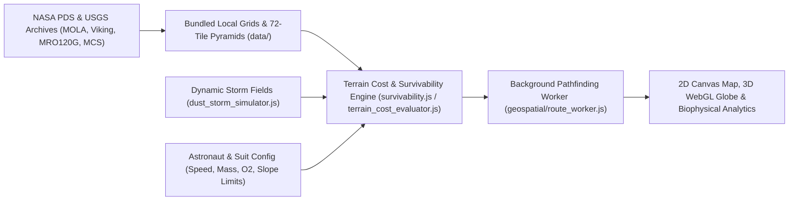

### Multi-Scale Spatial Architecture

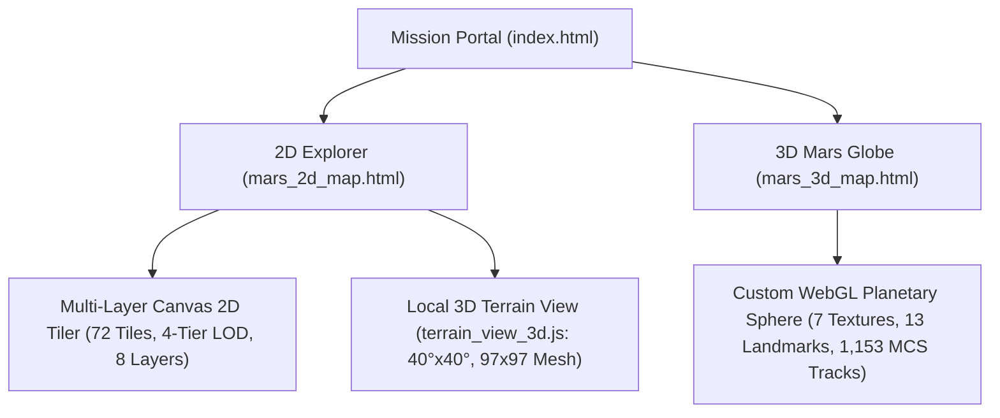

### Integrated EVA Routing & Validation Workflow

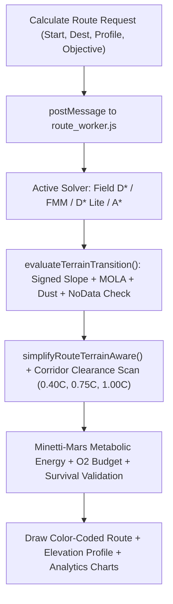

### Strict Severity Bottleneck & Survival Index (`survivability.js`)

For both site monitoring and route validation, `evaluateAstronautSurvival()` evaluates environmental parameters against proximity coefficient curves $p$ and assigns `SAFE`, `CAUTION`, `UNSAFE`, or `UNKNOWN`:

- **Strict Categorical Dominance:** `UNSAFE > CAUTION > UNKNOWN > SAFE`. If even **one** criterion fails an `UNSAFE` bound, the entire location or corridor is flagged **`UNSAFE`** (`S_overall = 0.5 * S_total`), preventing safe averages on benign metrics from hiding a lethal threat. Two or more `CAUTION` flags also halve `S_overall`, whereas a single `CAUTION` applies a `0.8` multiplier.
- **Regional Contrast Inside the Application:**
  - **Jezero Crater (`18.38°N, 77.58°E`):** Flat crater floor (`~0.6°` slope, `-2,500 m` elevation, `~771–773 Pa` modeled pressure) typically evaluates **`SAFE` (`99/100`)** with an `8.0 h` nominal EVA window.
  - **Olympus Mons Summit (`18.65°N, 226.2°E`):** Despite gentle summit shield slopes, extreme altitude (`~21.2 km`) drives modeled barometric pressure down to `~84–99 Pa` (far below the `180 Pa` critical limit), triggering an immediate decompression **`UNSAFE` (`38/100`)** warning.

### Data Provenance Taxonomy

| Category | Examples in the Application | Role & Interpretation |
|---|---|---|
| **Measured Orbital Datasets** | `Viking MDIM 2.1` color mosaic, `MGS MOLA (GTM090AA)` elevation tiles, `MRO120G / 120F` gravity model, `MRO MCS (2025073120_DDR)` tracks | Archived NASA/USGS planetary products stored locally in `data/` |
| **Derived Physical Values** | Terrain slope ($\theta$), surface gravity ($g$), areoid/geoid undulation ($N$), differential gravity ($\Delta g$), cumulative ascent/descent | Computed deterministically from loaded orbital rasters and spherical harmonic grids |
| **Modeled Estimates** | `Barometric Model P(h)` outside direct MCS tracks, `MODEL-BASED SAFETY INDEX`, Minetti-Mars metabolic work & O₂ rate, Dust Storm Engine (`MODELED`), GCR column shielding proxy | Engineering simulation estimates for mission trade studies; **not** raw in-situ telemetry |
| **Visual Representations** | `1x–10x` 3D Globe relief exaggeration, `Exag: 5x` Local 3D Terrain relief scaling, layer colormaps | Visual aids amplifying planetary relief and scalar variations |

### Pathfinding Suite & Scenario-Dependent Benchmarking

All four solvers implemented in [`geospatial/field_d_star.js`](geospatial/field_d_star.js) (`_runFieldDStar`, `_runDStarLite`, `_runFMM`, `_runAStar`) run against the **same** MOLA elevation/slope grids and the shared `evaluateTerrainTransition()` cost evaluator:

| Algorithm | Code Reference | Algorithmic Paradigm | Practical Behavior in Martian Terrain |
|---|---|---|---|
| **Field D\*** | `_runFieldDStar` + `replanFieldDStar` | Continuous any-angle linear edge interpolation + incremental repair (`Ferguson & Stentz`) | Eliminates discrete `45°/90°` staircase artifacts via continuous cell-edge crossings and supports incremental repair (`_fieldDStarState`) when hazards change |
| **Fast Marching Method (FMM)** | `_runFMM` | Forward upwind Eikonal PDE narrow-band wavefront propagation (`Sethian`) | Propagates smooth continuous arrival fronts across orthogonal frozen neighbors and traces gradient descent backward from goal to start |
| **D\* Lite** | `_runDStarLite` | Backward 8-connected incremental heuristic search (`Koenig & Likhachev`) | Maintains `(g, rhs)` two-component priority keys over an 8-neighbor graph |
| **Baseline A\*** | `_runAStar` | Discrete 8-connected forward graph search with admissible heuristic | Deterministic baseline used by `runFourAlgorithmBenchmark()` to compute relative `o2SavedVsAStarPct` and distance deltas |

> [!NOTE]
> **Scenario-Dependent Benchmark Outcomes:** Efficiency gains (such as distance or O₂ saved vs. Baseline A\*) are computed **dynamically per route** inside [`runFourAlgorithmBenchmark()`](geospatial/field_d_star.js#L2871-L2943) (`o2SavedVsAStarPct`). Measured savings vary by route geometry, local slope roughness, optimization objective (`min_risk`, `min_energy`, `min_elevation`, `balanced`), and obstacle density—there is no fixed universal percentage across all Martian terrains.

### Battery Telemetry & Consumables Clarification

Per [`geospatial/eva_analytics.js`](geospatial/eva_analytics.js#L1348-L1358), the **PLSS Battery (`20.5 V × 40 Ah / 820 Wh LIB`)** and **8.0 h Max EVA Limit** are displayed strictly as **`REFERENCE SPEC / NOT MODELED`**. The engine computes **mechanical/metabolic work equivalent (`Wh`)** alongside **dynamic oxygen (`L`) depletion**, and **does not** simulate active electrical battery drain from suit avionics, ventilation fans, heaters, or cooling pumps.

---

## ✨ Key Features

- **🗺️ Custom Multi-Layer 2D Mars Explorer ([`geospatial/equirectangular_map.js`](geospatial/equirectangular_map.js)):** Four-canvas pipeline rendering a verified **72-tile** `Viking MDIM 2.1` and `MOLA` 4-tier LOD pyramid plus **8 selectable scientific layers** (`main`, `elevation`, `pressure`, `gravity_120g`, `slope`, `surface_g`, `geoid_n`, `gravity_delta`) with an off-thread `createImageBitmap` LRU cache.
- **🪐 Custom WebGL 3D Mars Globe ([`mars_3d_map.html`](mars_3d_map.html)):** Interactive 3D planetary sphere built directly on native WebGL shaders without external globe or mapping libraries, supporting `1x–10x` radial terrain displacement, 6 switchable global scalar textures plus packed elevation/geoid textures, **13 pinned planetary landmarks**, and **1,153 MRO MCS sounding track overlays**.
- **⛰️ Interactive Local 3D Terrain Block ([`geospatial/terrain_view_3d.js`](geospatial/terrain_view_3d.js)):** Drag the **3D TERRAIN** Pegman astronaut onto any spot on Mars to inspect a `40° × 40°` (~`2,366 km` wide) `97 × 97` vertex (`18,432` triangles) MOLA heightfield with `Visual`, `MOLA`, and `Slope` shading.
- **🧭 Marswalk Planner & Background Worker ([`geospatial/route_worker.js`](geospatial/route_worker.js)):** Non-blocking route calculation with corridor safety buffers (`0.40·C`, `0.75·C`, `1.00·C`), directional uphill/downhill limits, customizable biomechanics (`speed`, `bodyMass`, `equipmentMass`, `oxygenCapacity`), and 4 optimization objectives.
- **🌪️ Dynamic Dust Storm Simulator ([`geospatial/dust_storm_simulator.js`](geospatial/dust_storm_simulator.js)):** Spawns moving 2D Gaussian storm cells (`R = 20–600 km`, `Weak` to `Severe`, compass vector `0°–359°`, velocity `0–100 km/h`) with hard `τ >= 2.0`, `wind > 100 km/h`, and `48 h` arrival separation constraints.
- **🏃 Animated Astronaut Walk & Analytics HUD ([`geospatial/eva_analytics.js`](geospatial/eva_analytics.js)):** `1×–200×` mission playback paired with 6 synchronized KPI cards, coupled Speed/VO₂ & DEM elevation SVG plots, and raw LaTeX export of active equations.
- **📍 Gazetteer Search, 7 Themes & Bilingual UI ([`geospatial/eva_settings.js`](geospatial/eva_settings.js)):** Fly directly to coordinates or features across **18** 2D quick presets, **13** 3D globe pins, **19** `MARS_LANDMARKS`, and **27** searchable `IAU/USGS` entries in [`geospatial/mars_gazetteer.js`](geospatial/mars_gazetteer.js), wrapped in **7 synchronized CSS themes** and an **ENG / VIE** language toggle.

---

## 📖 How Does EVA MARSWALK Work?

*A Complete Step-by-Step User Tutorial*

### 1. Getting Started & Launching the Workspace

1. Run `desktop/launch_desktop.bat` on Windows (or `python desktop/server.py index.html` from the repository root) and visit `http://localhost:8080/index.html` (or use the hosted web demo).
2. Always serve over HTTP rather than opening `.html` via `file://`, so the browser can load tile manifests, binary grids, and `route_worker.js`.
3. Use the top-right **`ENG | VIE`** toggle on any page to switch languages, and choose **`Open 2D map →`** (`mars_2d_map.html`) or **`Open 3D explorer →`** (`mars_3d_map.html`).


*Figure 1: The EVA MARSWALK Mission Portal (`index.html`) showing the **ENG | VIE** toggle and entry cards for the 2D Explorer and 3D Globe Explorer.*

### 2. Exploring Mars with the 2D Explorer

1. Click and drag on [`mars_2d_map.html`](mars_2d_map.html) to pan across `0°–360°E`, `90°S–90°N`, or click directly inside **`GLOBAL LOCATOR (0°–360°E)`** (bottom-left).
2. Scroll with the mouse wheel or use **`+`** / **`-`** and **Home (`Reset View`)** on the bottom-right stack to inspect sharper LOD pyramid tiers (`1.00x` up to `250.0x`).
3. Click any point on Mars to place the red target crosshair, read the bottom-left **`LAT` / `LON`** readout, and toggle surface labels using the **Map Pin** button.

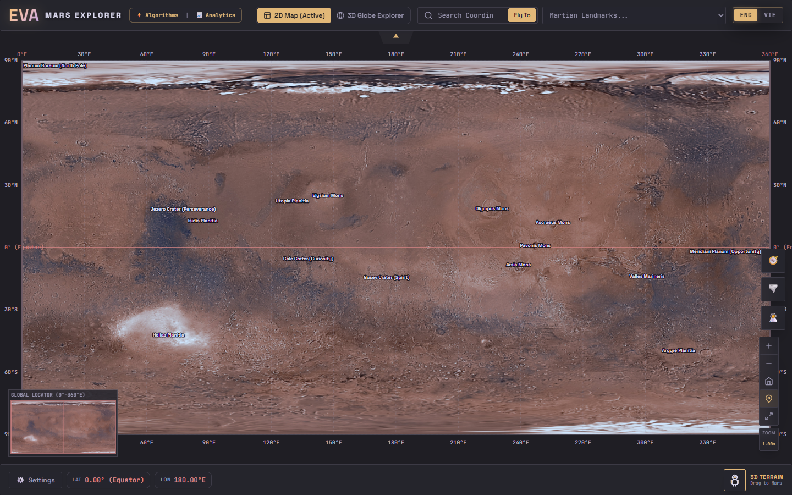
*Figure 2: The 2D Explorer main canvas with the top command bar, collapsed Layer Ribbon (`▲`), right-edge tool launchers, `GLOBAL LOCATOR`, bottom `Settings` button, and `3D TERRAIN` Pegman.*

### 3. Navigating with Fly To, Coordinates & Gazetteer

EVA MARSWALK uses **Latitude (`-90°` to `+90°`)** and **Planetocentric East Longitude (`0°` to `360°E`)** in `lat, lon` order (e.g., `18.38, 77.58` for Jezero Crater).

| Search Control | Location | Accepted Input | Behavior |
|---|---|---|---|
| **Global Search + `Fly To`** | 2D top bar | Feature name (`Olympus Mons`, `Jezero`) or `lat, lon` | Smoothly centers camera (`4.00x–6.50x`), places target crosshair, and updates `GLOBAL LOCATOR`; alerts if unparseable |
| **`Martian Landmarks...` / `Landmarks`** | 2D / 3D top bar | Dropdown presets (`18` 2D presets; `13` 3D pins) | Jumps directly to volcanoes, craters, basins, poles, and landing sites |
| **IAU/USGS Gazetteer Search** | **Marswalk Planner** drawer | Searchable dropdown (`27` cataloged features) | Fills Start (`S`) or Destination (`D`) `Latitude` and `Longitude` fields for route computation |

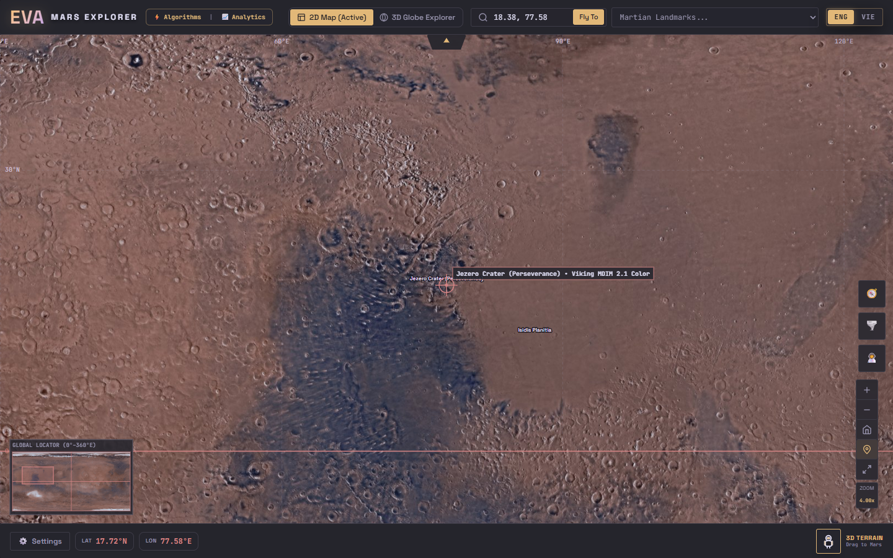
*Figure 3: Zooming into Jezero Crater (`18.38°N, 77.58°E`) via **Fly To**—showing the zoomed basemap, crosshair callout, and updated `GLOBAL LOCATOR` footprint.*

### 4. Switching Scientific Data Layers (2D Ribbon)

Click the centered **`▲`** tab below the top bar to expand the **Scientific Data Layer Ribbon**, select any of the **8 layers**, and read the bottom **`Scale:`** bar alongside the live **`Selected:`** cursor value. Remember that visual brightness in `Main RGB` is surface albedo, not elevation—switch to `MOLA Elevation` or `Terrain Slope` to judge physical steepness.

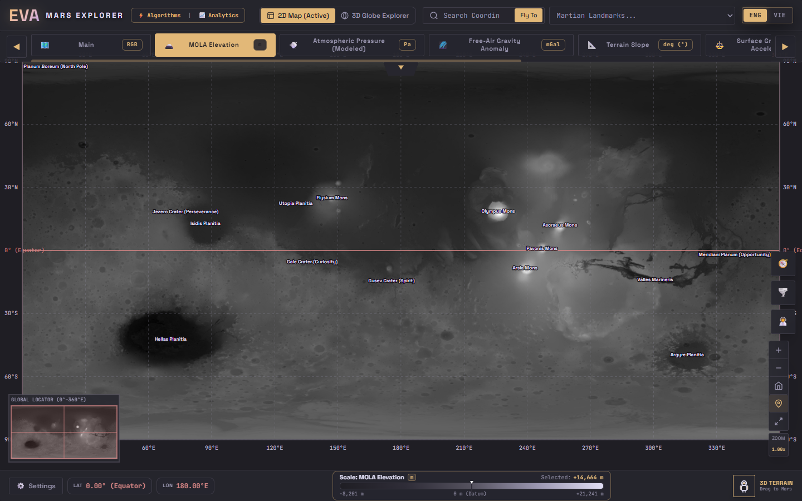
*Figure 4: Expanded top layer ribbon with `MOLA Elevation` active (`-8,201 m` to `+21,241 m`) showing deep dark basins and bright volcanic highlands.*

### 5. Exploring the 3D Mars Globe

1. Switch to **3D Globe Explorer** (`mars_3d_map.html`) from the portal or top bar.
2. Adjust **`3D TERRAIN RELIEF`** (`1x`, `2x`, `5x`, `10x`) and **`SPACE DISPLAY`** (`Lat/Lon Grid 30°`, `Pin 13 Landmarks`, `Auto-Rotate`, `Layer Opacity`), or toggle **`MCS Sounding Tracks (1,153)`**.
3. Click any point on the sphere to inspect **ASTRONAUT SURVIVAL MONITOR** and expand **`DETAILS ▼`** on `SELECTED LOCATION` for Cartesian `(X, Y, Z)` coordinates, planetary radius, gravity anomaly, and MCS atmospheric profiles when covered by a track.


*Figure 5: **3D Globe Explorer** centered on Olympus Mons (`5.0x` relief) with **ASTRONAUT SURVIVAL MONITOR** flagging `DANGEROUS (38/100)` due to low summit pressure.*


*Figure 6: Expanded `DETAILS ▼` geophysical card on the 3D Globe displaying Cartesian `(X, Y, Z)`, planetary radius, MOLA height, and gravity anomaly.*

### 6. Monitoring Astronaut Safety

Click the **Astronaut Monitoring** button on the right-edge tool rail in 2D Explorer (or inspect the right panel on 3D Globe) and expand **`Mission Details ▲ / ▼`** to view temperature, barometric pressure, terrain slope, airborne dust ($\tau$), radiation estimate, **`Estimated Safe EVA Window`**, and local warnings.

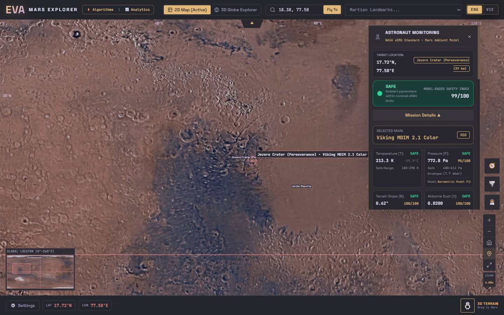
*Figure 7: **ASTRONAUT MONITORING** at Jezero Crater showing `SAFE (99/100)` and expanded 6-layer planetary telemetry.*

### 7. Planning a Marswalk Mission

1. Open **Marswalk Planner** (top icon on the right rail).
2. Set **`Starting Point` (`S`)** and **`Destination` (`D`)** via Gazetteer search, decimal coordinates, or **`Select Start/Destination on Map`**. (Use **`⇅ Swap Start / Destination`** to test the reverse direction for uphill/downhill asymmetry.)
3. Adjust **`Walking Speed`** (`0.1–15.0 m/s`, default `1.2 m/s`), **`Body Mass`** (default `80 kg`), **`Equip Mass`** (default `15 kg`, `+50 kg NASA xEMU` added automatically = `145.0 kg`), and **`O₂ Cap`** (default `480.0 L` in UI).
4. Pick an **`Optimization Objective`** (`Minimum Risk`, `Minimum Energy Consumption`, `Minimum Elevation Variation`, or `Balanced Optimization`), tune weights if desired, and click **`🚀 Calculate Route`**.


*Figure 8: Configuring Start (`18.41°N, 77.69°E`) and Destination (`17.60°N, 79.10°E`) inside **Marswalk Planner** before execution.*


*Figure 9: Generated continuous `Field D*` path with **`Route Telemetry Summary`** and an expected **`O₂ DEFICIT WARNING`** on a regional 187.9 km traverse under a 480 L single-EVA tank.*

### 8. Comparing Pathfinding Algorithms

Click **`Algorithms`** in the header (or **`Configure ⚡`** inside Marswalk Planner) to switch active solvers or click **`🔄 Re-Run Benchmark on Current Map`** to compare `Field D*`, `D* Lite`, `Fast Marching (FMM)`, and `Baseline A*` on CPU time, expanded nodes, distance, O₂ burn, and smoothness.


*Figure 10: **Algorithms & Benchmark Suite** comparing all four algorithms side-by-side on identical Jezero Crater terrain.*

### 9. Running the Simulated Astronaut Walk

After generating a route, scroll down in **Marswalk Planner** to **`Simulated Astronaut Walk`**, select a playback multiplier (`1×` up to `200×`), and click **`▶ Start Walk`** to animate traversal with real-time position, speed, segment slope (`θ`), and local storm telemetry updates.


*Figure 11: Mid-traversal playback at `200× Sim` updating coordinate progress, `Sim Time`, `Sim Dist`, and segment slope (`θ`).*

### 10. Simulating and Avoiding Dust Storms

1. Open the **`🌪️ Dust Storm`** tab (middle rail icon).
2. Click **`+ Add Storm`** (or **`📍 Place Storm on Mars Map`**), set **`Radius (R)`** (`20–600 km`), intensity (**`Weak` / `Moderate` / `Strong` / `Severe`**), propagation direction (`0°–359°`), and movement velocity (`0–100 km/h`).
3. Advance time with **`▶ Simulate Storm Movement`**, **`+1h`**, or **`+6h`**, then re-run **`🚀 Calculate Route`**. Storms breaching `tau >= 2.0`, `wind > 100 km/h`, or the **48h arrival buffer** force autonomous detours or cleanly abort with `STORM_EXCLUSION`.

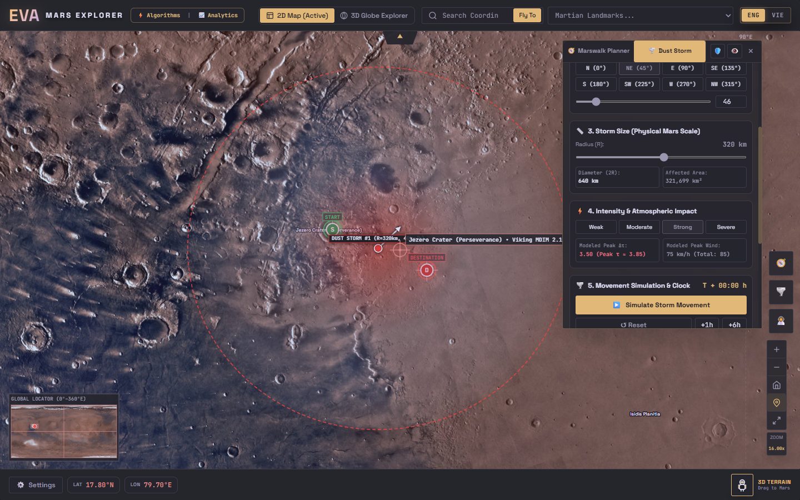
*Figure 12: Active **`DUST STORM #1`** (`Strong`, `R = 320 km`, `Peak Wind: 75 km/h`) rendered with its dashed hazard perimeter and propagation arrow.*

### 11. Inspecting Biophysical Analytics

Click **`Analytics`** in the top header after computing a route (use **`🔄 Sync Telemetry`** after changing suit parameters) to inspect the 6 KPI cards, coupled **Walking Speed & Oxygen Flow** SVG plot, **DEM Elevation Profile**, **Coupled Martian EVA Mathematical Model**, and raw LaTeX export.


*Figure 13: **Analytics Dashboard** synchronized to an active Jezero Crater traverse with speed, VO₂, elevation profile, and live parameter formulas.*

### 12. Inspecting Local 3D Terrain on the Spot

Drag the **`3D TERRAIN`** astronaut Pegman (bottom-right of 2D Explorer) onto any location and release it to open the **`MARS TERRAIN VIEW`** WebGL modal (`40° × 40°`, ~`2,366 km` regional patch). Orbit with left-drag, pan with right-drag, adjust **`Exag: - 5x +`**, and switch between **`Visual`**, **`MOLA`**, and **`Slope`** modes.

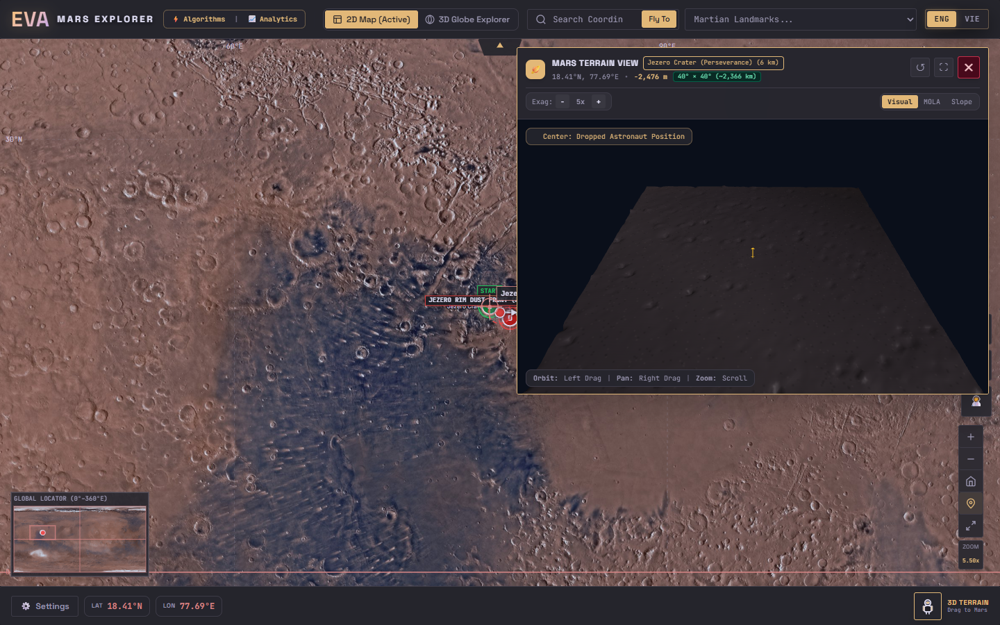
*Figure 14: **MARS TERRAIN VIEW** WebGL patch centered on Jezero Crater (`18.41°N, 77.69°E`) with `5x` vertical exaggeration.*

### 13. Customizing Themes, Constraints & Settings

Click **`Settings`** in the bottom-left footer of the 2D Explorer (changes persist via `localStorage` across all pages):

- **8 Settings Tabs:** `Appearance` (7 UI themes—`Cartographic Paper`, **`Rosé Pine Moon / Dusk`** default, `Studio Graphite & Muted Sage`, `USGS Cartographic Light`, `Martian Regolith`, `NASA JPL Tactical`, `Classic AI Slate`), `Maps & Offline Data`, `Navigation & Sensors`, `Profile & Constraints`, `Power & Performance` (`60 FPS` vs. `30 FPS` + `Purge Local Bitmap Cache`), `Safety & Survival`, `UI / HUD Display`, and `Future Developments` (all unimplemented roadmap items, detailed under [🚀 Future Developments](#-future-developments)).


*Figure 15: **Settings → Appearance** displaying all 7 synchronized interface themes.*


*Figure 16: **Settings → Profile & Constraints** configuring `Astronaut EVA (22.0°)`, `Robotic Rover (15.0°)`, or `Agile Scout (28.0°)` directional slopes and the 3-ring `Route Safety Clearance` corridor.*

### 14. Status Badges & Common Troubleshooting

| Status / Error | Meaning & Resolution |
|---|---|
| **`SAFE` / `SAFE_ROUTE_FOUND`** | All segments pass slope, corridor clearance, dust, and available pressure checks |
| **`CAUTION` / `CAUTION_ROUTE_FOUND`** | Traversable route crossing moderate slope/dust caution zones; inspect max directional slope |
| **`UNKNOWN` / `UNKNOWN_DATA_UNAVAILABLE`** | Terrain traversable where sampled, but crosses gaps lacking MRO MCS sounding data or exceeds `Max UNKNOWN Coverage` |
| **`STORM_EXCLUSION`** | Storm optical depth (`τ >= 2.0`), wind (`> 100 km/h`), or 48h buffer blocks endpoints or all corridors; resize/move/clear storm |
| **`NO_SAFE_CORRIDOR_FOUND`** | No path satisfies current slope + clearance `C`; enable `Allow CAUTION Segments`, adjust `C`, or raise `θ_max` |
| **Blank map or blocked Worker** | Launch through `desktop/server.py` (`http://localhost:8080/...`) instead of `file:///...`; verify WebGL is enabled in browser settings |

---

## 📸 Application Showcase & Screenshots

<p align="center">
  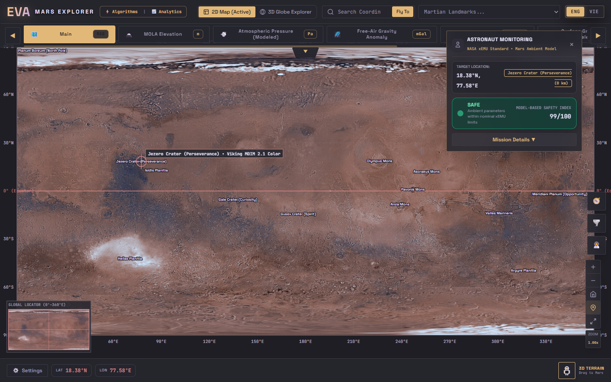
  <br>
  <em><strong>1. Mars 2D Global Explorer:</strong> Multi-canvas equirectangular tiler streaming the 72-tile NASA/USGS pyramid with docked locator and layer ribbon.</em>
</p>

<p align="center">
  
  <br>
  <em><strong>2. Marswalk Planner &amp; Telemetry:</strong> Terrain-aware continuous Field D* trajectory with elevation cross-section, slope validation, and O₂ demand.</em>
</p>

<p align="center">
  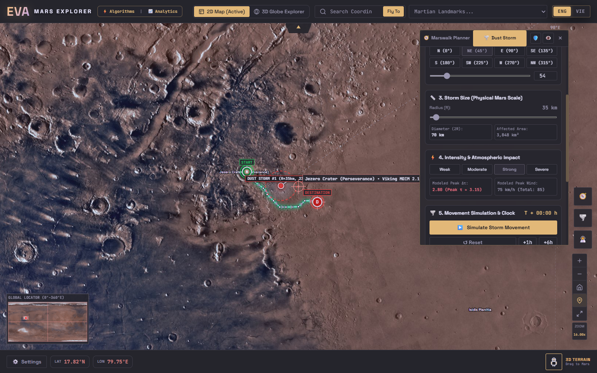
  <br>
  <em><strong>3. Dynamic Dust Storm Detour:</strong> Moving Gaussian storm hazard (`τ >= 2.0` core) triggering autonomous avoidance routing.</em>
</p>

<p align="center">
  
  <br>
  <em><strong>4. Four-Algorithm Benchmark Suite:</strong> Live Web Worker comparison across Field D*, D* Lite, FMM, and Baseline A*.</em>
</p>

<p align="center">
  
  <br>
  <em><strong>5. Interactive WebGL 3D Mars Globe:</strong> Custom WebGL sphere shader projecting topographic relief, landmarks, MRO MCS tracks, and live survival telemetry.</em>
</p>

<p align="center">
  
  <br>
  <em><strong>6. Local 3D Terrain View:</strong> Interactive 40° × 40° (`97 × 97` vertex) WebGL relief patch reconstructed from MOLA elevation data.</em>
</p>

<p align="center">
  
  <br>
  <em><strong>7. Astronaut Walk Simulation:</strong> Animated traversal playback monitoring speed transitions, oxygen flow, and local hazard status.</em>
</p>

---

## 🚀 Quick Start & Installation

EVA MARSWALK runs directly from static web files with zero compilation steps, build toolchains, or external databases.

- **Try Online Immediately:** [https://sm9038.github.io/Extravehicular-Activity-EVA-/](https://sm9038.github.io/Extravehicular-Activity-EVA-/)

### Prerequisites
- Modern browser supporting **HTML5 Canvas**, **WebGL**, and **ES6 Module Web Workers** (Chrome, Edge, Firefox, or Safari).
- **Python 3.8+** (for running the local HTTP file server so `fetch()`, manifests, and module Web Workers work without `file://` CORS blocks).

### Option 1: Windows One-Click Launchers
1. Double-click `desktop\launch_2d_map.bat` to open **2D Mars Explorer & Marswalk Planner** (`mars_2d_map.html`), **or**
2. Double-click `desktop\launch_desktop.bat` to open the **Mission Control Portal** (`index.html`).

### Option 2: Cross-Platform Terminal (Recommended Locally)

```bash
# 1. Clone the official repository
git clone https://github.com/SM9038/Extravehicular-Activity-EVA-.git
cd Extravehicular-Activity-EVA-

# 2. Launch the 2D Mars Explorer & Planner on http://localhost:8080
python desktop/server.py mars_2d_map.html

# Or launch the Mission Portal / 3D Mars Globe:
# python desktop/server.py index.html
# python desktop/server.py mars_3d_map.html
```

### Option 3: Python Built-In HTTP Server Fallback

```bash
cd Extravehicular-Activity-EVA-
python -m http.server 8080
```

Then open `http://localhost:8080/index.html`, `http://localhost:8080/mars_2d_map.html`, or `http://localhost:8080/mars_3d_map.html`.

> [!WARNING]
> **Always use `http://localhost:...` rather than `file:///...`.** Browsers block module Web Workers (`geospatial/route_worker.js`) and `fetch()` calls to local JSON manifests over `file://` URLs.

---

## 🔬 Scientific Data & Methodology

### Authoritative Datasets & Engineering Sources (`data/`)

| Dataset / Source Group | Scientific Provider / Provenance | Bundled Representation & Scale | Measured Coverage / Range | Active Role in Application |
|---|---|---|---|---|
| **MOLA MEGDR DEM (`GTM090AA`)** | NASA MGS / USGS Astrogeology | 72-tile pyramid (`6 × 12`, `30° × 30°`) + `720 × 360` raster (`0.5°/px`) | `-8,201.0 m` to `+21,241.0 m` (mean `-720.53 m`); slope `0.0°` to `14.78°` on coarse grid | Topographic elevation, directional slope cost, Local 3D block & 3D Globe relief |
| **Viking MDIM 2.1 Color Mosaic** | USGS Astrogeology / NASA PDS | `72` valid multi-tier LOD tiles (`512×512` winner vs. `256×256` benchmark) | `100.0%` spherical coverage (`2.577 GB` source, `144,371,390.88 km²`) | Global 2D visual basemap and Visual mode texture in `terrain_view_3d.js` |
| **MRO120G / 120F Gravity Field** | NASA PDS Geosciences / GSFC (`Genova et al., 2016`) | `720 × 360` spherical harmonic synthesis grids (`degree/order 120`) | Free-air `-870.12` to `+3,470.15 mGal`; `g` `3.7049–3.7483 m/s²`; `N` `-6,661.7` to `+4,923.0 m`; `Δg` `-208.3` to `+125.7 mGal` | `gravity_120g`, `surface_g`, `geoid_n`, and `gravity_delta` scientific overlays & site dossiers |
| **MRO MCS Soundings (`2025073120_DDR`)** | NASA MRO Mars Climate Sounder (`MRO-M-MCS-5-DDR-V6.2`) | `pds_pressure_mcs.json` (`615` `p_surf` soundings) + `mcs_soundings.json` / `mcs_tracks_summary.json` (`1,153` track records) | Surface pressure `271.32–781.33 Pa` (mean `450.07 Pa` across `615` `p_surf` records) | 3D Globe orbital ground tracks (`1,153`) & route MCS pressure verification |
| **NASA xEMU / EVA Engineering Specs** | NASA ICES / xEVAS Guidelines | Parameterized biomechanical & life-support envelope in JS configs | Default `M_tot = 145.0 kg` (`80 + 15 + 50 kg xEMU`), `O₂`: `480 L` UI / `1,200 L` engine fallback, `20%` reserve | Metabolic locomotion work, O₂ consumption, `820 Wh` static ref label, SWME pressure limits |
| **IAU/USGS Gazetteer & Landmarks** | IAU WGPSN / USGS | `mars_gazetteer.js`, `survivability.js`, `mars_3d_map.html`, 2D preset menu | `27` Gazetteer entries, `19` `MARS_LANDMARKS`, `18` 2D quick presets, `13` 3D pins | Instant `Fly To` navigation, planner endpoint autocomplete, and globe markers |

### Verified Physical & Mathematical Formulations

#### 1. Directional Slope Envelope & Coupled Walking Speed ([`terrain_cost_evaluator.js`](geospatial/terrain_cost_evaluator.js), [`field_d_star.js`](geospatial/field_d_star.js))
For each segment gradient angle $\theta_k = \arctan\!\left((z_v - z_u) / \Delta s_k\right) \cdot \frac{180^\circ}{\pi}$:
- **Asymmetric Safety Limits:** Default **Astronaut EVA** enforces $\theta_{\max,\text{up}} = +22.0^\circ$, $\theta_{\max,\text{down}} = -0.75\,\theta_{\max} = -16.5^\circ$ (to mitigate center-of-gravity tipping under a pressurized backpack), and nominal reference $\theta_{\text{ref}} = 0.40\,\theta_{\max} = 8.8^\circ$. Presets adjust $\theta_{\max}$ to `15.0°` (`Robotic Rover`) or `28.0°` (`Agile Scout`), while `survivability.js` flags fixed site inspection at `8°` nominal / `20°` walking limit.
- **Dust- & Slope-Coupled Speed:**
  $$v_{\text{eff}}(\theta_k, \tau_k) = \frac{v_0}{\sqrt{K(\theta_k)} \cdot (1 + 0.10\,\tau_k)} \quad [\text{m/s}]$$

#### 2. Mars-Scaled Minetti Metabolic Cost (`terrain_cost_evaluator.js` & `eva_analytics.js`)
With gradient $i = \mathrm{clamp}(\Delta z / \Delta s, -0.6, +0.6)$, default total suited mass $M_{\text{tot}} = 145.0\text{ kg}$ (`80 kg` body + `15 kg` equipment + `50 kg` xEMU; fallback `135.0 kg` when mass arguments are omitted), $g_{\text{Mars}} = 3.721\text{ m/s}^2$, and $g_{\text{Earth}} = 9.80665\text{ m/s}^2$:

$$C_W(i) = 280.5\,i^5 - 58.7\,i^4 - 218.4\,i^3 + 43.3\,i^2 + 9.6\,i + 1.88 \quad [\text{J/(kg}\cdot\text{m)}]$$

$$C_{\text{Mars}}(i) = \max\!\left(1.1,\; C_W(i)\cdot\left(0.38 + 0.62\,\frac{g_{\text{Mars}}}{g_{\text{Earth}}}\right)\right) \quad [\text{J/(kg}\cdot\text{m)}]$$

$$E_k = C_{\text{Mars}}(i_k)\cdot M_{\text{tot}}\cdot \Delta s_k \quad [\text{J}], \qquad P_{\text{met},k} = \frac{E_k}{\Delta t_{\text{eff},k}} \quad [\text{W}]$$

#### 3. Oxygen Consumption & Return Reserve (`terrain_cost_evaluator.js`)

$$\Phi_v(v_0) = 0.65 + 0.35\left(\frac{v_0}{1.2}\right)^{0.85}$$

$$\dot{V}_{\text{O}_2,k} = 2.80 \cdot \left(1.0 + 3.6\,i_{\text{up},k} + 0.8\,i_{\text{down},k} + 0.002\,\max(0, M_{\text{tot}} - 110)\frac{g_{\text{Mars}}}{g_{\text{Earth}}}\right) \cdot \Phi_v(v_0) \quad [\text{L/min}]$$

A route checks both non-negative remaining oxygen (`>= 0 L`) and flags a caution warning when remaining O₂ falls below the **`20%` return reserve**.

#### 4. Hydrostatic Atmospheric Pressure & Gravity Conventions
- **Isothermal Barometric Estimate ([`atmospheric_pressure.js`](geospatial/atmospheric_pressure.js)):** Explicitly tagged `MODELED_ESTIMATE` with $P_0 = 610.0\text{ Pa}$ at $h_0 = 0.0\text{ m}$, $T = 210.0\text{ K}$, $M_{\text{CO}_2} = 0.04401\text{ kg/mol}$, $g = 3.71\text{ m/s}^2$, $R = 8.314462618\text{ J/(mol}\cdot\text{K)}$:
  $$P(h) = P_0 \exp\!\left(-\frac{M_{\text{CO}_2}\,g\,(h - h_0)}{R\,T}\right) = P_0 \exp\!\left(-\frac{h - h_0}{H}\right), \quad H = \frac{R\,T}{M_{\text{CO}_2}\,g} \approx 10{,}693.7\text{ m}$$
- **Three Gravity Reference Conventions:** Locomotion/geodesy uses **$g_{\text{Mars}} = 3.721\text{ m/s}^2$** (`terrain_cost_evaluator.js`, `eva_analytics.js`), hydrostatic atmospheric scale height uses IAU **$3.71\text{ m/s}^2$** (`atmospheric_pressure.js`), and spatial `MRO120G` surface gravity computes local **$g = 3.713606 + \Delta g \times 10^{-5}\text{ m/s}^2$** (`coordinates.js`, `survivability.js`, `mars_3d_map.html`).

#### 5. Dynamic Storm Exclusion & Radiation Proxy ([`dust_storm_simulator.js`](geospatial/dust_storm_simulator.js), `survivability.js`)
- **Gaussian Optical Depth & Wind Decay:** $\tau(d, t) = \tau_{\text{base}} + \Delta\tau_{\max} I(t)\exp(-(d/R)^2)$ (`tau >= 2.0` prohibited; `1.5–2.0` Caution) and $v(d, t) = v_{\text{base}} + \Delta v_{\max} I(t)\max(0, 1 - d/R)$ (`> 100 km/h` prohibited; `40–100 km/h` Caution), enforced with a **`48 h` temporal separation window** on geodesic distance ($R_{\text{Mars}} = 3{,}396.19\text{ km}$).
- **Radiation Column Proxy:** $\dot{D}_{\text{rad}}(h) = 0.50 + 0.35\,[1 - \mathrm{clamp}((P(h) - 100.0)/1150.0, 0, 1)]\ \text{mSv/day}$ (used in Astronaut Monitoring & Analytics; not an active pathfinding blocker).

---

## 🛠️ Tech Stack & Verified System Architecture

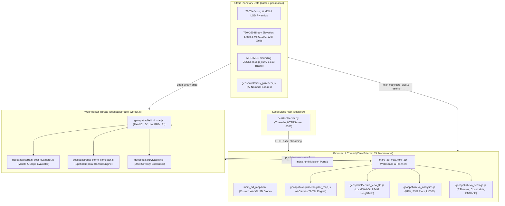

- **Frontend:** Vanilla ES6+ JavaScript, HTML5, CSS3 custom variable theming system (7 synchronized themes across `index.html`, `mars_2d_map.html`, `mars_3d_map.html`).
- **2D & 3D Graphics:** Custom 4-canvas 2D tiler (`equirectangular_map.js`) + custom raw WebGL shaders (`mars_3d_map.html` sphere & `terrain_view_3d.js` regional block), built directly on native browser Canvas and WebGL APIs.
- **Concurrency:** Module Web Worker (`geospatial/route_worker.js`) preventing UI blocking during multi-hundred-thousand-node terrain searches.
- **Local Server:** Python 3 `http.server.ThreadingHTTPServer` (`desktop/server.py`) + Windows `.bat` wrappers; no backend database required.

---

## ⚠️ Scientific Limitations & Disclaimers

1. **Academic & Simulation Scope Only:** EVA MARSWALK is an undergraduate competition prototype, not operational aerospace or flight-planning software.
2. **Global Grid Resolution vs. Meter-Scale Hazards:** Global `720 × 360` routing grids (`0.5°/px`, ~`30 km` equator cell spacing) and planetary DEM tiles resolve macro-topography (volcanic shields, chasm walls, large crater rims), not meter-scale boulders, soft regolith drifts, or sharp overhang hazards that require HiRISE/rover verification.
3. **Modeled Environmental Approximations:** Ambient pressure outside MCS tracks uses an isothermal hydrostatic scale height (`210 K`, omitting seasonal CO₂ frost condensation cycles and tropospheric lapse rates); ambient temperature and GCR attenuation use latitude/pressure proxies; dust storms are synthetic Gaussian hazard fields (`MODELED`).
4. **Static Battery Specification (`Not Modeled`):** PLSS battery labels (`20.5 V × 40 Ah / 820 Wh`) and `8.0 h` limits are static reference specifications; avionics/fan/heater electrical discharge is not simulated.
5. **Single-Leg Point-to-Point Optimization:** `Marswalk Planner` optimizes one leg (`Start → Destination`) per run rather than coupled outbound-plus-return closed loops; use **`⇅ Swap Start / Destination`** to evaluate return-leg asymmetry.

---

## 🚀 Future Developments

The following capabilities represent planned software integrations and conceptual mission-planning extensions—none are currently implemented as active hardware/orbital interfaces:

### In-App Hardware & Orbital Integration Roadmap (`Settings → Future Developments`)

| Capability | Classification | Technical Prerequisite |
|---|---|---|
| **1. Regional Offline Map Package Download** | `Planned` | IndexedDB multi-gigabyte blob chunking and client-side package extraction |
| **2. Live MRO Orbital Weather & Dust Telemetry** | `Planned` | NASA PDS open-access feed integration and planetary ephemeris relay |
| **3. Visual Odometry (VO) Landmark Tracking** | `Hardware Dependent` | Stereo suit/rover optical camera stream and real-time ORB-SLAM3 tracking |
| **4. 6-DOF IMU Inertial Navigation & Dead Reckoning** | `Hardware Dependent` | Tri-axial accelerometer and fiber-optic gyroscope hardware telemetry |
| **5. Celestial Navigation (Phobos & Deimos Triangulation)** | `Hardware Dependent` | Zenith-pointing star tracker optics and celestial ephemeris solver |
| **6. Physical Battery & Solar Array Consumption Controller** | `Hardware Dependent` | CAN-bus telemetry link to physical rover/PLSS power distribution units |
| **7. Subterranean Lava Tube Shelter Autonomous Routing** | `Scientific Data` | Validated ground-penetrating radar (`SHARAD` / `RIMFAX`) void database |
| **8. Real-Time Physiological Oxygen Sensor Integration** | `Hardware Dependent` | Biometric BLE pulse oximetry and suit pressure sensor streams |
| **9. Augmented Reality (AR) Visor Navigation HUD** | `Hardware Dependent` | WebXR-compatible optical waveguide helmet visor projection display |

### Conceptual Exploration Extensions
- **Non-Isothermal Atmospheric Model:** Seasonal solar longitude ($L_s$)-dependent CO₂ pressure oscillation and tropospheric temperature lapse rates.
- **Base Management, O₂ Resupply & Multi-Site Loop Planning:** Joint outbound-plus-return reachability checks, intermediate habitat/resupply nodes, and automatic contingency return recommendations.
- **Research-Priority & Equatorial Corridor Analysis:** Mineral/astrobiology science weighting and regional equatorial mobility corridor mapping.
- **WebXR & Multi-Agent Suit-Rover Cooperation:** Immersive VR terrain walkthroughs and coordinated human–robot traverse planning.

---

## 👥 Team & Acknowledgments

### Team AI-Powered
Undergraduate students from the **Ho Chi Minh University of Science (VNU-HCM), Vietnam** — *NASA Space Apps Challenge 2026*:
- Project Architecture, Geospatial Pathfinding & Full-Stack Engineering: **Team AI-Powered**

### Scientific Data & Technical Acknowledgments
- **NASA Planetary Data System (PDS) Geosciences Node** — `MGS MOLA` & `MRO MCS` planetary data archives
- **NASA Goddard Space Flight Center Planetary Geodesy Team** — `MRO120G / 120F` spherical harmonic gravity solutions
- **NASA xEMU / xEVAS Engineering Documentation** — suit mass, SWME pressure envelope, and O₂ reference guidelines  
  *(Reference archives collected in this [shared Drive folder](https://drive.google.com/drive/folders/1zfp6GEJgST5CYAE4ZpghkgAJ7kfVaqGo?usp=drive_link), with source PDFs linking back to official releases.)*
- [**NASA Mars Global Surveyor (MGS) MOLA DEM (`463 m`)**](https://astrogeology.usgs.gov/search/map/mars_mgs_mola_dem_463m)
- [**USGS Astrogeology Science Center — Viking MDIM 2.1 Colorized Mosaic (`232 m`)**](https://astrogeology.usgs.gov/search/map/mars_viking_colorized_global_mosaic_232m)
- [Coupled Physical & Mathematical Formulations](https://drive.google.com/file/d/1Mbj-ybad4u-FpCu4rIDO1XQtKZOsxyOg/view?usp=drive_link)

### Use of Artificial Intelligence (AI) Disclosure
AI coding and writing tools were used to assist with software engineering productivity and technical documentation drafting/editing. All scientific equations, codebase references, numerical constants, and architectural descriptions presented in this repository were audited directly against the implemented source code and bundled datasets.

---

## 📄 License & Open-Source Policy

**Status:** **No `LICENSE` file is currently committed in the repository root.**  
Open-source licensing terms remain **pending explicit selection and commit by the repository owner**. Until a formal `LICENSE` file is added to the repository, standard copyright defaults apply to unmodified repository contents, while bundled NASA/USGS planetary datasets remain subject to their respective U.S. Government / PDS public data policies.

---

<p align="center">
  <em>Developed for Mars exploration research &amp; education by Team AI-Powered • NASA Space Apps Challenge 2026</em>
</p>
