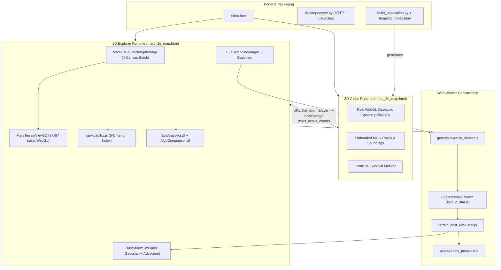
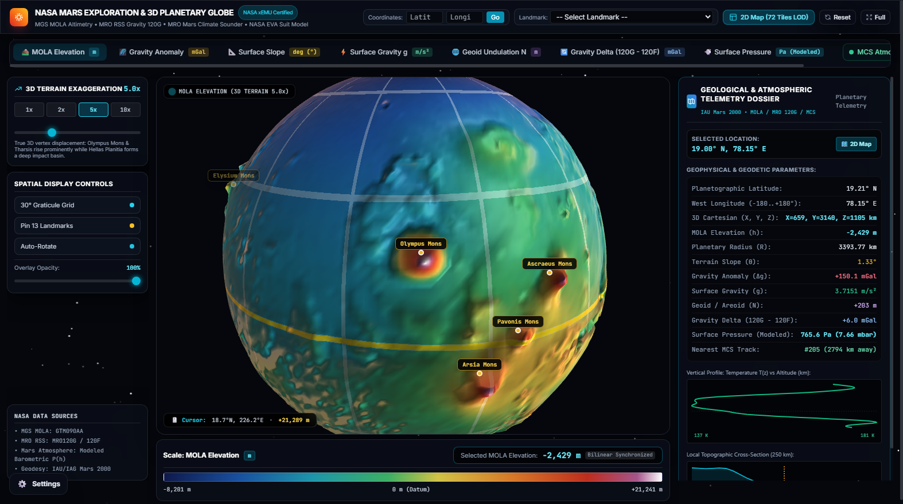
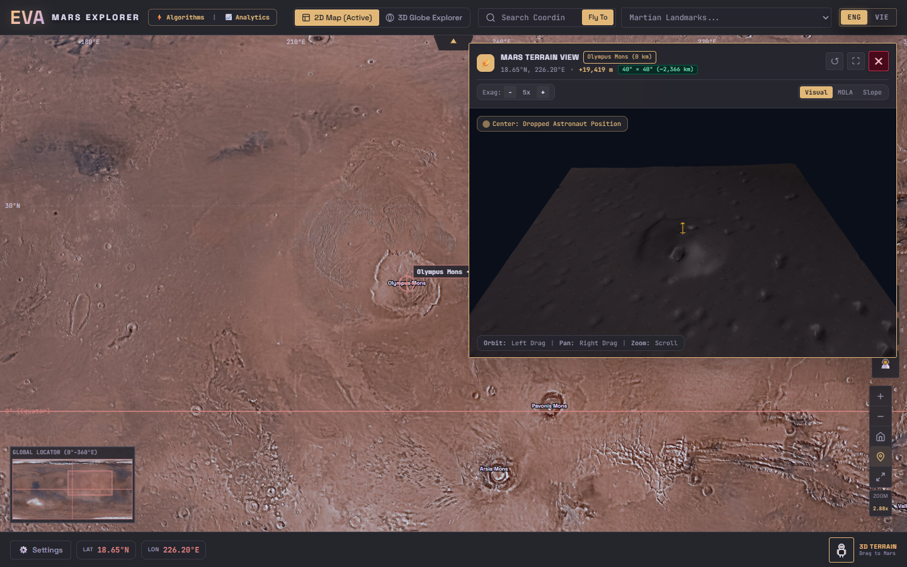
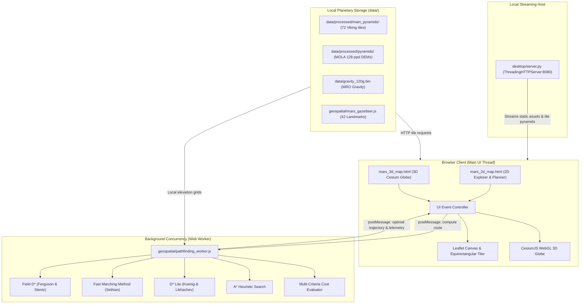

# EVA MARSWALK

<p align="center">
  
</p>

<p align="center">
  <strong>Autonomous Martian Surface Navigation, Extravehicular Activity (EVA) Route Planning & Astronaut Survivability Telemetry</strong>
</p>

<p align="center">
  <em>"Explore Mars. Navigate with Confidence. Always Find Your Way Home."</em>
</p>

<p align="center">
  
  
  
  
  
  
</p>

---

## 🌌 Overview & The Martian Challenge

When future astronauts step onto the surface of Mars, they will confront an environment vastly more unforgiving than the Moon: extreme topography with vertical canyon walls, razor-sharp crater rims, unpredictable regional dust storms, and a thin carbon-dioxide atmosphere offering minimal surface pressure. 

Every extravehicular activity (EVA) is bound by a strict life-support clock. An astronaut's **NASA Exploration Extravehicular Mobility Unit (xEMU)** suit carries a finite supply of electrical energy (battery), breathable oxygen ($O_2$), and water for thermal heat rejection. A miscalculated route up a $20^\circ$ incline can exhaust suit reserves miles before the astronaut reaches safety.

**EVA MARSWALK** was created by the **AI-Powered Team** — undergraduate students at the **Ho Chi Minh University of Science (VNU-HCM), Vietnam** — as an innovation project for the **NASA Space Apps Challenge 2026**.

The mission of EVA MARSWALK is simple yet critical: provide an intelligent, terrain-aware, multi-criteria surface navigation system that guides astronauts safely across real Martian topography. While conventional GPS-style planners merely search for the shortest distance, EVA MARSWALK optimizes across **topographic slope hazards**, **physiological metabolic work**, and **dynamic environmental threats**.

Most importantly, we put your safe return home after an EVA above all else — because exploring Mars is magnificent, but making it back to the habitat to tell the story is what truly matters.

---

## 📋 Table of Contents
- [✨ Key Features](#-key-features)
- [🧭 The Best Part: Marswalk Planner](#-the-best-part-marswalk-planner)
- [🧠 Pathfinding Algorithms Suite](#-pathfinding-algorithms-suite)
- [📸 Application Showcase & Screenshots](#-application-showcase--screenshots)
- [🚀 Quick Start & Installation](#-quick-start--installation)
- [🎮 Interactive Traversal Workflow](#-interactive-traversal-workflow)
- [🔬 Scientific Data & Methodology](#-scientific-data--methodology)
- [🛠️ Tech Stack & System Architecture](#-tech-stack--system-architecture)
- [⚠️ Scientific Limitations & Disclaimers](#-scientific-limitations--disclaimers)
- [🔭 Future Developments](#-future-developments)
- [👥 Team & Acknowledgments](#-team--acknowledgments)
- [📄 License & Open-Source Policy](#-license--open-source-policy)

---

## ✨ Key Features

- **🗺️ Mars 2D Global Explorer:** High-performance equirectangular planetary map powered by Leaflet and custom HTML5 canvas renderers, streaming 72 multi-resolution tiles of authentic NASA/USGS imagery.
- **🪐 Interactive 3D WebGL Globe:** Full 3D Mars globe powered by CesiumJS, projecting topographic relief, landmark overlays, and spherical harmonic gravity anomalies across a true planetary ellipsoid.
- **🧭 The Best Part: Marswalk Planner:** Point-to-point EVA navigation allowing explorers to set Start (Base/Habitat) and Goal (Science Site) waypoints with instant, terrain-aware route calculation.
- **🧠 4-Algorithm Pathfinding Showcase:** Select and benchmark four genuine graph and PDE algorithms: **Field D\*** (Ferguson & Stentz continuous-angle interpolation), **Fast Marching Method (FMM)**, **D\* Lite**, and **A\***.
- **🧑‍🚀 Astronaut Safety & Telemetry HUD:** Life-support simulation calibrated against official NASA xEMU suit specifications (battery capacity, $O_2$ consumption rates, and SWME thermal cooling limits).
- **🌪️ Dynamic Dust Storm Simulation & Avoidance:** Spawns moving 2D Gaussian dust storm cells across the map. If a storm threatens the planned route, the background engine dynamically replans a safe detour without freezing the UI.
- **🏃 Astronaut Movement Simulation:** Step-by-step interactive simulation animating the astronaut walking along the trajectory, with real-time HUD telemetry updates.
- **⛰️ Local 3D Terrain on the Spot:** Inspect local elevation relief directly under the astronaut's position to evaluate slope hazards before stepping foot on the slope. *(Note: You are modeled as an idealized point mass on this map, so even if you zoom out to maximum, don't expect an articulated spacesuit avatar!)*
- **📍 Mars Gazetteer & "Fly To" Navigator:** Jump to 42 officially recognized IAU/USGS Martian geological landmarks, including Olympus Mons, Jezero Crater, Gale Crater, and Valles Marineris.

# How Does EVA MARSWALK Work?

**EVA MARSWALK** is a client-side planetary geospatial exploration and autonomous Extravehicular Activity (EVA) path-planning application built for Mars surface navigation. Rather than optimizing purely for shortest geometric distance, its planning engine evaluates directed terrain transitions over **measured NASA/USGS Mars topography**, **modeled barometric pressure and physiological workload**, and **time-varying simulated dust storm hazards**, offloading route search and 4-algorithm benchmarking to a background Web Worker.

> **Important Scope Notice:** EVA MARSWALK is an engineering and scientific visualization prototype. While it uses authentic planetary datasets (such as MOLA topography, Viking imagery, MRO gravity harmonics, and MCS sounding records), its survivability thresholds, metabolic models, dust storms, and route safety checks are **simulation assumptions**, not flight-certified NASA operational mission planning guarantees.

---

## Tutorial Table of Contents

1. [Overview](#1-overview)
2. [System Architecture](#2-system-architecture)
3. [Scientific Data Pipeline](#3-scientific-data-pipeline)
4. [2D Explorer Engine](#4-2d-explorer-engine)
5. [3D Globe Engine](#5-3d-globe-engine)
6. [Terrain Analysis & Cost Modeling](#6-terrain-analysis--cost-modeling)
7. [Pathfinding Algorithms](#7-pathfinding-algorithms)
8. [Route Optimization & Post-Processing](#8-route-optimization--post-processing)
9. [Dynamic Environmental Hazards & Replanning](#9-dynamic-environmental-hazards--replanning)
10. [Astronaut Survivability, Physiology & Telemetry Analytics](#10-astronaut-survivability-physiology--telemetry-analytics)
11. [Settings, Profiles, Themes & Localization](#11-settings-profiles-themes--localization)
12. [Performance & Concurrency Design](#12-performance--concurrency-design)
13. [Scientific Assumptions, Limitations & Safety Disclaimers](#13-scientific-assumptions-limitations--safety-disclaimers)
14. [End-to-End Workflow](#14-end-to-end-workflow)

---

## 1. Overview

EVA MARSWALK separates **global planetary inspection** from **directed EVA surface navigation**:

- **Entry Selector (`index.html`):** Presents the mission portal linking to the two primary explorers and applying shared localization (`geospatial/i18n.js`) and theming (`geospatial/theme.js`, `geospatial/martian_theme.css`).
- **2D Global Explorer & Marswalk Planner (`mars_2d_map.html`):** The operational core of the application. It streams multi-resolution equirectangular Mars tile pyramids across a 4-layer HTML5 Canvas stack, hosts a local WebGL 3D terrain inspector ("Pegman" Street View), simulates moving dust storms, solves multi-criteria EVA routes on a non-blocking Web Worker (`geospatial/route_worker.js`), animates an astronaut/rover walker along the route, and runs live hazard replanning plus comparative 4-algorithm benchmarks.
- **3D Interactive Mars Globe (`mars_3d_map.html`):** A standalone WebGL displaced-sphere globe generated from `template_index.html` by `build_application.py`. It packs global 720×360 raster textures, MRO Mars Climate Sounder (MCS) atmospheric vertical temperature profiles, and an inline survivability HUD into a self-contained HTML view synchronized with the 2D Explorer by coordinates and active scientific layer.

Notably, the runtime web application uses **custom HTML5 Canvas 2D compositors and raw WebGL shaders** with ES modules—it does **not** load Leaflet or CesiumJS at runtime.

---

## 2. System Architecture

### Module & Runtime Topology



### Key Files & Responsibilities

| Component / File | Role in Live Application |
|---|---|
| `index.html` | Mission landing hub, theme/language initialization, synthesized Web Audio UI hover/click feedback, links to 2D and 3D apps. |
| `mars_2d_map.html` | Primary interactive UI: layer tabs, Gazetteer search, Fly To, Marswalk Planner controls, Walk Simulation loop, Storm Planner, and modal hosts. |
| `geospatial/equirectangular_map.js` | `Mars2DEquirectangularMap`: 4-canvas compositor (`canvasA`–`canvasD`), progressive pyramid tile streamer, LRU bitmap cache, Global Locator minimap (`190×95`), and route/storm overlays. |
| `geospatial/terrain_view_3d.js` | `MarsTerrainView3D`: on-demand `97×97` (`18,432`-triangle) WebGL local relief mesh opened via Pegman drag-and-drop or coordinate trigger. |
| `template_index.html` → `mars_3d_map.html` | Build-time template compiled by `build_application.py` with base64 720×360 layer textures, packed RG/BA topography+gravity buffer, landmarks, and MCS soundings. |
| `geospatial/route_worker.js` | Background Web Worker owning `EvaMarswalkRouter` instances, `DustStormSimulator` snapshots, max-slope / corridor config updates, route calculation, and 4-algorithm benchmarking. |
| `geospatial/field_d_star.js` | `EvaMarswalkRouter` (`FieldDStar` alias): implements Field D\*, D\* Lite, A\*, FMM, progressive 3-stage search expansion, 12-iteration corridor repair, and `runFourAlgorithmBenchmark`. |
| `geospatial/terrain_cost_evaluator.js` | Planetary geodesic distance, bilinear sampling, TRI/curvature, signed directional slope multiplier $K(\theta)$, Minetti-Mars metabolic energy, weighted transition cost, corridor safety scans, and route validation/simplification. |
| `geospatial/survivability.js` | `SCIENTIFIC_LAYERS` registry (8 layers), 19 `MARS_LANDMARKS`, 720×360 spherical-harmonic grid synthesis (`initSphericalHarmonicGrids`), raster sampler, and 2D 5-criterion `evaluateAstronautSurvival`. |
| `geospatial/atmospheric_pressure.js` | Isothermal barometric hydrostatic pressure model $P(h)$ and xEMU pressure envelope checks (`pds_pressure.js` is a thin compatibility wrapper delegating here). |
| `geospatial/dust_storm_simulator.js` | Moving 2D Gaussian optical depth $\tau$ and linear wind decay storm simulator with 48-hour temporal separation checks. |
| `geospatial/eva_analytics.js` & `algo_comparison.js` | Synchronized route physiology telemetry modal (`EvaAnalyticsUI`) and 4-algorithm trade-off benchmark modal (`AlgoComparisonUI`). |
| `geospatial/eva_settings.js`, `mars_gazetteer.js`, `theme.js`, `i18n.js` | Persistent settings (`eva_mars_settings`), 27-entry IAU/NASA Gazetteer, 7 CSS theme tokens, and EN/VI bilingual strings. |
| `desktop/server.py` | Optional local HTTP server (`ThreadingHTTPServer`) with clean caching/MIME headers and desktop launcher (`pywebview` or headless browser window). |

### Inter-Page State & Worker Messaging

- **2D ↔ 3D State Synchronization:** Both `mars_2d_map.html` and `template_index.html` share the active viewport target via URL query parameters (`?lat=<deg>&lon=<deg>&layer=<id>`) and `localStorage.getItem('mars_active_coords')`. Updating coordinates or layers updates navigation links (`mars_3d_map.html` / `mars_2d_map.html`) and calls `history.replaceState`. Settings (`eva_mars_settings`), active theme, language, algorithm choice (`eva_active_algorithm`), and movement profile (`eva_walker_profile`) are likewise persisted in `localStorage`.
- **Main Thread ↔ Worker Protocol:** `mars_2d_map.html` dispatches JSON messages to `geospatial/route_worker.js`: `INIT_PLANNER`, `UPDATE_STORMS`, `SET_MAX_SLOPE`, `CALCULATE_ROUTE` (supporting `isWalkingReplan`), `CANCEL_ROUTE`, and `RUN_BENCHMARK`. When `Worker` initialization fails (e.g., restricted `file://` contexts), `mars_2d_map.html` falls back asynchronously via `setTimeout` to an in-page `localPlanner` (`getLocalPlanner()`).

---

## 3. Scientific Data Pipeline

### Offline Preprocessing (`preprocessing/` & `build_application.py`)

Binary planetary grids (`720 × 360` float32 matrices at `0.5° × 0.5°` resolution, `259,200` cells) and high-resolution image pyramids are generated ahead of runtime:

1. `preprocessing/generate_textures.py` converts `data/*.bin` grids (`elevation`, `radius`, `slope`, `gravity_120g`, `surface_g`, `geoid_n`, `gravity_delta`) into 8-bit/16-bit PNGs and packed base64 buffers.
2. `preprocessing/build_tile_pyramids.py` / `build_high_performance_pyramids.py` validate all `72` $30^\circ \times 30^\circ$ source tiles (`6` latitude rows $\times$ `12` longitude columns) and emit multi-resolution image pyramids plus `data/dataset_manifest.json` and `data/main_manifest.json`.
3. `preprocessing/parse_mcs.py` parses Mars Climate Sounder (MCS) `DDR` profiles into `data/mcs_soundings.json`.
4. `preprocessing/process_thermal_inertia.py` quantizes the `7200 × 3600` THEMIS Nighttime IR GeoTIFF (`NightBmap2007.tif`) down to `data/thermal_inertia.bin`.
5. `build_application.py` reads `data/mola_elevation_meta.json`, `data/datasets_meta.json`, `data/mcs_tracks_summary.json`, `data/mcs_soundings.json`, and packed PNG/base64 textures to assemble `mars_3d_map.html`.

### Data Provenance & Live Usage Audit

A critical distinction in EVA MARSWALK is separating **measured planetary datasets** from **derived quantities**, **modeled estimates**, **visual effects**, and **legacy/unused repository files**:

| Asset / Quantity | Classification | Live Runtime Usage | Notes & Caveats |
|---|---|---|---|
| **MGS MOLA Elevation (`elevation.bin`, `elevation` pyramids L0–L3, packed RG texture)** | **Measured** (Gridded DEM) | Used in 2D map rendering, `terrain_cost_evaluator.js` pathfinding, `terrain_view_3d.js` local 3D mesh, and `mars_3d_map.html` globe displacement | Global MOLA GTM090AA / gridded elevation relative to areoid datum (`-16,081.2 m` to `+16,989.1 m` in `template_index.html`). |
| **Viking Orbiter MDIM 2.1 Color Mosaic (`main_manifest.json`, `main` pyramids L0–L2)** | **Measured** (Imagery) | Primary photographic base layer in 2D Explorer (`main`) and 3D Globe surface texture | Tile mosaic streamed progressively in 2D (`256×256` / tiled pyramid) and downscaled texture in 3D. |
| **MRO120G & MRO120F Gravity Harmonics (`gravity_120g`, `gravity_delta`, `geoid_n`, `surface_g`)** | **Measured / Spherical Harmonic Derived** | Displayed as switchable scientific layers (`gravity_120g`, `surface_g`, `geoid_n`, `gravity_delta`) in 2D and 3D; `surfaceG` & `radiusKm` shown in inspection HUD | `initSphericalHarmonicGrids()` in `survivability.js` also provides harmonic synthesis and base64 `72×36` offline fallbacks. |
| **Terrain Slope (`slope`), TRI, Curvature** | **Derived** | `slope` layer (`720×360`) + runtime central-difference & one-sided facet gradients inside `sampleBilinearSlope` & `computeLocalTerrainMetrics` | Pathfinding computes directional $\theta = \arctan(\Delta z / d_{xy})$ independently from intrinsic local cell steepness. |
| **MRO Mars Climate Sounder (`mcs_tracks_summary.json`, `mcs_soundings.json`)** | **Measured** (Orbital Profiles) | Embedded in `mars_3d_map.html` (`mars_3d_map` inspects nearest MCS track and renders vertical $T(\text{alt})$ SVG via `renderMcsVerticalChart`) | **3D Globe only.** Not used for 2D pathfinding or survival scoring. |
| **THEMIS Nighttime Thermal Inertia (`data/thermal_inertia.bin`)** | **Measured** (Loaded Raster) | Fetched into `this.thermalInertiaGrid` (`equirectangular_map.js`) & `meta.thermalInertiaGrid` (`survivability.js`) | Currently stored as an auxiliary grid; does not drive pathfinding edge costs or survivability equations. |
| **Atmospheric Pressure $P(h)$** | **Modeled Estimate** | Computed deterministically from MOLA elevation via isothermal barometric law (`atmospheric_pressure.js`) for `pressure` layer, edge constraints, and survival evaluation | Explicitly labeled `Atmospheric Pressure (Modeled)`. Does not include seasonal $\text{CO}_2$ cycle or weather fronts. |
| **Ambient Temperature $T$, Radiation Proxy, Baseline Dust $\tau$** | **Modeled Estimate** | Computed analytically from latitude, elevation, and modeled pressure in `survivability.js` and `template_index.html` | Empirical proxies, not real-time Mars weather observations. |
| **Dust Storm Simulation ($\tau$, wind speed)** | **Modeled / Synthetic** | User-placed or preset moving Gaussian storm cells in `DustStormSimulator` | Dynamic hazard overlay for replanning validation. |
| **PLSS Battery (`20.5 V / 40 Ah / 820 Wh`) & Humidity (`N/A`)** | **Static Reference / Unmodeled** | Shown in `EvaAnalyticsUI` metadata/comparison cards (`eva_analytics.js`) | Explicitly marked **Not Modeled** dynamically. |
| **3D Radial Relief (`5×` / `1×–15×` Exaggeration)** | **Visual Representation** | Radial vertex offset in `mars_3d_map.html` and local `MarsTerrainView3D` height scaling | Exaggerated purely for visual legibility; physics uses true unexaggerated meters. |
| **`eva/*.py`, `pds_climate_dataset.json`, `pds_pressure_mcs.json`, `tex_co2*`, `tex_h2o*`, `tex_dust*`, `tex_temperature*`, `tex_optical_depth*`, `tex_p_surf*`, `tex_tau_total*`** | **Unused Repository Assets** | **Not fetched, imported, or rendered** anywhere in the live web runtime (`pds_pressure.js` explicitly notes DDR climate layers were deprecated and removed) | Legacy/offline artifacts retained in the repo directory. |

### Missing, Out-of-Bounds & NoData Handling

- **Elevation NoData Guard:** Grid cells that are non-finite or satisfy $z \le \text{noDataVal} + 1.0$ (default `noDataVal = -9999.0` in `sampleBilinearElevation`) return `{ isValid: false, isNoData: true }`. If any corner of a bilinear interpolation stencil is invalid, `sampleBilinearElevation` propagates `isNoData: true` rather than fabricating topography.
- **Planner Strictness:** In `evaluateTerrainTransition`, `strictUnknown` defaults to `true`, rejecting transitions (`costMultiplier = Infinity`, `status = 'UNKNOWN'`) over invalid topography. Elevation profile SVGs in `eva_analytics.js` split `<polyline>` paths at `isNoData` points instead of drawing misleading straight lines across gaps.
- **Offline Graceful Fallback:** If `.bin` rasters cannot be fetched (for instance, restricted local file permissions), `survivability.js` falls back to embedded base64 `72×36` subgrids (`FALLBACK_GEOID_N_B64`, `FALLBACK_GDELTA_B64`) and packed RG/BA texture sampling.

---

## 4. 2D Explorer Engine

`Mars2DEquirectangularMap` (`geospatial/equirectangular_map.js`) renders Mars in an **equirectangular cylindrical projection** ($\lambda \in [0^\circ, 360^\circ\text{E}]$, $\phi \in [-90^\circ, +90^\circ]$) with seamless **East-West longitudinal wraparound** (`[x - worldW, x, x + worldW]` rendering passes when zoomed out or panning across $0^\circ / 360^\circ$).

### 4-Layer Canvas Compositor

To keep 60 FPS panning/zooming independent of animated walk/storm frames and HUD crosshairs, rendering is split across four stacked HTML5 canvases:

1. **`canvasA` (Static Base & Scientific Layer):** Draws the currently selected `SCIENTIFIC_LAYERS` raster/pyramid tiles, lat/lon graticule lines, and landmark place-name overlays. Only redrawn when zoom, pan, active layer, or newly decoded tiles arrive.
2. **`marsRouteCanvas` (`canvasB` — Route & Corridor Diagnostics):** Draws planned routes color-coded by segment safety status, rejected/corridor diagnostic overlays, Start (`S`) and Destination (`D`) pins, and corridor clearance boundaries.
3. **`marsSimCanvas` (`canvasC` — Dynamic Simulation Layer):** Continuously renders moving dust storm radial hazard rings/cores, the walked history breadcrumb path, and the animated EVA walker marker.
4. **`marsInteractionCanvas` (`canvasD` — Interaction & Locator HUD):** Draws the hover inspection crosshair, cursor telemetry tooltip, selection-mode banners (`Click map to set Start/Dest/Storm`), and the docked **`190×95` Global Locator Minimap** with a viewport bounding box and click-to-jump navigation.

### Progressive Multi-Resolution Tile Streaming

For `elevation` and `main` layers, `Mars2DEquirectangularMap` fetches `data/dataset_manifest.json` and `data/main_manifest.json` and selects discrete Level-of-Detail (LOD) pyramid levels dynamically using Screen-Space Error (projected pixel world width `worldW = baseScale * zoom * viewportWidth`):

| Layer | LOD 0 (Global Overview) | LOD 1 Threshold | LOD 2 Threshold | LOD 3 Threshold |
|---|---|---|---|---|
| **`elevation`** (`data/dataset_manifest.json`) | `< 550 px` | `>= 550 px` (`level_1`) | `>= 1,200 px` (`level_2`) | `>= 2,500 px` (`level_3`) |
| **`main`** (`data/main_manifest.json`) | `< 480 px` | `>= 480 px` (`level_0`/`level_1`) | `>= 1,000 px` (`level_2`) | `>= 2,200 px` (full-res `/main-tiles/`) |

Other layers (`slope`, `pressure`, `gravity_120g`, `surface_g`, `geoid_n`, `gravity_delta`) render from single global `720×360` rasters/textures. Visible tiles are prioritized radially from viewport center, limited to `maxConcurrentRequests = 6`, preempted cleanly via `AbortController` + `renderGeneration` tokens during rapid panning, and retained in LRU caches capped at `64` pyramid bitmaps and `6` full-resolution tiles.

### Gazetteer Search, Fly To & Local 3D Street View ("Pegman")

- **Mars Gazetteer (`geospatial/mars_gazetteer.js`):** Contains **27 curated IAU/NASA entries** (landing sites such as Jezero Crater / Perseverance, Gale Crater / Curiosity, Utopia Planitia, and geological landmarks like Olympus Mons and Valles Marineris). `normalizeLocationQuery()` strips diacritics and punctuation, `searchMarsGazetteer()` scores exact/prefix/substring/alias matches, and `validateMarsCoordinates()` parses decimal degrees or hemisphere-suffixed strings (`18.38°N, 77.58°E` or `-18.65, 226.2`, normalizing `W` longitudes into `[0, 360°E)`).
- **Target Selection:** Users can click a Gazetteer hit or press Fly To to smoothly center the 2D viewport and inspect terrain, or switch into interactive point-picking modes (`Set Start`, `Set Destination`, `Place Storm`, or drag-and-drop the Astronaut Pegman button).
- **Local 3D Terrain Street View (`geospatial/terrain_view_3d.js`):** Dropping Pegman (or triggering `openTerrainView3D(lat, lon)`) opens a regional WebGL modal building a **`97 × 97` vertex grid (`18,432` triangles)** spanning `extentDeg = 40°` (clamped `[4°, 60°]`) around the target coordinate. Relative elevation displacement is computed visually as:

$$
Z_{\text{visual}} = \left(\frac{z(r,c) - z_{\text{center}}}{1000}\right) \cdot E
$$

where $E$ is the user-adjustable vertical exaggeration (default `5.0x`, range `[1x, 15x]`). Three shader render modes (`0`: Viking mosaic, `1`: hypsometric elevation, `2`: slope hazard heatmap) share lighting with a central-difference normal field and an astronaut marker beacon at `(lat, lon)`.

---

## 5. 3D Globe Engine

The standalone 3D Globe (`mars_3d_map.html`, compiled from `template_index.html`) uses a **different rendering and survivability pipeline** from the 2D Explorer:

1. **Displaced Sphere Geometry (`template_index.html`):** Constructs a `120 × 240` latitude/longitude unit sphere mesh (**`29,161` vertices**).
2. **Vertex Shader Relief & Normal Perturbation (`vsSource`):** Reads a packed `720×360` RGBA data texture (`uPackedDataTexture`), decodes 16-bit normalized elevation from channels `(R, G)` via:

$$
\hat{e} = \frac{256 R + G}{257}, \qquad h = -16081.2 + \hat{e} \cdot (16989.1 - (-16081.2)) \text{ [m]}
$$

and radially displaces each sphere vertex outward along its unit normal:

$$
\mathbf{p}_{\text{disp}} = \mathbf{p} + \hat{\mathbf{n}} \cdot \left(\frac{h}{3{,}396{,}000} \cdot E \cdot 2.8\right)
$$

Surface normals are perturbed on the GPU using central finite differences across adjacent `1/720 × 1/360` texels scaled by `uExaggeration` (`E`) to create relief shadows under directional solar lighting plus a subtle Martian atmospheric rim term.

3. **Analytical Ray-Sphere Picking & Camera Controls (`handleRaycast`):** Dragging orbits yaw/pitch (`currentRotation`), scrolling adjusts `cameraDistance` within `[1.35, 4.8]`, and hovering/clicking casts a perspective ray (`45°` vertical FOV) against the **unit sphere** (`R = 1`) in camera space, rotating the intersection point back into Mars planetocentric `(lat, lon)` coordinates to sample the `720×360` raster buffers, plot a 250 km equatorial cross-section SVG (`renderCrossSection`), and look up the nearest MRO MCS orbital sounding (`mcsTracks` / `mcsSoundings`) to plot its vertical atmospheric temperature curve (`renderMcsVerticalChart`).
4. **2D vs 3D Survival Monitor Divergence:** While both share `localStorage.mars_active_coords` (`lat`, `lon`, `layer`), `mars_3d_map.html` retains its own inline threshold monitor returning discrete statuses **`SAFE` (`92`), `UNCERTAIN` (`68`), `DANGEROUS` (`38`)**, whereas `mars_2d_map.html` imports `geospatial/survivability.js` returning continuous piecewise scores (`0–100`) and **`SAFE`, `CAUTION`, `UNSAFE`, `UNKNOWN`**.

---

## 6. Terrain Analysis & Cost Modeling

All pathfinding algorithms in `geospatial/field_d_star.js` call the exact same unified evaluator **`evaluateTerrainTransition(fromPt, toPt, terrainData, profile, weights, options)`** inside `geospatial/terrain_cost_evaluator.js`.

### Geographic Mapping & Mars Surface Distance

For a global grid of dimensions $(R, C) = (360, 720)$ (`0.5°` pixel spacing, $\approx 29{,}600\text{ m}$ at the equator), continuous pixel-center row/column coordinates $(r, c)$ map bidirectionally to planetocentric `(lat, lon)`:

$$
\text{lat} = 90^\circ - \frac{r + 0.5}{R} \cdot 180^\circ, \qquad \text{lon} = \left(\frac{c + 0.5}{C} \cdot 360^\circ\right) \bmod 360^\circ
$$

Horizontal great-circle distance $d_{xy}$ between points $u = (\phi_u, \lambda_u)$ and $v = (\phi_v, \lambda_v)$ uses the **Mars spherical Haversine formula** with wrapped longitudinal delta $\Delta\lambda \in [-\pi, \pi]$ and reference radius $R_M = 3{,}396{,}190.0\text{ m}$ (`MARS_RADIUS_M`):

$$
a = \sin^2\!\left(\frac{\Delta\phi}{2}\right) + \cos\phi_u \cos\phi_v \sin^2\!\left(\frac{\Delta\lambda}{2}\right), \qquad d_{xy} = 2 R_M \operatorname{atan2}\!\left(\sqrt{a},\, \sqrt{1 - a}\right)
$$

### Elevation, Local Steepness, TRI & Curvature

1. **Bilinear Elevation (`sampleBilinearElevation`):** Samples the `2×2` surrounding grid cell with clamped latitude rows and modular longitude wraparound (`(c0 + 1) % cols`). Any non-finite or `-9999.0` corner flags `isNoData = true`.
2. **Intrinsic Local Steepness (`sampleBilinearSlope` & `computeLocalTerrainMetrics`):** Combines bilinearly interpolated precomputed `slopeGrid` with a half-cell (`step = 0.5`) 2D central gradient:

$$
\frac{\partial z}{\partial x} = \frac{z(r, c + 0.5) - z(r, c - 0.5)}{\Delta x_M}, \qquad \frac{\partial z}{\partial y} = \frac{z(r + 0.5, c) - z(r - 0.5, c)}{\Delta y_M}, \qquad \theta_{\text{central}} = \arctan\!\left(\sqrt{\left(\frac{\partial z}{\partial x}\right)^2 + \left(\frac{\partial z}{\partial y}\right)^2}\right)
$$

where $\Delta y_M = \pi R_M / R$ and $\Delta x_M = (2\pi R_M \max(0.05, \cos\phi))/C$, plus an **8-neighbor one-sided facet maximum** and **Terrain Ruggedness Index ($\text{TRI}$)**:

$$
\text{TRI} = \sqrt{\frac{1}{N_{\text{valid}}} \sum_{k=1}^{8} (z_k - z_0)^2}
$$

and local topographic Laplacian curvature (distinguishing ridge crests from basin floors). Taking $\max$ over `slopeGrid`, central gradient, and one-sided facets guarantees sharp crater rims and scarps cannot cancel across symmetric cells.

### Directed Signed Slope & Asymmetric Piecewise Multiplier $K(\theta)$

Along an edge $u \to v$, elevation difference is $\Delta z = z_v - z_u$, and the signed directional slope angle $\theta$ (in degrees) is:

$$
s = \frac{\Delta z}{\max(0.25,\, d_{xy})}, \qquad \theta = \frac{180}{\pi}\arctan(s)
$$

- $\theta > 0$: **Uphill**
- $\theta < 0$: **Downhill**
- $|\theta| \le 1^\circ$: **Near-Flat (`FLAT`)**

Because descending steep loose regolith poses a forward slip/tumbling hazard for an EVA suit with high center of mass, `evaluateDirectionalSlopeCost` applies **asymmetric hard thresholds** derived from user setting $\theta_{\max} = \text{maxSafeSlopeDeg}$ (default `22.0°`, range `[5°, 35°]`):

- **Uphill hard limit:** $\theta_{\max,\text{up}} = \theta_{\max}$
- **Downhill hard limit:** $\theta_{\max,\text{down}} = 0.75\,\theta_{\max}$ (`16.5°` at default `22°`)
- **Reference slope:** $\theta_{\text{ref}} = 0.4\,\theta_{\max}$ (`8.8°`), **Downhill reference:** $\theta_{\text{ref,down}} = 0.5\,\theta_{\text{ref}} = 0.2\,\theta_{\max}$ (`4.4°`)

The piecewise directional cost multiplier $K(\theta)$ is:

$$
K(\theta) = \begin{cases}
1 + \dfrac{\theta}{\theta_{\text{ref}}}, & 0 \le \theta \le \theta_{\text{ref}} \quad (\text{Uphill SAFE}) \\[8pt]
2 + 4p + 6p^2,\quad p = \dfrac{\theta - \theta_{\text{ref}}}{\theta_{\max,\text{up}} - \theta_{\text{ref}}}, & \theta_{\text{ref}} < \theta \le \theta_{\max,\text{up}} \quad (\text{Uphill CAUTION}) \\[8pt]
+\infty\ (\text{REJECT\_EDGE}), & \theta > \theta_{\max,\text{up}} \quad (\text{Uphill UNSAFE}) \\[8pt]
1 - 0.25\,\dfrac{|\theta|}{\theta_{\text{ref,down}}}, & -\theta_{\text{ref,down}} \le \theta < 0 \quad (\text{Gentle Downhill SAFE}) \\[8pt]
0.75 + 5q^2,\quad q = \dfrac{|\theta| - \theta_{\text{ref,down}}}{\theta_{\max,\text{down}} - \theta_{\text{ref,down}}}, & -\theta_{\max,\text{down}} \le \theta < -\theta_{\text{ref,down}} \quad (\text{Steep Downhill CAUTION}) \\[8pt]
+\infty\ (\text{REJECT\_EDGE}), & |\theta| > \theta_{\max,\text{down}} \quad (\text{Downhill UNSAFE})
\end{cases}
$$

Note the small energy-saving gravity assist on gentle descents ($K$ drops down to `0.75` at $-\theta_{\text{ref,down}}$) before rising quadratically up to `5.75` at the downhill limit (and up to `12.0` at the uphill limit).

### Mars-Calibrated Minetti Metabolic Energy Model

`estimateTransitionEnergy` computes biomechanical walking work in Joules using Minetti et al.'s specific-energy polynomial $C_W(i)$ ($\text{J}/(\text{kg}\cdot\text{m})$) evaluated on clamped gradient $i = \operatorname{clamp}(\Delta z / d_{xy},\, -0.6,\, 0.6)$:

$$
C_{\text{Earth}}(i) = 280.5\,i^5 - 58.7\,i^4 - 218.4\,i^3 + 43.3\,i^2 + 9.6\,i + 1.88
$$

Because Mars surface gravity ($g_M = 3.721\text{ m/s}^2$, $g_M/g_E \approx 0.3794$) reduces gravitational vertical work while inertial leg-swing and horizontal gait losses persist (~62% inertial weighting), specific Martian cost is scaled as:

$$
C_{\text{Mars}}(i) = \max\!\left(1.1,\; C_{\text{Earth}}(i) \cdot \left(0.38 + 0.62\,\frac{g_M}{g_E}\right)\right), \qquad E_{\text{trans}} = C_{\text{Mars}}(i) \cdot m_{\text{total}} \cdot d_{xy}
$$

where $g_E = 9.80665\text{ m/s}^2$ and default astronaut `astronaut` total mass $m_{\text{total}} = 135\text{ kg}$ ($70\text{ kg}$ body $+ 15\text{ kg}$ payload $+ 50\text{ kg}$ xEMU/PLSS).

### Adaptive Sub-Edge Sampling & Combined Transition Cost

Longer edges ($d > 1$ cell, sub-grid diagonal chords, or simplified route legs) are subdivided into `sampleSteps = clamp(ceil(gridDist * 8.0), 8, 64)` intermediate intervals so narrow crater rims or valleys cannot be "tunneled" across endpoints. Across these samples, the evaluator tracks:
- `totalAbsVerticalM`: total $|\Delta z|$ climbed and descended along sub-steps,
- `oscillationM` $= \max(0,\, \text{totalAbsVerticalM} - |\text{elevEnd} - \text{elevStart}|)$,
- mean local slope $\bar{\theta}_{\text{local}}$ and mean $\overline{\text{TRI}}$,
- worst storm $\tau$, wind, 48-hour violation, and destination modeled barometric pressure $P(h_{\text{end}})$.

Normalizing against one equatorial $0.5^\circ$ grid cell ($L_{\text{cell}} = 29{,}600\text{ m}$):

$$
\tilde{d} = \frac{d_{xy}}{29{,}600}, \qquad \text{cost}_{\text{struct}} = \tilde{d}\cdot\Big(C_{\text{climb}} + C_{\text{osc}} + C_{\text{steep}} + C_{\text{rough}}\Big)
$$

$$
C_{\text{climb}} = \mathbb{I}(\Sigma|\Delta z| > 5)\, w_{\text{elev}}\,0.45\,\frac{\Sigma|\Delta z|}{320}, \qquad C_{\text{osc}} = \mathbb{I}(\text{osc} > 8)\, w_{\text{elev}}\,0.85\,\frac{\text{osc}}{180}
$$

$$
C_{\text{steep}} = \mathbb{I}(\bar{\theta}_{\text{local}} > 0.35)\, w_{\text{slope}}\,0.38\,\left(\frac{\bar{\theta}_{\text{local}}}{\max(2,\theta_{\text{ref}})}\right)^{1.3}, \qquad C_{\text{rough}} = \mathbb{I}(\overline{\text{TRI}} > 6)\, w_{\text{rough}}\,0.45\,\frac{\overline{\text{TRI}}}{160}
$$

$$
C_{\text{energy}} = w_{\text{energy}}\cdot 0.25 \cdot \frac{E_{\text{trans}}}{1.156 \cdot m_{\text{total}} \cdot 29{,}600}
$$

Combining base cost and the blended directional slope multiplier $K_{\text{eff}}$:

$$
\text{cost}_{\text{base}} = \max\!\Big(10^{-4},\; w_{\text{dist}}\,\tilde{d} + C_{\text{energy}} + \text{cost}_{\text{struct}} + w_{\text{safety}}\,(P_{\text{safety}} + P_{\text{corridor}})\Big)
$$

$$
\text{Cost}(u \to v) = \text{cost}_{\text{base}} \cdot K_{\text{eff}}(\theta)
$$

Here $P_{\text{safety}}$ adds `0.15` for CAUTION barometric pressure, `3.0` for non-strict NoData, and `3.5` for CAUTION dust storm exposure; any UNSAFE slope, pressure (`< 180 Pa` or `> 1150 Pa`), storm ($\tau \ge 2.0$, $v > 100\text{ km/h}$, or `< 48h` buffer violation), or blocked corridor cell marks `traversable = false` ($\text{Cost} = +\infty$).

---

## 7. Pathfinding Algorithms

`EvaMarswalkRouter` (`geospatial/field_d_star.js`) builds a unified search grid over the `360 × 720` planetary matrix with **east-west wraparound** (`wrapCols = true`). Before searching (`_buildSearchContext`), endpoints are snapped within up to a 10-cell radius if seated on NoData or severe storm cores (`_snapEndpoint`), and **adaptive sub-grid refinement** activates in Stage 1 for shorter/rugged Marswalks (provided no huge $\ge 300\text{ km}$ storm expands the needed detour box): `subStep = 0.25` when `gridDist <= 8.5` cells, or `subStep = 0.5` when `gridDist <= 16.0` and terrain variation exceeds `12 m` (or `gridDist < 3.5`).

All four selectable algorithms share the same `evaluateTerrainTransition` physics and `BinaryMinHeap` priority queues:

### 1. Field D\* (`field_dstar` — Default)
- **Implementation Reality:** `_runFieldDStar` is a **genuine continuous-angle reverse incremental search** following Ferguson & Stentz (2005), NOT a wrapper around D\* Lite. It maintains $g(s)$, $\text{rhs}(s)$, a two-part priority key `[min(g, rhs) + h, min(g, rhs)]`, and exposes `replanFieldDStar(changedCells, terrainGrid, ...)` for incremental graph updates.
- **Continuous Neighbor-Pair Interpolation (`computeFieldDStarInterpolatedTransition`):** Instead of snapping paths solely to discrete $45^\circ$ grid centers, for each of the 8 ordered consecutive neighbor pairs $(s_1, s_2)$ around node $s$ (checking both direct center-to-neighbor and triangle-edge crossings), it evaluates $c \cdot d_{\text{edge}} + g(s_k)$ using local Euclidean chord approximations of Haversine edge lengths $(d_1, d_2, b)$ and solves the analytical interior minimizer when $0 < f = g(s_1) - g(s_2) \le b$ and $c \cdot d_2 > f$ (with symmetric swap for $g_2 > g_1$):

$$
y^* = \min\!\left(1,\; \frac{f \cdot d_1}{d_2 \sqrt{(c \cdot d_2)^2 - f^2}}\right), \qquad \text{total} = c\sqrt{d_1^2 + (y^* d_2)^2} + g(s_2) + (1 - y^*)f
$$

If optimal $y^*$ lies in $(0, 1)$, an intermediate fractional crossing point on edge $(s_1, s_2)$ is stored (`interpTarget`).
- **Path Extraction & Post-Processing:** Traces backward from `start` along stored fractional edge crossings (`maxIter = 8000`, `visitedFrac` loop prevention) and applies **`simplifyRouteTerrainAware`** (`maxSpan = 3`) **only for Field D\***, eliminating redundant collinear micro-vertices if and only if all 7 terrain safety and cost checks pass.

### 2. D\* Lite (`dstar_lite`)
- **Implementation Reality:** `_runDStarLite` implements Koenig & Likhachev's reverse incremental 2-key search propagating from `goal` (`rhs(goal) = 0`) toward `start` with heuristic focus on `start`.
- **Directional Symmetry Preservation:** Because edge costs in EVA MARSWALK are **asymmetric** ($K(+\theta) \ne K(-\theta)$), when updating vertex `u` from backward predecessor/neighbor `n`, `_runDStarLite` explicitly evaluates `evaluateTerrainTransition(u, n)` in the **forward astronaut travel direction (`u -> n`)** rather than reversing costs. No diagonal corner-cutting check or post-simplification is applied.

### 3. A\* (`astar`)
- **Implementation Reality:** `_runAStar` is a standard forward 8-connected weighted-graph heap search from `start` to `goal` with admissible Euclidean grid heuristic (`hWeightScaleAStar`) scaled to match the active normalized movement floor (`0.70 * max(0.25, wDist + 0.23 * wEnergy)`) and **diagonal corner-cutting prevention** (blocking diagonal steps if both adjacent orthogonal cardinal cells are non-traversable). Produces unsmoothed grid-center trajectories.

### 4. Fast Marching Method (`fmm`)
- **Implementation Reality:** `_runFMM` implements an isotropic **forward upwind Eikonal solver** computing arrival times $T(u)$ from `start` (`T = 0`) across `UNVISITED / NARROW_BAND / FROZEN` states.
- **2D Quadratic Upwind Update:** Using cardinal frozen neighbors ($t_H = \min(T_L, T_R)$, $t_V = \min(T_U, T_D)$) and local inverse speed $1/F$ mapped from average cardinal transition cost (`cost / stepSpan`), whenever $|t_H - t_V| < 1/F$ it solves the 2D Eikonal quadratic:

$$
T_{\text{new}} = \frac{1}{2}\left(t_H + t_V + \sqrt{2\,(1/F)^2 - (t_H - t_V)^2}\right)
$$

otherwise falling back to the 1D upwind step $\min(t_H, t_V) + 1/F$.
- **Gradient Descent Extraction (`parentMap` Guarded):** Backtracks from `goal` to `start` picking neighbors that strictly decrease $T$ **and** pass forward `evaluateTerrainTransition(n, current)` checks (falling back to `parentMap` if local gradient stalls on anisotropic slope barriers). No post-simplification is applied.

### Algorithm Comparison Summary

| Algorithm | Search Direction & Space | Continuous Angles? | Diagonal Corner-Cutting Guard | Post-Simplification | Characteristic Trade-Off on Mars |
|---|---|---|---|---|---|
| **Field D\*** | Reverse incremental, edge-pair interpolation | **Yes** (`computeFieldDStarInterpolatedTransition`) | Via `isBlocked` edge-pair checks | **Yes** (strict 7-condition `simplifyRouteTerrainAware`) | Smoothest non-grid-bound paths and avoids jagged stair-stepping around craters; higher per-node arithmetic. |
| **D\* Lite** | Reverse incremental, 8-neighbor discrete grid | No | No | No | Reuses incremental search machinery cleanly under asymmetric forward slope checks; discrete $45^\circ$ headings. |
| **A\*** | Forward single-source heap search, 8-neighbor grid | No | **Yes** | No | Fast goal-directed expansion on simple open plains; discrete $45^\circ$ headings (`zigzag` artifacts on diagonals). |
| **FMM** | Forward Eikonal wavefront (`T` arrival field) | Wavefront continuous; extraction is grid-step | **Yes** (on extraction/band checks) | No | Models continuous anisotropic speed wavefronts well; slightly heavier narrow-band updates and relies on directional fallback in steep ravines. |

---

## 8. Route Optimization & Post-Processing

### Optimization Presets & Weight Tuning Nuances

In `geospatial/terrain_cost_evaluator.js`, `OPTIMIZATION_PROFILES` defines continuous internal profile weights:

| Profile Key | `safety` | `slope` | `elevation` | `distance` | `energy` | `roughness` |
|---|---|---|---|---|---|---|
| `min_risk` | `4.5` | `3.0` | `1.5` | `0.8` | `0.8` | `1.0` |
| `balanced` | `2.5` | `2.0` | `2.0` | `1.5` | `1.5` | `1.0` |
| `min_energy` | `2.0` | `3.5` | `2.5` | `1.0` | `4.5` | `1.0` |
| `min_distance` | `1.5` | `1.0` | `0.5` | `5.0` | `0.5` | `0.5` |

In the 2D Explorer UI (`mars_2d_map.html`), `<select id="routeObjectiveSelect">` exposes four user-facing options (`min_risk`, `min_energy`, `min_elevation`, `balanced`) paired with `OBJECTIVE_PRESETS` percentage sliders (`0–100%` summing to `100`):

| UI Option (`routeObjectiveSelect`) | Risk | Elev Var | Slope | Roughness | Distance | Energy |
|---|---|---|---|---|---|---|
| **`min_risk`** (Default) | `35%` | `25%` | `20%` | `10%` | `5%` | `5%` |
| **`min_energy`** | `10%` | `25%` | `20%` | `15%` | `15%` | `15%` |
| **`min_elevation`** | `10%` | `45%` | `20%` | `10%` | `10%` | `5%` |
| **`balanced`** | `25%` | `25%` | `20%` | `10%` | `10%` | `10%` |

*(Implementation detail: `EvaMarswalkRouter.setObjective()` falls back to `OPTIMIZATION_PROFILES.balanced` for `'min_elevation'`, while the live UI planner passes the explicit `0–100` slider weights into `routeConfig.weights`, which directly override `OPTIMIZATION_PROFILES` in `evaluateTerrainTransition`.)*

### 3-Stage Progressive Expansion & Strict-to-Relaxed Fallback

`EvaMarswalkRouter.findRoute()` never silently returns unsafe shortcuts:
1. **Progressive Node Budgets:** Searches within `30,000 ms` total wall-clock budget across up to 3 expansion stages (`350,000`, `750,000`, and `1,500,000` node expansions, broadening geographic bounding windows progressively and falling back to full planetary grid at Stage 3).
2. **Strict-SAFE First (`allowCaution = false`):** If both endpoints lie on `SAFE` terrain and the user has not forced relaxed mode, Stage 1 searches strictly on `SAFE` edges (`strictSafeOnly = true`). Only if no pure-SAFE path exists—and `allowCaution` is permitted—does it allow `CAUTION` edges weighted by rising $K(\theta)$.

### 3-Radius Corridor Safety Scanner & Iterative Repair

After an algorithm returns a candidate path, `findRoute()` evaluates wide-area neighborhood safety—not just the razor-thin 1D line—via `evaluateRouteCorridor` (`evaluateSegmentCorridorSafety` in `geospatial/terrain_cost_evaluator.js`):
- At `alongSteps = clamp(ceil(gridDist * 2.5), 2, 12)` intermediate stations along each leg, it samples **3 concentric safety rings** around user clearance $C = \text{routeSafetyClearanceM}$ (default `30,000 m`, clamped `[0, 120,000 m]`):
  - Inner ring $r_1 = 0.40\,C$
  - Intermediate ring $r_2 = 0.75\,C$
  - Outer boundary $r_3 = 1.00\,C$ (plus extended probe $r_{\text{ext}} = \max(1.4\,C, 38{,}000\text{ m})$)
  across **8 radial azimuths ($45^\circ$ increments)**.
- **Corridor Rejection Gates:** A candidate path is rejected if:
  1. `unknownCoverage > maxUnknownCoverage` (default `0.15` → `REJECTED_UNKNOWN_COVERAGE`),
  2. Immediate inner-ring UNSAFE detections (`unsafeImmediateCount > 0`), **narrow channel pinches** (opposing radial rays $k$ and $k+4$ both UNSAFE at $r_2$), cliff drops ($|\Delta z| > 480\text{ m}$ and steep), or excessive intermediate/global UNSAFE density (`> 0.12` / `> 0.06`) → `REJECTED_UNSAFE_PROXIMITY`, or
  3. Elevated `cautionDensity > maxCautionDensity` (default `0.35`) or continuous widespread CAUTION exposure (`REJECTED_RISK_DENSITY`).
- **12-Iteration Corridor Replanning Loop:** On corridor failure, `_penalizeOffendingCorridorSegments` blocks (`blockedCells`) or adds escalating soft penalties (`corridorPenaltyMap`) around offending cells and re-runs the solver up to `12` iterations until a clean corridor passes `validateFinalRouteCorridor` (or reports `NO_SAFE_PATH` / `CORRIDOR_SAFETY_VIOLATION`).

### Terrain-Aware Simplification & Smoothness Metric

For Field D\*, `simplifyRouteTerrainAware` attempts greedy shortcutting (`maxSpan = 3`), accepting a shortcut $A \to B$ **only if** all 7 invariants hold simultaneously:
1. Shortcut `traversable === true` and status $\ne$ `UNSAFE` / `UNKNOWN`,
2. Shortcut does not introduce `CAUTION` onto an otherwise `SAFE` chain,
3. Shortcut distance does not exceed original chain distance ($+2\%$),
4. Peak uphill/downhill slope does not worsen beyond $+1.5^\circ$,
5. Total vertical elevation excursion does not increase beyond $+15\text{ m}$,
6. Transition cost does not worsen beyond $+3\%$, and
7. `evaluateSegmentCorridorSafety` passes for the shortcut leg.

Path geometry quality is quantified by **`computePathSmoothness`** (`0–100` score), derived from mean and peak heading turn angles ($\Delta \psi_i \in [0^\circ, 180^\circ]$) and turn-reversal frequency across consecutive segments.

---

## 9. Dynamic Environmental Hazards & Replanning

### Dust Storm Simulator (`geospatial/dust_storm_simulator.js`)

`DustStormSimulator` manages moving mesoscale storms parameterized by 4 presets:

| Preset | Peak $\Delta\tau_{\max}$ | Peak Wind $\Delta v_{\max}$ | Drift Speed | Footprint Radius $R$ |
|---|---|---|---|---|
| **`weak`** | `1.0` | `30 km/h` | `15 km/h` | `120 km` |
| **`moderate`** | `2.0` | `50 km/h` | `25 km/h` | `200 km` |
| **`strong`** | `3.5` | `75 km/h` | `40 km/h` | `320 km` |
| **`severe`** | `5.5` | `110 km/h` | `55 km/h` | `500 km` |

Each storm center advances over simulation time $t$ (hours) along great-circle `forwardGeodesic` azimuth trajectories (`directionDeg`, `speedKmH`). At distance $d$ (Haversine km) from storm center with temporal envelope $I(t)$ (active within `[startTimeHrs, startTimeHrs + durationHrs]`):

$$
\tau(d, t) = \tau_{\text{base}} + \sum_{k} \Delta\tau_{\max,k}\, I_k(t)\,\exp\!\left(-\left(\frac{d_k}{R_k}\right)^2\right), \qquad \tau_{\text{base}} = 0.35
$$

$$
v(d, t) = v_{\text{base}} + \max_{k}\!\left(\Delta v_{\max,k}\, I_k(t)\,\max\!\left(0,\, 1 - \frac{d_k}{R_k}\right)\right), \qquad v_{\text{base}} = 10.0\text{ km/h}
$$

- **Optical Depth Thresholds:** $\tau < 1.5$ → `SAFE`; $1.5 \le \tau < 2.0$ → `CAUTION`; **$\tau \ge 2.0$ → `UNSAFE` (hard exclusion)**.
- **Wind Speed Thresholds:** $v \le 40\text{ km/h}$ → `SAFE`; $40 < v \le 100\text{ km/h}$ → `CAUTION`; **$v > 100\text{ km/h}$ → `UNSAFE`**.
- **48-Hour Spatiotemporal Separation (`getStormExposureWindow`):** Estimates whether a storm footprint ($d \le R$) intersects location `(lat, lon)` over `[enterTime, exitTime]` and rejects arrivals violating:

$$
t_{\text{arr}} < t_{\text{enter}} - 48\text{ h} \quad \text{OR} \quad t_{\text{arr}} > t_{\text{exit}} + 48\text{ h}
$$

### Live Walking Simulation & Replanning Behavior

During `startWalkSim()` (`mars_2d_map.html`), an animation loop advances simulated distance $s(t)$ via binary search over cumulative segment distances (`routeCumDistM`), accelerating real-time playback (`0.5×` to `200×`, default `20×` simulation multiplier) while evaluating storm hazards ahead on the remaining path every `>= 500 ms` via **`checkWalkingReplanning()`**:

1. Samples remaining legs ahead of `currentWalkerCoords` at current `simTime`.
2. If any point triggers $\tau \ge 2.0$, $v > 100\text{ km/h}$, or `violates48hBuffer`:
   - **Immediate Safety Halt:** Calls `pauseWalkSim()`, sets `isReplanningActive = true`, and shows an alert banner.
   - **Fresh Worker Re-Solve:** Posts a **`CALCULATE_ROUTE`** (`isWalkingReplan: true`) request to `routeWorker` from `currentWalkerCoords` to `state.destPoint`. *(Architecture note: although `EvaMarswalkRouter` implements an incremental `replanFieldDStar()` method, the live UI walking monitor triggers a fresh full worker `findRoute` calculation so that all 4 selectable algorithms, corridor safety validation, and storm states stay unified.)*
3. If replanning fails (`NO_SAFE_PATH`), enforces a cooldown (`REPLAN_FAILURE_COOLDOWN_MS`) until storms drift by `>= 4°`, then resumes automatically when a detour clears.

---

## 10. Astronaut Survivability, Physiology & Telemetry Analytics

### Modeled Barometric Pressure (`geospatial/atmospheric_pressure.js`)

All atmospheric pressure queries in the 2D Explorer and pathfinding engine use the isothermal hydrostatic equation relative to MOLA datum ($h_0 = 0\text{ m}$, $P_0 = 610.0\text{ Pa}$, $T = 210.0\text{ K}$, $M_{\text{CO}_2} = 0.04401\text{ kg/mol}$, $g = 3.71\text{ m/s}^2$, $R = 8.314462618\text{ J/(mol}\cdot\text{K)}$):

$$
H = \frac{R T}{M_{\text{CO}_2} g} \approx 10{,}693.7\text{ m}, \qquad P(h) = P_0 \exp\!\left(-\frac{h - h_0}{H}\right)
$$

Modeled xEMU pressure zones: **SAFE** $[400.0,\, 611.65]\text{ Pa}$ (water triple point ceiling for SWME heat rejection), **CAUTION** $[180.0,\, 400.0)$ or $(611.65,\, 1150.0]\text{ Pa}$, **UNSAFE** $< 180.0\text{ Pa}$ or $> 1150.0\text{ Pa}$.

### 2D Survivability Scoring Engine (`geospatial/survivability.js`)

For point inspection, `evaluateAstronautSurvival` models ambient temperature ($T_{\text{est}}$ from latitude & elevation), baseline dust, $P(h)$, and cosmic radiation attenuation proxy ($\text{Rad}(P) = 0.50 + 0.35\,[1 - \operatorname{clamp}((P - 100)/1150,\, 0,\, 1)]\text{ mSv/day}$), scoring each criterion via **normalized proximity $p$** relative to perfect band $[X_{\text{p,min}}, X_{\text{p,max}}]$ and hard limit $X_{\text{limit}}$:

$$
p = \frac{|X - X_{\text{perfect}}|}{|X_{\text{limit}} - X_{\text{perfect}}|}
$$

$$
S(p) = \begin{cases}
100, & p = 0 \text{ (inside perfect range)} \\
100 - \dfrac{p}{0.85}\cdot 15, & 0 < p < 0.85 \quad (\text{SAFE: } S \ge 80) \\
80 - \dfrac{p - 0.85}{0.10}\cdot 30, & 0.85 \le p < 0.95 \quad (\text{CAUTION: } 50 \le S < 80) \\
50 - \dfrac{p - 0.95}{0.05}\cdot 50, & 0.95 \le p < 1.0 \quad (\text{UNSAFE: } S < 50) \\
0, & p \ge 1.0 \quad (\text{UNSAFE})
\end{cases}
$$

Internal arithmetic mean $S_{\text{total}} = \frac{1}{n}\sum_i S_i$ is then scaled strictly under **Rules A, B, and C**:
- **Rule A (All SAFE):** $S_{\text{overall}} = S_{\text{total}}$
- **Rule B (Exactly 1 CAUTION, 0 UNSAFE):** $S_{\text{overall}} = 0.8 \cdot S_{\text{total}}$
- **Rule C ($\ge 2$ CAUTION or $\ge 1$ UNSAFE):** $S_{\text{overall}} = 0.5 \cdot S_{\text{total}}$

*(The severity hierarchy is strictly `UNSAFE > CAUTION > UNKNOWN > SAFE`.)*

### Route Physiology & Comparative Analytics (`validateRoutePath`, `EvaAnalyticsUI`, `AlgoComparisonUI`)

For each validated segment in `validateRoutePath` (`geospatial/terrain_cost_evaluator.js`):
- **Effective Walking Speed:** Attenuated by directional slope factor $K(\theta)$ and dust opacity $\tau$:

$$
v_{\text{eff}} = \frac{v_0}{\sqrt{\operatorname{clamp}(K,\, 0.5,\, 12.0)} \cdot (1 + 0.10\,\tau)}
$$

- **Oxygen ($\text{O}_2$) Consumption Rate:** Scaled for uphill vs downhill grade, carried mass penalty above `110 kg` weighted by Mars/Earth gravity ratio (`3.721 / 9.81`), and nominal pace factor:

$$
\dot{V}_{\text{O}_2} = 2.8 \cdot \Big(1 + 3.6\,g_{\text{up}} + 0.8\,g_{\text{down}} + 0.002\max(0, m_{\text{total}} - 110)\,\frac{3.721}{9.81}\Big) \cdot \left(0.65 + 0.35\left(\frac{v_0}{1.2}\right)^{0.85}\right)\text{ [L/min]}
$$

- **Life-Support Envelope Checks:** Enforces a **`20%` emergency $\text{O}_2$ return reserve** (`0.20 * initialO2L`) and **`8.0 h` suit EVA duration ceiling**, outputting a 6-card summary, Speed & $\text{O}_2$ dual-axis SVG chart, MOLA elevation profile SVG, equation reference cards, and data provenance table inside `EvaAnalyticsUI` (`geospatial/eva_analytics.js`).
- **4-Algorithm Benchmark (`AlgoComparisonUI`):** Executes `RUN_BENCHMARK` inside `route_worker.js` sequentially across `field_dstar`, `dstar_lite`, `astar`, and `fmm` under identical slope, clearance, weights, and storm state, reporting $\text{O}_2$ saved vs A\*, distance, smoothness, and CPU runtime.

---

## 11. Settings, Profiles, Themes & Localization

- **Movement Profiles (`geospatial/eva_settings.js`):** Users select among three presets (`VEHICLE_PROFILES`) or customize parameters in Settings:
  - `astronaut`: `1.2 m/s`, `135 kg` total (`70 kg` body + `15 kg` equipment + `50 kg` suit), `22°` max slope.
  - `rover`: `0.3 m/s`, `899 kg` (MSL-class reference mass), `15°` max slope.
  - `scout`: `1.8 m/s`, `90 kg`, `28°` max slope.
- **Safety Sanitization & Worker Sync:** Settings clamp `maxSafeSlopeDeg` to `[5°, 35°]`, `routeSafetyClearanceM` to `[0 m, 120,000 m]`, `maxCautionDensity` to `[0.05, 0.90]`, and `maxUnknownCoverage` to `[0.01, 0.50]`, pushing live updates to `state`, `localPlanner`, and `routeWorker` (`SET_MAX_SLOPE`).
- **7-Theme CSS Design System (`geospatial/martian_theme.css`, `theme.js`):** Persists `[data-theme="<id>"]` CSS custom properties across all HTML pages (`cartographic-paper`, default `rose-pine-dusk`, `studio-graphite`, `usgs-light`, `martian-regolith`, `nasa-jpl`, `classic-ai`).
- **Bilingual Localization (`geospatial/i18n.js`):** Translates UI labels, alerts, charts, and scientific metadata seamlessly between **English (`en`)** and **Vietnamese (`vi`)**.

---

## 12. Performance & Concurrency Design

1. **Non-Blocking Search Offload:** Pathfinding (up to `1.5M` node expansions) and 4-algorithm comparisons execute in `geospatial/route_worker.js`, preventing UI freezes while permitting in-flight cancellation (`CANCEL_ROUTE`) and storm state synchronization.
2. **Bounded LRU Memoization:** `terrain_cost_evaluator.js` caches up to **`8,192`** continuous bilinear elevation queries (`elevationSampleCache`) and **`16,384`** directed transition evaluations (`transitionCostCache`) keyed by endpoints, $\theta_{\max}$, weights, $\theta_{\text{ref}}$, storm count, and simulation time (bypassed automatically during `corridorPenaltyMap` / `blockedCells` repair passes).
3. **Adaptive Preemption in Rendering:** Rapid panning/zooming increments `renderGeneration` and triggers `AbortController` cancellations on stale off-screen HTTP tile fetches; tile bitmaps obey strict LRU eviction (`64` pyramid tiles, `6` full-resolution tiles).
4. **Geometric Pruning in Storm Forecasts:** `getStormExposureWindow` uses an $O(1)$ stationary fast-path and triangle-inequality spatial exclusion (`dStart - maxTravelKm > radiusKm`) to avoid hourly trajectory scans for distant storms.

---

## 13. Scientific Assumptions, Limitations & Safety Disclaimers

1. **Planetary Planning Grid Resolution:** Global terrain cost evaluation operates on a **`720 × 360` (`0.5° ≈ 29.6 km` equatorial)** matrix with Stage-1 adaptive `0.25`/`0.5` sub-grid refinement (`~7.4–14.8 km`). While well-suited for regional planetary mission trade-offs, it **cannot resolve meter-scale boulders, steep craterlet walls, or regolith bearing strength** required for tactical local rover/astronaut footstep navigation.
2. **Modeled vs In-Situ Atmosphere:** Atmospheric pressure $P(h)$ uses an isothermal (`210 K`) pure-$\text{CO}_2$ hydrostatic equation (`atmospheric_pressure.js`); it omits seasonal polar $\text{CO}_2$ condensation swings (~25–30%), diurnal thermal tides, and elevation-dependent lapse rates. Ambient temperature and radiation in 2D survivability are analytical proxies.
3. **Idealized Kinematics & Unmodeled Consumables:** The astronaut/rover is modeled as a point mass traveling at constant baseline speed $v_0$ modulated by $K(\theta)$ and $\tau$. **PLSS electrical battery discharge (`20.5 V / 40 Ah / 820 Wh`) and suit humidity (`N/A`) are reference specifications only and are not dynamically modeled.**
4. **Simulated Dust Storms & Heuristic Separation Thresholds:** Gaussian storm profiles, `48 h` temporal separation buffers, `30 km` corridor safety radii, and piecewise survivability rules (`SAFE`/`CAUTION`/`UNSAFE`) are **application engineering assumptions** designed for clear safety behavior, not NASA human-rating flight rules.

---

## 14. End-to-End Workflow

1. **Launch & Portal Initialization:** Open `index.html` (via `desktop/server.py` or a local HTTP server). Select language (`EN`/`VI`) and one of 7 visual themes (persisted in `localStorage`), then enter **2D Explorer** (`mars_2d_map.html`) or **3D Globe** (`mars_3d_map.html`).
2. **Dataset Streaming & State Sync:** On `mars_2d_map.html` load, `initMap()` reads any `?lat=&lon=&layer=` URL parameters or `localStorage.mars_active_coords`, instantiates `Mars2DEquirectangularMap`, fetches `data/dataset_manifest.json` + `data/main_manifest.json` + global `720×360` scientific grids, and streams progressive Viking / MOLA tiles onto `canvasA` while initializing `route_worker.js`.
3. **Target Exploration & Coordinate Inspection:** Pan/zoom seamlessly across $0^\circ / 360^\circ$ wraparound, switch scientific layers (`main`, `elevation`, `pressure`, `slope`, gravity layers), search any of the 27 entries in `mars_gazetteer.js`, or click/hover anywhere on `canvasD` to compute live bilinear elevation, local slope, $P(h)$, and the 5-criterion `survivability.js` xEMU score. Optionally drop **Pegman** anywhere to inspect the `97×97` WebGL `MarsTerrainView3D` relief mesh, or open `mars_3d_map.html` to view the displaced sphere and nearest MRO MCS vertical profile.
4. **Configure Walker, Objective & Dust Storms:** In the Marswalk Planner drawer, choose an optimization preset (`min_risk`, `min_energy`, `min_elevation`, `balanced`) or tune custom slider weights, select a profile (`astronaut`, `rover`, `scout`) or slope/corridor tolerances in Settings, and optionally place moving Gaussian storms in the Dust Storm tab.
5. **Select Waypoints & Solve Route:** Set **Start (`S`)** and **Destination (`D`)** points via map clicks or coordinate input, pick one of the 4 solvers (`Field D*`, `D* Lite`, `A*`, `FMM`), and press **Calculate Route**. `route_worker.js` snaps endpoints if needed, runs progressive Stage 1–3 search (starting with strict-SAFE unless cautioned), validates 3-radius concentric corridor clearances across up to 12 repair iterations, simplifies Field D\* routes via 7-condition checks, and draws the color-coded path onto `canvasB`.
6. **Simulate EVA Walk & Live Replanning:** Start the animated walk simulation (`startWalkSim`). The walker steps along `routeCumDistM` on `canvasC` while live telemetry updates distance, time, signed slope, and storm $\tau$/wind. Every `>= 500 ms`, `checkWalkingReplanning()` checks the path ahead against moving storm trajectories; any hazard halts movement (`pauseWalkSim`) and dispatches a fresh worker `CALCULATE_ROUTE` detour from the astronaut's live position.
7. **Analyze Physiology & Benchmark Algorithms:** Open the **Analytics** modal (`EvaAnalyticsUI`) to inspect $\text{O}_2$ consumption, 20% return reserve margin, speed profile, and MOLA elevation gaps, or switch to the **Algorithms** tab (`AlgoComparisonUI`) to benchmark `Field D*`, `D* Lite`, `A*`, and `FMM` side-by-side in the Web Worker.


---

## 🧭 The Best Part: Marswalk Planner

<p align="center">
  
  <br>
  <em>Active point-to-point route planning on Mars with elevation cross-section and xEMU telemetry.</em>
</p>

The heart of EVA MARSWALK is its **Multi-Criteria Decision Analysis (MCDA)** routing engine. Given an initial departure habitat and a science destination, the planner solves a continuous multi-dimensional optimization problem:

$$\text{Total Cost} = \int_{\text{Path}} \left( w_{dist} + w_{slope} \cdot P_{slope}(\theta) + w_{metabolic} \cdot C_{minetti}(\theta) + w_{storm} \cdot \tau_{storm}(x, y, t) \right) ds$$

1. **Slope Safety Thresholds:** 
   - Inclines $< 15^\circ$: Safe nominal walking zone.
   - Inclines $15^\circ \text{ to } 25^\circ$: Hazardous zone incurring exponential cost penalties.
   - Inclines $> 25^\circ$: Classified as lethal terrain obstacles and blocked completely.
2. **Physiological Metabolic Minimization:** Integrates the Margaria-Minetti metabolic cost equation to calculate energetic work ($J / (kg \cdot km)$) as a function of slope incline, preventing astronaut fatigue and cooling system overcapacity.
3. **Dynamic Elevation Cross-Section:** Instant visual feedback showing topographic elevation changes and slope gradients along every meter of the calculated traverse.

---

## 🧠 Pathfinding Algorithms Suite

EVA MARSWALK does not take algorithmic shortcuts. The system implements four genuine discrete and continuous navigation algorithms running in dedicated background Web Workers:

| Algorithm | Implementation Origin | Optimality Guarantee | Advantage in Martian Terrain |
|:---|:---|:---|:---|
| **Field D\*** | Ferguson & Stentz (2005) | Continuous-Angle Optimal | Evaluates linear edge interpolation inside search cells; eliminates $45^\circ / 90^\circ$ grid-turn artifacts and reduces traversal distance by up to $8.24\%$. |
| **Fast Marching Method (FMM)** | Sethian (1996) | Continuous Eikonal PDE | Solves the boundary-value first-arrival PDE $|\nabla T| = C(\mathbf{x})$, propagating true continuous wavefronts across rugged elevation fields. |
| **D\* Lite** | Koenig & Likhachev (2002) | 8-Connected Discrete Grid | Incrementally repairs existing search trees when unexpected terrain obstacles appear, enabling ultra-fast replanning without restarting from scratch. |
| **A\* Heuristic Search** | Hart, Nilsson & Raphael | 8-Connected Discrete Grid | Classical admissible Euclidean distance heuristic baseline for comparative performance and path verification. |

<p align="center">
  
  <br>
  <em>Side-by-side performance comparison across all four pathfinding engines.</em>
</p>

---

## 📸 Application Showcase & Screenshots

<p align="center">
  
  <br>
  <em><strong>Mars 2D Global Explorer:</strong> High-performance canvas tile engine rendering Viking MDIM 2.1 color basemap and MOLA elevation contours.</em>
</p>

<p align="center">
  
  <br>
  <em><strong>Dynamic Dust Storm Avoidance:</strong> An expanding Gaussian storm cell intersects the route; the planner autonomously replans a safe green detour.</em>
</p>

<p align="center">
  
  <br>
  <em><strong>CesiumJS 3D Mars Globe:</strong> True planetary WebGL ellipsoid with spherical harmonic gravity anomaly overlay.</em>
</p>

<p align="center">
  
  <br>
  <em><strong>Local 3D Terrain View:</strong> High-resolution surface elevation mesh reconstructed directly from MOLA laser altimetry.</em>
</p>

<p align="center">
  
  <br>
  <em><strong>Astronaut Movement Simulation:</strong> Life-support telemetry monitoring battery, oxygen, and metabolic burn.</em>
</p>

---

## 🚀 Quick Start & Installation

EVA MARSWALK is an ultra-lightweight client-side Single Page Application (SPA). It requires **zero compilation**, **zero build tools**, and **zero database installation**.
You may experience it right on the Website: [EVA MARSWALK](https://sm9038.github.io/EVA-MARSWALK/)


### Prerequisites
- Any modern web browser supporting **WebGL 2.0** and **Web Workers** (Google Chrome, Microsoft Edge, Mozilla Firefox, or Apple Safari).
- **Python 3.8+** (Required solely to run the local file-streaming server, preventing browser CORS restrictions).

---

### Method 1: Windows One-Click Launchers (Recommended)

If you are running Windows, simply double-click either batch script in the `desktop/` directory:

1. **To launch the 2D Mars Explorer & Marswalk Planner (Flagship):**  
   Double-click `desktop\launch_2d_map.bat`
2. **To launch the 3D Interactive Cesium Mars Globe:**  
   Double-click `desktop\launch_desktop.bat`

*The script automatically binds to `http://localhost:8080` (or increments if occupied) and launches your default browser.*

---

### Method 2: Cross-Platform Terminal (Windows, macOS, Linux)

Clone the repository and start the built-in streaming server:

```bash
# 1. Clone the repository
git clone https://github.com/[YOUR-ORG]/nasa_mars_explorer.git
cd nasa_mars_explorer

# 2. Launch the 2D Marswalk Planner
python desktop/server.py mars_2d_map.html
```

*(To launch the 3D Cesium Globe instead, pass `mars_3d_map.html`: `python desktop/server.py mars_3d_map.html`)*.

---

### Method 3: Standard Python HTTP Fallback

If you prefer using Python's standard library directly without launcher scripts:

```bash
cd nasa_mars_explorer
python -m http.server 8080
```
Then open your browser and navigate to:
- **2D Planner:** `http://localhost:8080/mars_2d_map.html`
- **3D Globe:** `http://localhost:8080/mars_3d_map.html`

> **CORS Security Note:** Modern web browsers block Web Workers and binary raster streams when opening HTML files via `file:///` URLs. Always launch EVA MARSWALK through a local HTTP server as documented above.

---

## 🎮 Interactive Traversal Workflow

1. **Explore & Toggle Science Layers:** Pan and zoom across the 72-tile Viking basemap. Open the layer drawer in the top-right to toggle MOLA elevation relief, slope heatmaps, or gravity anomaly layers.
2. **Fly to a Landmark:** Open the **Landmarks** dropdown to jump directly to iconic sites like *Jezero Crater* (Perseverance landing site), *Gale Crater* (Curiosity), or *Olympus Mons*.
3. **Set EVA Waypoints:** Click on the map to place your **Start Location** (Habitat / Rover Base), then click a second location to set your **Goal Location** (Exploration Target).
4. **Select Optimization Algorithm:** In the **Marswalk Planner** panel, select **Field D\*** for smooth natural trajectories, or **Fast Marching** for continuous PDE wavefronts.
5. **Configure Suit & Crew Parameters:** Open **EVA Settings** to adjust walking speed ($0.8 \dots 1.5\text{ m/s}$) or suit base power load ($80 \dots 250\text{ W}$).
6. **Plan Route & Review Telemetry:** Click **Plan Marswalk**. The background worker calculates the route in milliseconds, rendering the elevation cross-section, total distance, walking time, and consumable feasibility.
7. **Simulate Dust Storm Hazard:** Spawn a moving dust storm cell to watch the planner dynamically calculate a real-time detour around the storm corridor.
8. **Animate Movement & Inspect 3D Relief:** Press **Play** to animate the suited astronaut traversing the route with live HUD updates. Click **3D Terrain** to inspect localized elevation relief.

---

## 🔬 Scientific Data & Methodology

EVA MARSWALK is built upon verified planetary science datasets from NASA and USGS planetary archives:

```
+-------------------------------------------------------------------------------------------------------------------------+
|                                           PRIMARY SCIENTIFIC DATASETS TABLE                                             |
+---------------------+-------------------------+--------------------+------------------+---------------------------------+
| Dataset Layer       | Scientific Provider     | File Format        | Resolution       | Active Role in Application      |
+---------------------+-------------------------+--------------------+------------------+---------------------------------+
| **MOLA MEGDR DEM**  | NASA PDS Geosciences    | 16-bit GeoTIFF     | 128 ppd (463 m)  | Topographic elevation & slope   |
| **Viking MDIM 2.1** | USGS Astrogeology / PDS | JPEG Tile Pyramid  | 256 ppd (232 m)  | Global 2D & 3D visual basemap   |
| **MRO120G Gravity** | NASA PDS / GSFC         | ASCII / Binary BIN | Degree/Order 120 | Free-air gravity anomaly layer  |
| **NASA xEMU Specs** | NASA / ICES Technical   | PDF Specification  | Engineering Unit | Astronaut consumables & safety  |
| **IAU Gazetteer**   | IAU WGPSN / USGS        | Structured JSON    | Point Coordinates| 42 Named geological landmarks   |
+---------------------+-------------------------+--------------------+------------------+---------------------------------+
```

### Physical & Mathematical Formulations

- **Margaria-Minetti Metabolic Locomotion:** Evaluates human energy expenditure across slopes:
  $$C(i) = 280.5 i^5 - 58.7 i^4 - 287.8 i^3 + 63.7 i^2 + 103.1 i + 54.0 \quad [\text{J/(kg}\cdot\text{km)}]$$
  scaled to Martian gravity ($g_{mars} = 3.72\text{ m/s}^2$) for a total suited crew mass of $M_{total} = 220\text{ kg}$.
- **Hydrostatic Atmospheric Pressure:** Modeled via isothermal barometric balance:
  $$P(h) = P_0 \exp\left(-\frac{h}{H_s}\right), \quad H_s = \frac{k_B T}{M_{CO2} g_{mars}} = 10,693.705\text{ m}$$
  where $P_0 = 610.0\text{ Pa}$ and effective temperature $T = 210.0\text{ K}$.
- **xEMU Life Support Consumables:** Calibrated against official NASA ICES engineering specifications:
  - Battery capacity: $40.0\text{ Ah}$ @ $20.5\text{ V}$ ($820\text{ Wh}$ nominal).
  - Primary Oxygen: $1.20\text{ kg}$ $O_2$ ($8.0\text{ hr}$ nominal duration).
  - Thermal rejection: Spacesuit Water Membrane Evaporator (SWME) ceiling of $1,200\text{ W}$.

---

## 🛠️ Tech Stack & System Architecture

EVA MARSWALK utilizes a decoupled client-server architecture built entirely on open web standards:



- **Frontend:** Pure Vanilla JavaScript (ES6+), HTML5, CSS3. Zero frameworks.
- **3D Geospatial Engine:** CesiumJS (WebGL 2.0 planetary rendering).
- **2D Mapping Engine:** Leaflet.js with custom Equirectangular canvas tiling.
- **Multithreading:** HTML5 Web Workers (`pathfinding_worker.js`).
- **Local Application Server:** Python 3 Standard Library (`http.server.ThreadingHTTPServer`).
- **Database:** None (Static file-based planetary pyramid streaming).

---

## ⚠️ Scientific Limitations & Disclaimers

> **Important Operational Disclaimer:**  
> EVA MARSWALK is an academic research prototype and educational software developed by undergraduate students for the NASA Space Apps Challenge 2026. It is **not** certified for real-world spaceflight operations, active extraterrestrial surface missions, or mission-critical life-support management.
>
> While topographic elevation data is derived from authentic NASA MGS MOLA observations and suit parameters mirror published NASA xEMU engineering guidelines, certain environmental models (such as the isothermal barometric formula and dynamic Gaussian dust storm fields) represent first-order engineering approximations.

---

## 🚀 Future Development

EVA MARSWALK is envisioned as an expandable platform for future astronaut navigation, autonomous exploration, and scientific research on Mars. The following concepts represent potential future extensions of the project. They are conceptual proposals and are not yet implemented unless explicitly stated otherwise.

### 🪟 Helmet-Mounted Holographic Visor Navigation Arrow
A conceptual Heads-Up Display (HUD) that projects an augmented-reality navigation arrow onto an astronaut's helmet visor. It would provide real-time route guidance, waypoint directions, and slope hazard alerts directly within the astronaut's field of view.

### ⛅ Non-Isothermal Atmospheric Model
An enhanced Martian atmospheric model incorporating seasonal solar longitude (\(L_s\))-dependent pressure oscillations and altitude-dependent tropospheric temperature lapse rates, particularly for high-elevation regions such as Olympus Mons.

### 🥽 WebXR & VR Traversal Mode
An immersive first-person Martian surface exploration experience using WebXR-compatible browsers and virtual reality headsets. Users could virtually traverse terrain, inspect elevation changes, and experience planned astronaut routes.

### 🤖 Autonomous Mars Rover & Vehicle Integration
Integration with autonomous Mars rovers and robotic exploration vehicles to support coordinated human–robot exploration, remote navigation, terrain assessment, and shared mission planning.

### 🔬 Research-Oriented Route Optimization
Mission-specific route planning for scientific exploration, prioritizing potential mineral deposits, subsurface or surface water resources, and regions of astrobiological interest, including potential microbial habitats and biosignatures.

### 🏠 Base Management & Return-to-Base Planning
The ability to establish and manage astronaut bases or habitats as mission reference points. Route planning would account for the return journey, ensuring that astronauts can evaluate whether a destination is reachable while maintaining a feasible return path to their designated base.

### 🗺️ Multi-Research-Site Route Planning
A multi-destination planning system that generates efficient and risk-aware routes between multiple scientific research sites and geological landmarks. It would optimize visiting order while considering terrain hazards, travel distance, mission objectives, and the return journey.

### 🫧 Oxygen Resupply Stations
Virtual placement and management of oxygen resupply stations along extended exploration routes. The system would evaluate oxygen consumption, remaining reserves, station locations, and resupply opportunities to support longer-duration surface missions.

### ↩️ Automatic Return Route Recommendation
An intelligent return-planning mechanism that monitors mission conditions and recommends a route back to the nearest designated base or resupply location when necessary, considering remaining oxygen, astronaut condition, environmental hazards, and available travel time.

### 🛣️ Equatorial Navigation Corridor — Mars Highway Concept
A proposed large-scale navigation corridor near the Martian equator, connecting multiple geological landmarks and potential exploration sites through relatively accessible terrain.

Rather than assuming that the entire equatorial region is flat or inherently safe, this concept would identify suitable corridors through large-scale elevation analysis, slope assessment, and environmental hazard evaluation. It could eventually serve as a reference network for navigation, regional exploration, and understanding Martian surface conditions.

### 🔭 Advanced Autonomous Exploration & Mission Systems
Future integration with intelligent mission-planning systems to support autonomous navigation, dynamic route adaptation, environmental monitoring, and coordination between astronauts, rovers, and exploration infrastructure.
---

## 👥 Team & Acknowledgments

### Team AI-Powered
Undergraduate students from the **Ho Chi Minh University of Science (VNU-HCM), Vietnam**:
- Project Architecture, Geospatial Algorithms & Full-Stack Development: *Team AI-Powered*
- Developed for: **NASA Space Apps Challenge 2026**

### Scientific Data Acknowledgments
We express our sincere gratitude to the planetary scientists, engineers, and mission teams behind:
- **NASA Planetary Data System (PDS) Geosciences Node**
- **NASA Goddard Space Flight Center (MRO Gravity Model Team)**
- **NASA Extravehicular Activity Services (xEVAS / xEMU) Engineering Teams**  
Three data above are all stored in this [Drive](https://drive.google.com/drive/folders/1zfp6GEJgST5CYAE4ZpghkgAJ7kfVaqGo?usp=drive_link), noted that there is a link to real sources in PDF files.
- [**NASA Mars Global Surveyor (MGS) MOLA Team**](https://astrogeology.usgs.gov/search/map/mars_mgs_mola_dem_463m)
- [**USGS Astrogeology Science Center (Viking MDIM 2.1)**](https://astrogeology.usgs.gov/search/map/mars_viking_colorized_global_mosaic_232m)  
- [The Formulas we used](https://drive.google.com/drive/folders/1qmaZEgfylcoY5k9zOefDfHjus6xiIXdv?usp=drive_link)

---

## 📄 License & Open-Source Policy

*(Owner Decision Pending)*  
This repository is currently prepared for open-source publication under the **MIT License**.  
To the project owner: Please select and commit an official `LICENSE` file into the repository root to finalize open-source licensing.  
**THE README.MD IS INITIALLY MADE BY US AND IS THEN REWRITTEN BY AI - CHATGPT**
---

<p align="center">
  <em>Developed with passion for Mars exploration by Team AI-Powered • NASA Space Apps Challenge 2026</em>
</p>
