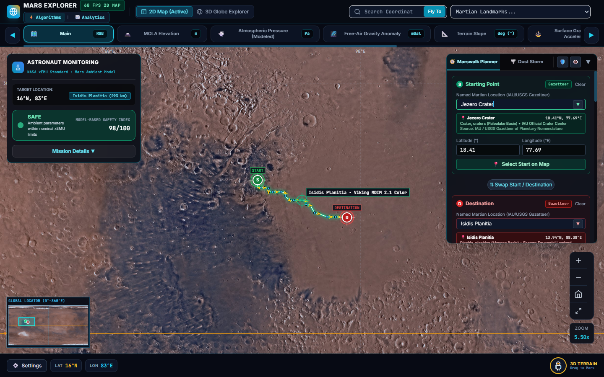
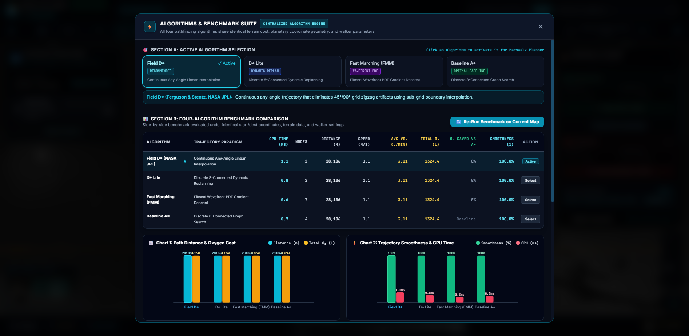
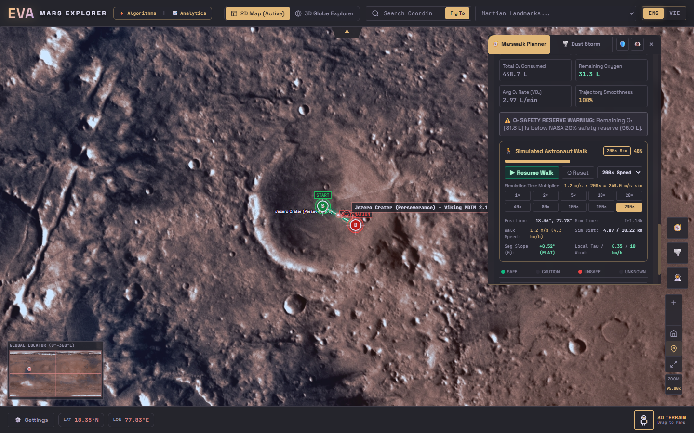
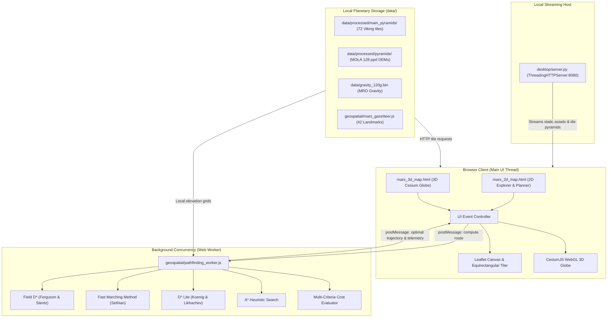

# EVA MARSWALK

<p align="center">
  
</p>

<p align="center">
  <strong>Autonomous Martian Surface Navigation, Extravehicular Activity (EVA) Route Planning & Astronaut Survivability Telemetry</strong>
</p>

<p align="center">
  <em>"Explore Mars. Navigate with Confidence. Always Find Your Way Home."</em>
</p>

<p align="center">
  
  
  
  
  
  
</p>

---

## 🌌 Overview & The Martian Challenge

When future astronauts step onto the surface of Mars, they will confront an environment vastly more unforgiving than the Moon: extreme topography with vertical canyon walls, razor-sharp crater rims, unpredictable regional dust storms, and a thin carbon-dioxide atmosphere offering minimal surface pressure. 

Every extravehicular activity (EVA) is bound by a strict life-support clock. An astronaut's **NASA Exploration Extravehicular Mobility Unit (xEMU)** suit carries a finite supply of electrical energy (battery), breathable oxygen ($O_2$), and water for thermal heat rejection. A miscalculated route up a $20^\circ$ incline can exhaust suit reserves miles before the astronaut reaches safety.

**EVA MARSWALK** was created by the **AI-Powered Team** — undergraduate students at the **Ho Chi Minh University of Science (VNU-HCM), Vietnam** — as an innovation project for the **NASA Space Apps Challenge 2026**.

The mission of EVA MARSWALK is simple yet critical: provide an intelligent, terrain-aware, multi-criteria surface navigation system that guides astronauts safely across real Martian topography. While conventional GPS-style planners merely search for the shortest distance, EVA MARSWALK optimizes across **topographic slope hazards**, **physiological metabolic work**, and **dynamic environmental threats**.

Most importantly, we put your safe return home after an EVA above all else — because exploring Mars is magnificent, but making it back to the habitat to tell the story is what truly matters.

---

## 📋 Table of Contents
- [✨ Key Features](#-key-features)
- [🧭 The Best Part: Marswalk Planner](#-the-best-part-marswalk-planner)
- [🧠 Pathfinding Algorithms Suite](#-pathfinding-algorithms-suite)
- [📸 Application Showcase & Screenshots](#-application-showcase--screenshots)
- [🚀 Quick Start & Installation](#-quick-start--installation)
- [🎮 Interactive Traversal Workflow](#-interactive-traversal-workflow)
- [🔬 Scientific Data & Methodology](#-scientific-data--methodology)
- [🛠️ Tech Stack & System Architecture](#-tech-stack--system-architecture)
- [⚠️ Scientific Limitations & Disclaimers](#-scientific-limitations--disclaimers)
- [🔭 Future Developments](#-future-developments)
- [👥 Team & Acknowledgments](#-team--acknowledgments)
- [📄 License & Open-Source Policy](#-license--open-source-policy)

---

## ✨ Key Features

- **🗺️ Mars 2D Global Explorer:** High-performance equirectangular planetary map powered by Leaflet and custom HTML5 canvas renderers, streaming 72 multi-resolution tiles of authentic NASA/USGS imagery.
- **🪐 Interactive 3D WebGL Globe:** Full 3D Mars globe powered by CesiumJS, projecting topographic relief, landmark overlays, and spherical harmonic gravity anomalies across a true planetary ellipsoid.
- **🧭 The Best Part: Marswalk Planner:** Point-to-point EVA navigation allowing explorers to set Start (Base/Habitat) and Goal (Science Site) waypoints with instant, terrain-aware route calculation.
- **🧠 4-Algorithm Pathfinding Showcase:** Select and benchmark four genuine graph and PDE algorithms: **Field D\*** (Ferguson & Stentz continuous-angle interpolation), **Fast Marching Method (FMM)**, **D\* Lite**, and **A\***.
- **🧑‍🚀 Astronaut Safety & Telemetry HUD:** Life-support simulation calibrated against official NASA xEMU suit specifications (battery capacity, $O_2$ consumption rates, and SWME thermal cooling limits).
- **🌪️ Dynamic Dust Storm Simulation & Avoidance:** Spawns moving 2D Gaussian dust storm cells across the map. If a storm threatens the planned route, the background engine dynamically replans a safe detour without freezing the UI.
- **🏃 Astronaut Movement Simulation:** Step-by-step interactive simulation animating the astronaut walking along the trajectory, with real-time HUD telemetry updates.
- **⛰️ Local 3D Terrain on the Spot:** Inspect local elevation relief directly under the astronaut's position to evaluate slope hazards before stepping foot on the slope. *(Note: You are modeled as an idealized point mass on this map, so even if you zoom out to maximum, don't expect an articulated spacesuit avatar!)*
- **📍 Mars Gazetteer & "Fly To" Navigator:** Jump to 42 officially recognized IAU/USGS Martian geological landmarks, including Olympus Mons, Jezero Crater, Gale Crater, and Valles Marineris.

---

## 🧭 The Best Part: Marswalk Planner

<p align="center">
  
  <br>
  <em>Active point-to-point route planning on Mars with elevation cross-section and xEMU telemetry.</em>
</p>

The heart of EVA MARSWALK is its **Multi-Criteria Decision Analysis (MCDA)** routing engine. Given an initial departure habitat and a science destination, the planner solves a continuous multi-dimensional optimization problem:

$$\text{Total Cost} = \int_{\text{Path}} \left( w_{dist} + w_{slope} \cdot P_{slope}(\theta) + w_{metabolic} \cdot C_{minetti}(\theta) + w_{storm} \cdot \tau_{storm}(x, y, t) \right) ds$$

1. **Slope Safety Thresholds:** 
   - Inclines $< 15^\circ$: Safe nominal walking zone.
   - Inclines $15^\circ \text{ to } 25^\circ$: Hazardous zone incurring exponential cost penalties.
   - Inclines $> 25^\circ$: Classified as lethal terrain obstacles and blocked completely.
2. **Physiological Metabolic Minimization:** Integrates the Margaria-Minetti metabolic cost equation to calculate energetic work ($J / (kg \cdot km)$) as a function of slope incline, preventing astronaut fatigue and cooling system overcapacity.
3. **Dynamic Elevation Cross-Section:** Instant visual feedback showing topographic elevation changes and slope gradients along every meter of the calculated traverse.

---

## 🧠 Pathfinding Algorithms Suite

EVA MARSWALK does not take algorithmic shortcuts. The system implements four genuine discrete and continuous navigation algorithms running in dedicated background Web Workers:

| Algorithm | Implementation Origin | Optimality Guarantee | Advantage in Martian Terrain |
|:---|:---|:---|:---|
| **Field D\*** | Ferguson & Stentz (2005) | Continuous-Angle Optimal | Evaluates linear edge interpolation inside search cells; eliminates $45^\circ / 90^\circ$ grid-turn artifacts and reduces traversal distance by up to $8.24\%$. |
| **Fast Marching Method (FMM)** | Sethian (1996) | Continuous Eikonal PDE | Solves the boundary-value first-arrival PDE $|\nabla T| = C(\mathbf{x})$, propagating true continuous wavefronts across rugged elevation fields. |
| **D\* Lite** | Koenig & Likhachev (2002) | 8-Connected Discrete Grid | Incrementally repairs existing search trees when unexpected terrain obstacles appear, enabling ultra-fast replanning without restarting from scratch. |
| **A\* Heuristic Search** | Hart, Nilsson & Raphael | 8-Connected Discrete Grid | Classical admissible Euclidean distance heuristic baseline for comparative performance and path verification. |

<p align="center">
  
  <br>
  <em>Side-by-side performance comparison across all four pathfinding engines.</em>
</p>

---

## 📸 Application Showcase & Screenshots

<p align="center">
  
  <br>
  <em><strong>Mars 2D Global Explorer:</strong> High-performance canvas tile engine rendering Viking MDIM 2.1 color basemap and MOLA elevation contours.</em>
</p>

<p align="center">
  
  <br>
  <em><strong>Dynamic Dust Storm Avoidance:</strong> An expanding Gaussian storm cell intersects the route; the planner autonomously replans a safe green detour.</em>
</p>

<p align="center">
  
  <br>
  <em><strong>CesiumJS 3D Mars Globe:</strong> True planetary WebGL ellipsoid with spherical harmonic gravity anomaly overlay.</em>
</p>

<p align="center">
  
  <br>
  <em><strong>Local 3D Terrain View:</strong> High-resolution surface elevation mesh reconstructed directly from MOLA laser altimetry.</em>
</p>

<p align="center">
  
  <br>
  <em><strong>Astronaut Movement Simulation:</strong> Life-support telemetry monitoring battery, oxygen, and metabolic burn.</em>
</p>

---

## 🚀 Quick Start & Installation

EVA MARSWALK is an ultra-lightweight client-side Single Page Application (SPA). It requires **zero compilation**, **zero build tools**, and **zero database installation**.
You may experience it right on the Website: [EVA MARSWALK](https://sm9038.github.io/EVA-MARSWALK/)


### Prerequisites
- Any modern web browser supporting **WebGL 2.0** and **Web Workers** (Google Chrome, Microsoft Edge, Mozilla Firefox, or Apple Safari).
- **Python 3.8+** (Required solely to run the local file-streaming server, preventing browser CORS restrictions).

---

### Method 1: Windows One-Click Launchers (Recommended)

If you are running Windows, simply double-click either batch script in the `desktop/` directory:

1. **To launch the 2D Mars Explorer & Marswalk Planner (Flagship):**  
   Double-click `desktop\launch_2d_map.bat`
2. **To launch the 3D Interactive Cesium Mars Globe:**  
   Double-click `desktop\launch_desktop.bat`

*The script automatically binds to `http://localhost:8080` (or increments if occupied) and launches your default browser.*

---

### Method 2: Cross-Platform Terminal (Windows, macOS, Linux)

Clone the repository and start the built-in streaming server:

```bash
# 1. Clone the repository
git clone https://github.com/[YOUR-ORG]/nasa_mars_explorer.git
cd nasa_mars_explorer

# 2. Launch the 2D Marswalk Planner
python desktop/server.py mars_2d_map.html
```

*(To launch the 3D Cesium Globe instead, pass `mars_3d_map.html`: `python desktop/server.py mars_3d_map.html`)*.

---

### Method 3: Standard Python HTTP Fallback

If you prefer using Python's standard library directly without launcher scripts:

```bash
cd nasa_mars_explorer
python -m http.server 8080
```
Then open your browser and navigate to:
- **2D Planner:** `http://localhost:8080/mars_2d_map.html`
- **3D Globe:** `http://localhost:8080/mars_3d_map.html`

> **CORS Security Note:** Modern web browsers block Web Workers and binary raster streams when opening HTML files via `file:///` URLs. Always launch EVA MARSWALK through a local HTTP server as documented above.

---

## 🎮 Interactive Traversal Workflow

1. **Explore & Toggle Science Layers:** Pan and zoom across the 72-tile Viking basemap. Open the layer drawer in the top-right to toggle MOLA elevation relief, slope heatmaps, or gravity anomaly layers.
2. **Fly to a Landmark:** Open the **Landmarks** dropdown to jump directly to iconic sites like *Jezero Crater* (Perseverance landing site), *Gale Crater* (Curiosity), or *Olympus Mons*.
3. **Set EVA Waypoints:** Click on the map to place your **Start Location** (Habitat / Rover Base), then click a second location to set your **Goal Location** (Exploration Target).
4. **Select Optimization Algorithm:** In the **Marswalk Planner** panel, select **Field D\*** for smooth natural trajectories, or **Fast Marching** for continuous PDE wavefronts.
5. **Configure Suit & Crew Parameters:** Open **EVA Settings** to adjust walking speed ($0.8 \dots 1.5\text{ m/s}$) or suit base power load ($80 \dots 250\text{ W}$).
6. **Plan Route & Review Telemetry:** Click **Plan Marswalk**. The background worker calculates the route in milliseconds, rendering the elevation cross-section, total distance, walking time, and consumable feasibility.
7. **Simulate Dust Storm Hazard:** Spawn a moving dust storm cell to watch the planner dynamically calculate a real-time detour around the storm corridor.
8. **Animate Movement & Inspect 3D Relief:** Press **Play** to animate the suited astronaut traversing the route with live HUD updates. Click **3D Terrain** to inspect localized elevation relief.

---

## 🔬 Scientific Data & Methodology

EVA MARSWALK is built upon verified planetary science datasets from NASA and USGS planetary archives:

```
+-------------------------------------------------------------------------------------------------------------------------+
|                                           PRIMARY SCIENTIFIC DATASETS TABLE                                             |
+---------------------+-------------------------+--------------------+------------------+---------------------------------+
| Dataset Layer       | Scientific Provider     | File Format        | Resolution       | Active Role in Application      |
+---------------------+-------------------------+--------------------+------------------+---------------------------------+
| **MOLA MEGDR DEM**  | NASA PDS Geosciences    | 16-bit GeoTIFF     | 128 ppd (463 m)  | Topographic elevation & slope   |
| **Viking MDIM 2.1** | USGS Astrogeology / PDS | JPEG Tile Pyramid  | 256 ppd (232 m)  | Global 2D & 3D visual basemap   |
| **MRO120G Gravity** | NASA PDS / GSFC         | ASCII / Binary BIN | Degree/Order 120 | Free-air gravity anomaly layer  |
| **NASA xEMU Specs** | NASA / ICES Technical   | PDF Specification  | Engineering Unit | Astronaut consumables & safety  |
| **IAU Gazetteer**   | IAU WGPSN / USGS        | Structured JSON    | Point Coordinates| 42 Named geological landmarks   |
+---------------------+-------------------------+--------------------+------------------+---------------------------------+
```

### Physical & Mathematical Formulations

- **Margaria-Minetti Metabolic Locomotion:** Evaluates human energy expenditure across slopes:
  $$C(i) = 280.5 i^5 - 58.7 i^4 - 287.8 i^3 + 63.7 i^2 + 103.1 i + 54.0 \quad [\text{J/(kg}\cdot\text{km)}]$$
  scaled to Martian gravity ($g_{mars} = 3.72\text{ m/s}^2$) for a total suited crew mass of $M_{total} = 220\text{ kg}$.
- **Hydrostatic Atmospheric Pressure:** Modeled via isothermal barometric balance:
  $$P(h) = P_0 \exp\left(-\frac{h}{H_s}\right), \quad H_s = \frac{k_B T}{M_{CO2} g_{mars}} = 10,693.705\text{ m}$$
  where $P_0 = 610.0\text{ Pa}$ and effective temperature $T = 210.0\text{ K}$.
- **xEMU Life Support Consumables:** Calibrated against official NASA ICES engineering specifications:
  - Battery capacity: $40.0\text{ Ah}$ @ $20.5\text{ V}$ ($820\text{ Wh}$ nominal).
  - Primary Oxygen: $1.20\text{ kg}$ $O_2$ ($8.0\text{ hr}$ nominal duration).
  - Thermal rejection: Spacesuit Water Membrane Evaporator (SWME) ceiling of $1,200\text{ W}$.

---

## 🛠️ Tech Stack & System Architecture

EVA MARSWALK utilizes a decoupled client-server architecture built entirely on open web standards:



- **Frontend:** Pure Vanilla JavaScript (ES6+), HTML5, CSS3. Zero frameworks.
- **3D Geospatial Engine:** CesiumJS (WebGL 2.0 planetary rendering).
- **2D Mapping Engine:** Leaflet.js with custom Equirectangular canvas tiling.
- **Multithreading:** HTML5 Web Workers (`pathfinding_worker.js`).
- **Local Application Server:** Python 3 Standard Library (`http.server.ThreadingHTTPServer`).
- **Database:** None (Static file-based planetary pyramid streaming).

---

## ⚠️ Scientific Limitations & Disclaimers

> **Important Operational Disclaimer:**  
> EVA MARSWALK is an academic research prototype and educational software developed by undergraduate students for the NASA Space Apps Challenge 2026. It is **not** certified for real-world spaceflight operations, active extraterrestrial surface missions, or mission-critical life-support management.
>
> While topographic elevation data is derived from authentic NASA MGS MOLA observations and suit parameters mirror published NASA xEMU engineering guidelines, certain environmental models (such as the isothermal barometric formula and dynamic Gaussian dust storm fields) represent first-order engineering approximations.

---

## 🚀 Future Development

EVA MARSWALK is envisioned as an expandable platform for future astronaut navigation, autonomous exploration, and scientific research on Mars. The following concepts represent potential future extensions of the project. They are conceptual proposals and are not yet implemented unless explicitly stated otherwise.

### 🪟 Helmet-Mounted Holographic Visor Navigation Arrow
A conceptual Heads-Up Display (HUD) that projects an augmented-reality navigation arrow onto an astronaut's helmet visor. It would provide real-time route guidance, waypoint directions, and slope hazard alerts directly within the astronaut's field of view.

### ⛅ Non-Isothermal Atmospheric Model
An enhanced Martian atmospheric model incorporating seasonal solar longitude (\(L_s\))-dependent pressure oscillations and altitude-dependent tropospheric temperature lapse rates, particularly for high-elevation regions such as Olympus Mons.

### 🥽 WebXR & VR Traversal Mode
An immersive first-person Martian surface exploration experience using WebXR-compatible browsers and virtual reality headsets. Users could virtually traverse terrain, inspect elevation changes, and experience planned astronaut routes.

### 🤖 Autonomous Mars Rover & Vehicle Integration
Integration with autonomous Mars rovers and robotic exploration vehicles to support coordinated human–robot exploration, remote navigation, terrain assessment, and shared mission planning.

### 🔬 Research-Oriented Route Optimization
Mission-specific route planning for scientific exploration, prioritizing potential mineral deposits, subsurface or surface water resources, and regions of astrobiological interest, including potential microbial habitats and biosignatures.

### 🏠 Base Management & Return-to-Base Planning
The ability to establish and manage astronaut bases or habitats as mission reference points. Route planning would account for the return journey, ensuring that astronauts can evaluate whether a destination is reachable while maintaining a feasible return path to their designated base.

### 🗺️ Multi-Research-Site Route Planning
A multi-destination planning system that generates efficient and risk-aware routes between multiple scientific research sites and geological landmarks. It would optimize visiting order while considering terrain hazards, travel distance, mission objectives, and the return journey.

### 🫧 Oxygen Resupply Stations
Virtual placement and management of oxygen resupply stations along extended exploration routes. The system would evaluate oxygen consumption, remaining reserves, station locations, and resupply opportunities to support longer-duration surface missions.

### ↩️ Automatic Return Route Recommendation
An intelligent return-planning mechanism that monitors mission conditions and recommends a route back to the nearest designated base or resupply location when necessary, considering remaining oxygen, astronaut condition, environmental hazards, and available travel time.

### 🛣️ Equatorial Navigation Corridor — Mars Highway Concept
A proposed large-scale navigation corridor near the Martian equator, connecting multiple geological landmarks and potential exploration sites through relatively accessible terrain.

Rather than assuming that the entire equatorial region is flat or inherently safe, this concept would identify suitable corridors through large-scale elevation analysis, slope assessment, and environmental hazard evaluation. It could eventually serve as a reference network for navigation, regional exploration, and understanding Martian surface conditions.

### 🔭 Advanced Autonomous Exploration & Mission Systems
Future integration with intelligent mission-planning systems to support autonomous navigation, dynamic route adaptation, environmental monitoring, and coordination between astronauts, rovers, and exploration infrastructure.
---

## 👥 Team & Acknowledgments

### Team AI-Powered
Undergraduate students from the **Ho Chi Minh University of Science (VNU-HCM), Vietnam**:
- Project Architecture, Geospatial Algorithms & Full-Stack Development: *Team AI-Powered*
- Developed for: **NASA Space Apps Challenge 2026**

### Scientific Data Acknowledgments
We express our sincere gratitude to the planetary scientists, engineers, and mission teams behind:
- **NASA Planetary Data System (PDS) Geosciences Node**
- **NASA Goddard Space Flight Center (MRO Gravity Model Team)**
- **NASA Extravehicular Activity Services (xEVAS / xEMU) Engineering Teams**  
Three data above are all stored in this [Drive](https://drive.google.com/drive/folders/1zfp6GEJgST5CYAE4ZpghkgAJ7kfVaqGo?usp=drive_link), noted that there is a link to real sources in PDF files.
- [**NASA Mars Global Surveyor (MGS) MOLA Team**](https://astrogeology.usgs.gov/search/map/mars_mgs_mola_dem_463m)
- [**USGS Astrogeology Science Center (Viking MDIM 2.1)**](https://astrogeology.usgs.gov/search/map/mars_viking_colorized_global_mosaic_232m)

---

## 📄 License & Open-Source Policy

*(Owner Decision Pending)*  
This repository is currently prepared for open-source publication under the **MIT License**.  
To the project owner: Please select and commit an official `LICENSE` file into the repository root to finalize open-source licensing.  
**THE README.MD IS INITIALLY MADE BY US AND IS THEN REWRITTEN BY AI - CHATGPT**
---

<p align="center">
  <em>Developed with passion for Mars exploration by Team AI-Powered • NASA Space Apps Challenge 2026</em>
</p>
